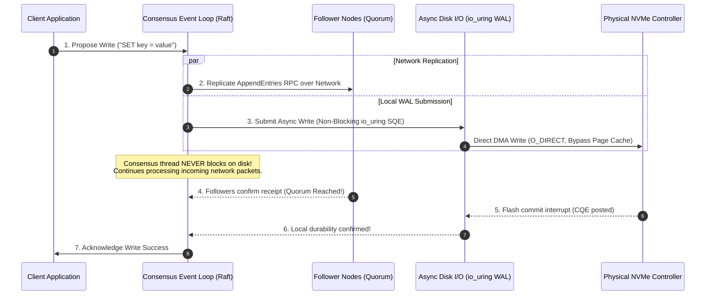
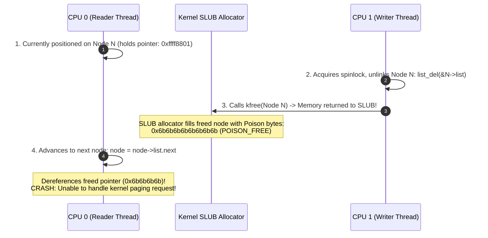
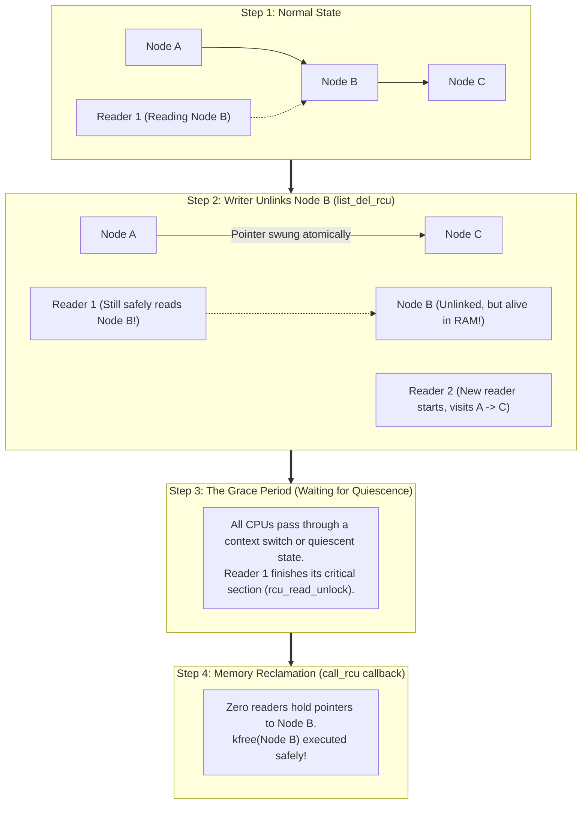

In distributed storage engines whether you are running Apache Kafka, etcd, CockroachDB, or a custom Raft-based consensus cluster there is one invariant rule that governs data safety:

**A proposed log entry does not exist until a majority quorum of nodes has durably persisted it to non-volatile storage.**

This is the contract of the **Write-Ahead Log (WAL)**. 

If your leader node receives a client write, replicates it across the network, but acknowledges the write before the bytes are physically committed to flash memory, a sudden power failure or kernel panic will cause state machine divergence and data corruption.

Yet, here lies the great distributed systems paradox: **Network threads must move in microseconds, while physical disk persistence takes milliseconds.**

If your network consensus thread stops to wait for an NVMe drive to finish a synchronous disk flush, the entire cluster halts. Heartbeat timers expire, leader elections trigger, network sockets back up, and cascading failovers bring down your infrastructure.

To survive at scale, you must master two separate but deeply connected engineering domains:
1. **At the System Boundary**: Decoupling network consensus from disk I/O using **`io_uring`** and **`O_DIRECT`** to achieve zero-syscall, asynchronous, deterministic write-ahead journaling.
2. **Inside the Operating System Kernel**: Eliminating phantom memory corruptions and reader-writer lock contention in high-concurrency log buffers using **Read-Copy-Update (RCU)** and diagnosing low-level use-after-free traps using **`kgdb`**.

Let us dissect the anatomy of high-throughput distributed journaling from the network socket down to the kernel memory allocator.

---

## 1. The Distributed Journaling Architecture

In a distributed consensus engine (such as Raft or Multi-Paxos), the lifecycle of a client request follows a four-stage pipeline:



### The Decoupling Mandate
The most common mistake in amateur consensus implementations is calling `write()` and `fsync()` directly inside the network event loop:

```c
// DISASTROUS ARCHITECTURE: Synchronous Disk I/O inside Consensus Thread
void on_append_entries_received(struct raft_msg *msg) {
    // 1. Write to local log file
    write(log_fd, msg->payload, msg->len);
    
    // 2. Block until physical disk writes finish:
    fdatasync(log_fd); // BLOCKS FOR 1 TO 5 MILLISECONDS!
    
    // 3. Send vote / acknowledgment to leader
    send_ack_to_leader(msg->term, msg->index);
}
```

Why is this fatal?
- **Head-of-Line Blocking**: While `fdatasync()` blocks the thread waiting for physical NAND flash cells to program, the node cannot process incoming network packets, cannot reply to leader heartbeats, and cannot process client reads.
- **Cascading Election Storms**: In Raft, if a follower fails to reply to a heartbeat within `election_timeout` (typically 150ms to 300ms), other followers assume the leader is dead and start a new election, throwing the entire cluster into chaos.
- **Tail Latency Amplification**: A single microscopic write stall on one node's SSD degrades the p99 latency of the entire distributed system.

The network consensus engine must **never block on disk**. The consensus state machine must submit the write asynchronously and immediately return to its event loop.

---

## 2. The Storage Engine: `write()` + `fsync()` vs. `io_uring` + `O_DIRECT`

When writing a Write-Ahead Log on Linux, engineers face three fundamental choices for disk durability:

| Mechanism | Kernel Path | Page Cache Interaction | Thread Behavior | Performance Impact |
| :--- | :--- | :--- | :--- | :--- |
| **`write()`** | User $\to$ Kernel buffer copy | Pollutes Linux Page Cache | Asynchronous, but blocks if cache is dirty | Zero durability guarantee until flushed. |
| **`fdatasync()`** | Traverses dirty inode lists | Flushes dirty pages to NVMe | **Synchronous / Blocking** | Stalls thread for milliseconds. |
| **`O_SYNC` / `O_DSYNC`** | Forces synchronous commit | Updates cache, blocks on flash | **Synchronous / Blocking** | Every single write incurs a syscall + disk stall. |
| **`io_uring` + `O_DIRECT`** | **Zero-copy direct DMA** | **Completely Bypasses Page Cache** | **100% Non-Blocking** | Millions of IOPS, zero syscalls in hot path. |

### The Problem with the Linux Page Cache in WAL Design
Why not simply use standard buffered writes with periodic background flushing?
1. **Unpredictable Latency Spikes (Dirty Page Throttling)**: When background writeback falls behind incoming write volume, the Linux kernel triggers **synchronous write throttling**. Your application thread is abruptly forced to pause and write dirty pages to disk, causing random 50ms latency spikes.
2. **Double Memory Consumption**: Data in the WAL is transient: once an entry is applied to the state machine database, it is rarely read again. Keeping WAL data in the Linux Page Cache evicts active, valuable database indexes and working-set data from RAM.
3. **Double Copying**: Data is copied from application buffers into kernel page-cache pages before being copied to disk via Direct Memory Access (DMA).

### The Modern Frontier: `io_uring` and `O_DIRECT`
Introduced by Jens Axboe in Linux 5.1, **`io_uring`** fundamentally redesigns Linux storage I/O:
- It establishes two lock-free circular ring buffers shared directly between user space and the kernel: the **Submission Queue (SQ)** and the **Completion Queue (CQ)** an architecture mirroring the lock-free shared-memory ring buffers we analyzed in our [guide on C11 atomics and memory barriers](/posts/lock-free-shared-memory-ring-buffer-c11-atomics).
- **Zero System Calls in the Hot Path**: The application writes a Submission Queue Entry (SQE) into memory and, using kernel polling (`IORING_SETUP_SQPOLL`), the kernel automatically reaps requests without a single context switch!
- **`O_DIRECT` (Direct I/O)**: Instructs the storage subsystem to bypass the Linux Page Cache entirely. The NVMe controller transfers data directly from user-space application memory to physical drive controller memory via DMA.

> [!IMPORTANT]
> **The `O_DIRECT` Alignment Rule:**
> When using `O_DIRECT`, the Linux kernel enforces strict physical hardware alignment. The memory buffer address, the file offset, and the write length **must all be exact multiples of the underlying block size** (typically 4,096 bytes for modern Advanced Format 4Kn NVMe drives). Passing an unaligned buffer causes `write()` or `io_uring` to fail with `-EINVAL`.

---

## 3. High-Performance Asynchronous WAL Implementation

Here is a production-grade, compilable implementation of an asynchronous Write-Ahead Log writer using `io_uring` and `O_DIRECT`:

```c
#define _GNU_SOURCE
#include <stdio.h>
#include <stdlib.h>
#include <stdint.h>
#include <stdbool.h>
#include <string.h>
#include <fcntl.h>
#include <unistd.h>
#include <errno.h>
#include <sys/stat.h>
#include <linux/fs.h>
#include <linux/io_uring.h>
#include <sys/syscall.h>
#include <sys/mman.h>

#define BLOCK_SIZE 4096U
#define RING_DEPTH 1024U

// Context tracking data for each in-flight async I/O request
struct wal_io_request {
    uint64_t log_index;
    uint32_t term;
    void *aligned_buf;
    size_t length;
    struct iovec iov;
};

// Raw syscall wrapper for systems without liburing-dev
static int sys_io_uring_setup(unsigned entries, struct io_uring_params *p) {
    return (int)syscall(__NR_io_uring_setup, entries, p);
}

static int sys_io_uring_enter(int fd, unsigned to_submit, unsigned min_complete,
                              unsigned flags, sigset_t *sig) {
    return (int)syscall(__NR_io_uring_enter, fd, to_submit, min_complete, flags, sig);
}

// Low-level ring state mapped into user space
struct user_io_ring {
    int ring_fd;
    // Submission Queue
    uint32_t *sq_khead;
    uint32_t *sq_ktail;
    uint32_t *sq_kring_mask;
    uint32_t *sq_kflags;
    uint32_t *sq_array;
    struct io_uring_sqe *sqes;
    // Completion Queue
    uint32_t *cq_khead;
    uint32_t *cq_ktail;
    uint32_t *cq_kring_mask;
    struct io_uring_cqe *cqes;
};

int init_wal_ring(struct user_io_ring *ring, unsigned depth) {
    struct io_uring_params p;
    memset(&p, 0, sizeof(p));

    ring->ring_fd = sys_io_uring_setup(depth, &p);
    if (ring->ring_fd < 0) {
        perror("io_uring_setup");
        return -1;
    }

    // Map the Submission and Completion queues
    size_t sq_size = p.sq_off.array + p.sq_entries * sizeof(uint32_t);
    size_t cq_size = p.cq_off.cqes + p.cq_entries * sizeof(struct io_uring_cqe);

    void *sq_ptr = mmap(0, sq_size, PROT_READ | PROT_WRITE,
                        MAP_SHARED | MAP_POPULATE, ring->ring_fd, IORING_OFF_SQ_RING);
    void *cq_ptr = mmap(0, cq_size, PROT_READ | PROT_WRITE,
                        MAP_SHARED | MAP_POPULATE, ring->ring_fd, IORING_OFF_CQ_RING);

    ring->sqes = mmap(0, p.sq_entries * sizeof(struct io_uring_sqe),
                      PROT_READ | PROT_WRITE, MAP_SHARED | MAP_POPULATE,
                      ring->ring_fd, IORING_OFF_SQES);

    // Save submission queue pointer offsets
    ring->sq_khead = sq_ptr + p.sq_off.head;
    ring->sq_ktail = sq_ptr + p.sq_off.tail;
    ring->sq_kring_mask = sq_ptr + p.sq_off.ring_mask;
    ring->sq_array = sq_ptr + p.sq_off.array;

    // Save completion queue pointer offsets
    ring->cq_khead = cq_ptr + p.cq_off.head;
    ring->cq_ktail = cq_ptr + p.cq_off.tail;
    ring->cq_kring_mask = cq_ptr + p.cq_off.ring_mask;
    ring->cqes = cq_ptr + p.cq_off.cqes;

    return 0;
}

// Submit asynchronous direct I/O write for a WAL entry
int submit_wal_entry(struct user_io_ring *ring, int fd, uint64_t file_offset,
                     uint64_t log_index, uint32_t term, const void *payload, size_t len) {
    // 1. Allocate 4096-byte aligned buffer required by O_DIRECT
    size_t aligned_len = ((len + BLOCK_SIZE - 1) / BLOCK_SIZE) * BLOCK_SIZE;
    void *buf = NULL;
    if (posix_memalign(&buf, BLOCK_SIZE, aligned_len) != 0) {
        return -ENOMEM;
    }
    memset(buf, 0, aligned_len);
    memcpy(buf, payload, len);

    struct wal_io_request *req = malloc(sizeof(*req));
    req->log_index = log_index;
    req->term = term;
    req->aligned_buf = buf;
    req->length = aligned_len;
    req->iov.iov_base = buf;
    req->iov.iov_len = aligned_len;

    // 2. Reserve an SQE slot
    uint32_t tail = *ring->sq_ktail;
    uint32_t index = tail & *ring->sq_kring_mask;
    struct io_uring_sqe *sqe = &ring->sqes[index];
    memset(sqe, 0, sizeof(*sqe));

    // 3. Prepare Vectored Direct Write
    sqe->opcode = IORING_OP_WRITEV;
    sqe->fd = fd;
    sqe->addr = (uint64_t)&req->iov;
    sqe->len = 1; // 1 iovec
    sqe->off = file_offset;
    sqe->user_data = (uint64_t)req;

    // Link SQ array and commit tail
    ring->sq_array[index] = index;
    __atomic_store_n(ring->sq_ktail, tail + 1, __ATOMIC_RELEASE);

    // 4. Submit to kernel
    sys_io_uring_enter(ring->ring_fd, 1, 0, 0, NULL);
    return 0;
}

// Background thread function: Reaps completions and commits entries
void reap_wal_completions(struct user_io_ring *ring) {
    uint32_t head = *ring->cq_khead;
    uint32_t tail = __atomic_load_n(ring->cq_ktail, __ATOMIC_ACQUIRE);

    while (head != tail) {
        struct io_uring_cqe *cqe = &ring->cqes[head & *ring->cq_kring_mask];
        struct wal_io_request *req = (struct wal_io_request *)cqe->user_data;

        if (cqe->res < 0) {
            fprintf(stderr, "[WAL Error] Async write failed for log index %lu: %s\n",
                    req->log_index, strerror(-cqe->res));
        } else {
            // Durability confirmed on NVMe controller!
            // Inform consensus state machine that log entry is committed.
            printf("[WAL Durable] Log Index %lu (Term %u) committed to NVMe (%d bytes)\n",
                   req->log_index, req->term, cqe->res);
        }

        // Clean up aligned memory
        free(req->aligned_buf);
        free(req);

        head++;
    }

    __atomic_store_n(ring->cq_khead, head, __ATOMIC_RELEASE);
}
```

---

## 4. The Kernel Concurrency Nightmare: The Phantom Memory Corruption

Now we venture across the user-space boundary into the Linux kernel itself.

When writing high-concurrency storage engines, device drivers, or distributed journal caches, engineers frequently maintain **an in-memory linked list of in-flight log entries**. Multiple readers traverse the list (e.g., telemetry exporters, replication streams, compaction workers), while worker threads insert and delete committed entries.

Look at how standard multi-threaded code attempts to protect this list using a **`spinlock_t`**:

```c
// DANGEROUS KERNEL CODE: The Spinlock Race Condition
struct log_entry {
    uint64_t index;
    char data[256];
    struct list_head list;
};

static DEFINE_SPINLOCK(log_lock);
static LIST_HEAD(log_list);

// --- WRITER: Deletes and frees a committed node ---
void remove_committed_entry(struct log_entry *entry) {
    spin_lock(&log_lock);
    list_del(&entry->list); // Unlinks node from list
    spin_unlock(&log_lock);

    kfree(entry); // IMMEDIATELY FREES MEMORY!
}

// --- READER: Traverses list to read entries ---
void scan_in_flight_entries(void) {
    struct log_entry *entry;

    spin_lock(&log_lock);
    list_for_each_entry(entry, &log_list, list) {
        // Read entry data...
        if (entry->index == target_index) {
            // Process entry
        }
    }
    spin_unlock(&log_lock);
}
```

### The Invisible Race Condition
An engineer might look at the code above and think: *"Both the writer and the reader hold `log_lock`. How can there be a race condition?"*

Look at what happens in real-world high-throughput systems when developers attempt to optimize reader latency:
1. Holding `log_lock` across the entire list traversal introduces severe **lock contention**. If a reader takes 50 microseconds to scan 1,000 entries, writers on other CPU cores stall completely.
2. A developer decides to drop the lock during processing:
   ```c
   // BROKEN OPTIMIZATION
   list_for_each_entry(entry, &log_list, list) {
       // Processes data without holding lock to avoid starving writers
   }
   ```
3. Look at what happens to the memory pointers:



The moment the reader attempts to follow `node->list.next`, it is dereferencing memory that **no longer belongs to the node**.

### The SLUB Poisoning Signature: `0x6b6b6b6b`
In Linux kernels built with memory debugging (`CONFIG_SLUB_DEBUG_ON`), the SLUB allocator does not leave freed memory intact. To catch use-after-free bugs immediately, it overwrites the freed memory block with a standardized byte pattern:

- **`0x6b` (`POISON_FREE`)**: Written to newly freed slab objects.
- **`0x5a` (`POISON_INUSE`)**: Written to allocated objects.

When your reader thread crashes with a kernel panic like this:

```text
[  142.502119] BUG: unable to handle page fault for address: 6b6b6b6b6b6b6b6b
[  142.503001] #PF: supervisor read access in kernel mode
[  142.503521] #PF: error_code(0x0000) - not-present page
[  142.504012] PGD 0 P4D 0 
[  142.504500] Oops: 0000 [#1] PREEMPT SMP NOPTI
[  142.505102] CPU: 3 PID: 4102 Comm: wal-reader Tainted: G        W  6.8.0-custom
[  142.506001] RIP: 0010:scan_in_flight_entries+0x42/0x90 [wal_module]
[  142.507002] RSP: 0018:ffffc90002143dc8 EFLAGS: 00010206
[  142.508001] RAX: 6b6b6b6b6b6b6b6b RBX: ffff8801a2340000 RCX: 0000000000000000
```

That address `0x6b6b6b6b6b6b6b6b` is the unmistakable, definitive mathematical signature of a **Use-After-Free race condition**. The reader was reading a node that the writer had already freed via `kfree()`.

---

## 5. Post-Mortem Debugging with `kgdb`

When a phantom memory corruption brings down a production kernel, post-mortem analysis with **`kgdb` (the Kernel GNU Debugger)** is how senior engineers diagnose the failure.

### Configuring kgdb over Serial Console
In automated test clusters or development virtual machines, `kgdb` connects to the kernel via a virtual serial port (`ttyS0`):

```bash
# Append to Linux kernel boot arguments:
console=ttyS0,115200 kgdboc=ttyS0,115200 kgdbwait
```

When the kernel boots, `kgdbwait` halts execution at startup, waiting for a remote GDB client to connect over the serial pipe:

```bash
gdb vmlinux
(gdb) target remote /dev/ttyUSB0
Remote debugging using /dev/ttyUSB0
kgdb_breakpoint () at kernel/debug/debug_core.c:1072
(gdb)
```

### Inspecting the Corrupt State
When the kernel encounters the phantom memory corruption panic:

```text
(gdb) break do_page_fault
Breakpoint 1 at 0xffffffff81072a10: file arch/x86/mm/fault.c, line 1490.
(gdb) continue
Continuing.

[Switching to Thread 4102]
Breakpoint 1, do_page_fault (regs=0xffffc90002143d48, error_code=0)
    at arch/x86/mm/fault.c:1490
```

Now inspect the registers and local variables of the crashing reader:

```text
(gdb) frame 3
#3  0xffffffffc0002042 in scan_in_flight_entries () at wal_module.c:84
84          list_for_each_entry(entry, &log_list, list) {

(gdb) print entry
$1 = (struct log_entry *) 0xffff8801a2340000

(gdb) print *entry
$2 = {
  index = 0x6b6b6b6b6b6b6b6b,
  data = "kkkkkkkkkkkkkkkkkkkkkkkkkkkkkkkk...",
  list = {
    next = 0x6b6b6b6b6b6b6b6b,
    prev = 0x6b6b6b6b6b6b6b6b
  }
}
```

The memory inspection proves the diagnosis conclusively:
1. `entry->list.next` is overwritten with `0x6b6b6b6b6b6b6b6b`.
2. The SLUB allocator poisoned the memory because `remove_committed_entry()` freed the block while `scan_in_flight_entries()` was actively traversing it.
3. The spinlock protected the linked list pointer update, **but failed completely to protect the lifetime of the object**.

---

## 6. The Solution: Linux Kernel RCU (Read-Copy-Update)

To solve this fundamentally, the Linux kernel provides **Read-Copy-Update (RCU)**, pioneered by Paul E. McKenney.

RCU separates list management into three distinct phases:
1. **Read**: Readers traverse the list **lockless**, with zero spinlocks, zero atomic operations, and zero bus-locking instructions.
2. **Copy / Update**: The writer unlinks the target node from the list using an atomic pointer assignment (`list_del_rcu`).
3. **Reclaim**: The writer **defers freeing the physical memory** until every reader that could possibly hold a pointer to that node has completed its read operation.



### The Concept of the Grace Period
How does the kernel know when it is safe to call `kfree()`?

1. **RCU Read Critical Section**: Wrapped between `rcu_read_lock()` and `rcu_read_unlock()`. On non-preemptible kernels, `rcu_read_lock()` compiles to a **no-op** (zero instructions!). On preemptible kernels, it merely increments a per-CPU counter. It does not acquire a lock.
2. **The Invariant**: A thread inside an RCU read critical section is **forbidden from blocking or sleeping**.
3. **The Quiescent State**: When a CPU switches context, enters the idle loop, or returns to user space, it is guaranteed that any RCU read critical section running on that CPU has finished.
4. **The Grace Period**: The time interval during which **every CPU in the system has passed through at least one quiescent state**.

Once a Grace Period elapses after a node is unlinked, no thread in the entire operating system can possibly hold a pointer to that node. Memory can now be freed with 100% mathematical safety.

---

## 7. Complete, Compilable Linux Kernel RCU Module

Here is a complete, production-grade Linux Kernel Module (`lkm_rcu_wal.c`) demonstrating safe, lockless RCU log management:

```c
#include <linux/init.h>
#include <linux/module.h>
#include <linux/kernel.h>
#include <linux/slab.h>
#include <linux/list.h>
#include <linux/rculist.h>
#include <linux/rcupdate.h>
#include <linux/spinlock.h>
#include <linux/kthread.h>
#include <linux/delay.h>

MODULE_LICENSE("GPL");
MODULE_AUTHOR("Systems Engineer");
MODULE_DESCRIPTION("Lockless RCU-Protected Write-Ahead Journal Buffer");
MODULE_VERSION("1.0");

// The RCU-protected log entry
struct wal_kernel_entry {
    uint64_t index;
    uint32_t term;
    char payload[64];
    struct list_head list; // Standard kernel linked-list node
    struct rcu_head rcu;   // RCU callback tracking head
};

static LIST_HEAD(wal_active_list);
static DEFINE_SPINLOCK(wal_writer_lock);

// --- RCU RECLAMATION CALLBACK ---
// This function executes ONLY after the grace period has elapsed!
static void wal_entry_free_callback(struct rcu_head *head) {
    struct wal_kernel_entry *entry = 
        container_of(head, struct wal_kernel_entry, rcu);

    pr_info("[RCU Reclaim] Grace period expired. Safely kfreeing entry %llu\n",
            entry->index);
    kfree(entry);
}

// --- WRITER: Inserts a new entry ---
int wal_insert_entry(uint64_t index, uint32_t term, const char *data) {
    struct wal_kernel_entry *new_entry = 
        kmalloc(sizeof(*new_entry), GFP_KERNEL);
    if (!new_entry) return -ENOMEM;

    new_entry->index = index;
    new_entry->term = term;
    strscpy(new_entry->payload, data, sizeof(new_entry->payload));

    spin_lock(&wal_writer_lock);
    // list_add_tail_rcu guarantees correct memory barriers on ARM/x86!
    list_add_tail_rcu(&new_entry->list, &wal_active_list);
    spin_unlock(&wal_writer_lock);

    return 0;
}

// --- WRITER: Deletes an entry safely ---
void wal_delete_entry(uint64_t target_index) {
    struct wal_kernel_entry *entry, *tmp;

    spin_lock(&wal_writer_lock);
    list_for_each_entry_safe(entry, tmp, &wal_active_list, list) {
        if (entry->index == target_index) {
            // 1. Atomically unlink from list using RCU pointer swing
            list_del_rcu(&entry->list);
            spin_unlock(&wal_writer_lock);

            // 2. Defer memory freeing until all active readers finish!
            call_rcu(&entry->rcu, wal_entry_free_callback);
            return;
        }
    }
    spin_unlock(&wal_writer_lock);
}

// --- READER: Traverses list completely lockless ---
void wal_scan_entries(void) {
    struct wal_kernel_entry *entry;

    // Enter RCU read critical section (Zero lock contention!)
    rcu_read_lock();

    list_for_each_entry_rcu(entry, &wal_active_list, list) {
        // Safe to read entry fields: memory will NOT be freed out from under us!
        pr_info("[WAL Reader] Active in-flight entry: Index=%llu, Term=%u, Data=%s\n",
                entry->index, entry->term, entry->payload);
    }

    // Exit RCU read critical section
    rcu_read_unlock();
}

static int __init rcu_wal_init(void) {
    pr_info("[RCU WAL] Initializing lockless kernel journaling module\n");

    wal_insert_entry(1001, 1, "SET user_id = 42");
    wal_insert_entry(1002, 1, "SET user_balance = 500");

    pr_info("[RCU WAL] Performing lockless scan:\n");
    wal_scan_entries();

    pr_info("[RCU WAL] Deleting entry 1001 via RCU unlinking:\n");
    wal_delete_entry(1001);

    pr_info("[RCU WAL] Scanning immediately after deletion:\n");
    wal_scan_entries();

    return 0;
}

static void __exit rcu_wal_exit(void) {
    struct wal_kernel_entry *entry, *tmp;

    spin_lock(&wal_writer_lock);
    list_for_each_entry_safe(entry, tmp, &wal_active_list, list) {
        list_del_rcu(&entry->list);
        call_rcu(&entry->rcu, wal_entry_free_callback);
    }
    spin_unlock(&wal_writer_lock);

    // Wait for all deferred RCU callbacks to finish before unloading module
    rcu_barrier();
    pr_info("[RCU WAL] Module unloaded cleanly\n");
}

module_init(rcu_wal_init);
module_exit(rcu_wal_exit);
```

### The Kernel Makefile
To compile this kernel module against your running kernel headers:

```makefile
obj-m += lkm_rcu_wal.o

KDIR ?= /lib/modules/$(shell uname -r)/build
PWD := $(shell pwd)

default:
	$(MAKE) -C $(KDIR) M=$(PWD) modules

clean:
	$(MAKE) -C $(KDIR) M=$(PWD) clean
```

---

## Architectural Synthesis

High-performance distributed storage engines achieve predictable low latency by enforcing strict boundaries:

1. **Decouple the Network Consensus Loop from Disk Durability**: The Raft state machine submits writes asynchronously via `io_uring` and continues processing heartbeats to prevent leader election storms.
2. **Bypass the Linux Page Cache with `O_DIRECT`**: Eliminate synchronous dirty-page write throttling and memory evictions by executing direct DMA transfers from 4096-byte aligned buffers.
3. **Never Use Spinlocks for Long Traversals in Kernel Memory**: Spinlocks create reader-writer starvation. Dropping locks without RCU triggers use-after-free corruptions that leave the telltale `0x6b6b6b6b` SLUB poison mark in `kgdb`.
4. **Use RCU for Lockless High-Throughput Reading**: Readers traverse data structures with zero locks via `rcu_read_lock()` and `list_for_each_entry_rcu()`, while writers decouple pointer deletion (`list_del_rcu`) from memory reclamation (`call_rcu`) across the Grace Period.

When software respects the physics of storage controllers and the memory model of multi-core processors, distributed systems transition from fragile, latency-jittered clusters into deterministic, high-throughput engines.

---

### Foundational References & Literature

1. **Ongaro, Diego, & Ousterhout, John.** (2014). *"In Search of an Understandable Consensus Algorithm"*. *2014 USENIX Annual Technical Conference (USENIX ATC 14)*, 305–319. [USENIX Paper](https://www.usenix.org/conference/atc14/technical-sessions/presentation/ongaro) *(The foundational Raft consensus paper defining write-ahead log persistence boundaries).*
2. **Axboe, Jens.** (2019). *"Efficient IO with io_uring"*. Linux Kernel Documentation. [Kernel.org io_uring Whitepaper](https://kernel.dk/io_uring.pdf) *(The architectural reference paper for Linux asynchronous I/O).*
3. **McKenney, Paul E., & Slingwine, John D.** (1998). *"Read-Copy Update: Using Execution History to Solve Concurrency Problems"*. *Parallel and Distributed Computing and Systems*, 509–518. *(The landmark original paper introducing RCU to computer science).*
4. **McKenney, Paul E.** (2019). *Is Parallel Programming Hard, And, If So, What Can You Do About It?* (v2019.12.22a). [Kernel.org GitBook](https://mirrors.edge.kernel.org/pub/linux/kernel/people/paulmck/perfbook/perfbook.html) *(The definitive systems textbook on RCU mechanics and memory ordering).*
5. **Corbet, Jonathan, Rubini, Alessandro, & Kroah-Hartman, Greg.** (2005). *Linux Device Drivers* (3rd ed.). O'Reilly Media. *(Chapters 5 and 11: Concurrency, Spinlocks, and Kernel Debugging).*
6. **Lamport, Leslie.** (1998). *"The Part-Time Parliament"*. *ACM Transactions on Computer Systems (TOCS)*, 16(2), 133–169. [DOI: 10.1145/279227.279229](https://doi.org/10.1145/279227.279229) *(The original Paxos consensus specification).*
