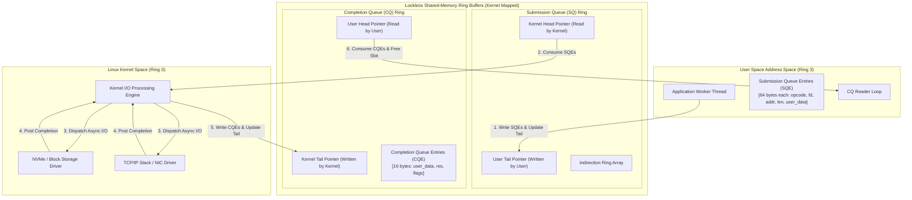
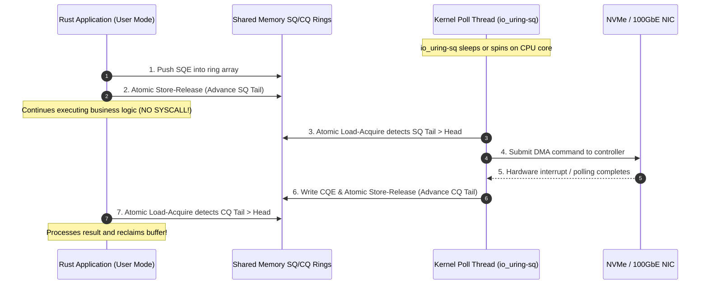
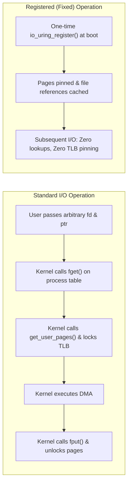

For twenty years, the holy grail of high-performance Linux network programming was `epoll`. 

When `epoll` landed in Linux 2.5.44 back in 2002, it solved the $O(N)$ scanning bottleneck that crippled `select()` and `poll()`. Suddenly, an event loop could monitor hundreds of thousands of concurrent file descriptors in $O(1)$ time. Nginx, Node.js, Go's netpoller, and Rust's Tokio built entire empires on top of it. 

The industry declared asynchronous I/O solved, slapped `#[tokio::main]` on their microservices, and moved on.

Except it was never truly solved. 

If you have ever attempted to write a high-throughput storage engine, an ultra-low-latency database, or a network proxy pushing millions of requests per second on modern NVMe drives and 100GbE NICs, you know the dirty secret: **`epoll` is fundamentally readiness-based, crippled for storage, and plagued by syscall overhead.**

In 2019, Jens Axboe merged `io_uring` into Linux 5.1. It is not an incremental optimization of `epoll`. It is a total architectural repudiation of how user space and kernel space communicate.

By placing dual lockless ring buffers in shared memory, `io_uring` enables asynchronous disk and network I/O with unified semantics—and, under the right configuration, drops the number of system calls required to process millions of I/O operations to precisely zero.

Yet, when you bring `io_uring` into Rust, you immediately hit a brick wall. The fundamental abstraction that powers async Rust—`Future::poll(&mut Context)`—was tailor-made for readiness-based `epoll`. When forced into the completion-based world of `io_uring`, Rust’s borrow checker does not just complain; it violently clashes with kernel-space memory guarantees.

Here is the unvarnished systems engineering breakdown of how `io_uring` actually works beneath the libc wrappers, why it breaks the standard Tokio mental model, and how to harness it safely in production Rust.

---

## The Three Fatal Flaws of the Epoll Era

To appreciate why `io_uring` exists, you must first understand where `epoll` hits a physical wall.

```
+-------------------------------------------------------------------------------+
| The Epoll Execution Loop (Readiness-Based Syscall Ping-Pong)                  |
+-------------------------------------------------------------------------------+
  User Space                                               Kernel Space
      |                                                         |
      |--- 1. epoll_wait() ------------------------------------>| (Thread blocks)
      |                                                         |
      |<-- 2. Return event (FD 12 is READABLE) -----------------| (Context switch)
      |                                                         |
      |--- 3. read(FD 12, user_buf) --------------------------->| (Context switch)
      |                                                         | (DMA / Copy data)
      |<-- 4. Return bytes read (e.g., 4096 bytes) -------------| (Context switch)
      |                                                         |
  (Process data...)                                             |
      |                                                         |
      |--- 5. write(FD 12, response_buf) ---------------------->| (Context switch)
      |<-- 6. Return bytes written -----------------------------| (Context switch)
+-------------------------------------------------------------------------------+
```

Under high concurrency, this workflow introduces three severe architectural penalties:

### 1. Readiness vs. Completion (The Syscall Tax)
`epoll` is strictly **readiness-based**. It does not perform I/O; it merely notifies you when a file descriptor will not block if you *attempt* to perform I/O. 

When `epoll_wait` wakes up to tell you socket `fd=12` has data, you must immediately make a subsequent `read()` or `recv()` system call to actually fetch the bytes. If you have 50,000 active connections receiving requests, you are executing 50,000 `epoll_wait` returns followed by 50,000 `read()` system calls, followed by 50,000 `write()` system calls.

Every single system call requires transitioning from ring 3 (user mode) to ring 0 (kernel mode), flushing or validating CPU registers, handling potential cache invalidations, and navigating the hardware mitigations introduced for Meltdown and Spectre (KPTI, page table isolation, branch prediction barriers). 

When your storage layer can service an NVMe read in 10 microseconds, spending 1.5 microseconds just crossing the user-kernel boundary is an unacceptable 15% latency penalty paid purely to operating system bookkeeping.

### 2. Disk I/O Does Not Exist in Epoll
This is the dirty secret of asynchronous runtimes: **Linux `epoll` cannot poll regular disk files.**

If you pass a regular file descriptor to `epoll_ctl()`, it will immediately register, but `epoll_wait()` will *always* report the file descriptor as ready. The kernel's page cache and virtual filesystem (VFS) layers were not designed around non-blocking semantics for local block devices. 

When your async thread calls `read()` on a local file, and the requested 4KB page is not resident in RAM, the operating system **freezes your thread synchronously** while the NVMe controller or SATA bus fetches the sector. 

If that thread happened to be your main Tokio worker running an event loop with 5,000 active WebSocket connections, all 5,000 connections stall until the disk head resolves.

How does Tokio "fix" this? It spawns an external thread pool:

```rust
// Under the hood, this doesn't use non-blocking kernel I/O;
// it offloads blocking libc::read() to a dedicated thread pool!
tokio::fs::read("heavy_database.bin").await?;
```

Tokio's `spawn_blocking` pushes the blocking file operation onto a thread pool (which defaults to up to 512 threads). This introduces context switches, thread stack allocations (typically 2MB per thread), thread synchronization lock contention, and L1/L2 cache pollution. 

Linux did have an asynchronous storage API—POSIX AIO and kernel AIO (`io_submit`)—but it was an operational nightmare. It only functioned if you opened files with `O_DIRECT` (bypassing page cache entirely), required sector-aligned memory buffers, and could still block unpredictably if an inode metadata lock was contested.

### 3. Syscall Amplification & Buffer Pinning
Every traditional read or write requires the kernel to look up the file descriptor in the process's file table (`fget()`), verify memory access boundaries, allocate an internal kernel buffer or lock physical memory pages (`get_user_pages()`), copy data across the protection boundary, and drop the reference (`fput()`). 

Doing this per packet, per buffer, millions of times a second is an exercise in computational futility.

---

## The Core Primitive: Dual Lockless Ring Buffers

`io_uring` bypasses this entire paradigm. It does not treat I/O as a synchronous request-response procedure call. It treats I/O as an **asynchronous producer-consumer queue in shared memory**.

When you initialize an `io_uring` instance via `io_uring_setup()`, the kernel creates two circular ring buffers in kernel memory:

1. **Submission Queue (SQ)**: The user space is the producer; the kernel is the consumer.
2. **Completion Queue (CQ)**: The kernel is the producer; the user space is the consumer.

The kernel then maps these exact memory regions directly into the application’s address space using `mmap()`.



Let's dissect what makes this architecture blazingly fast:

### The Submission Queue Entry (SQE)
A Submission Queue Entry is a fixed 64-byte descriptor. It contains everything the kernel needs to execute an operation:

```c
struct io_uring_sqe {
    __u8   opcode;       // IORING_OP_READV, IORING_OP_WRITE, IORING_OP_ACCEPT, etc.
    __u8   flags;        // IOSQE_FIXED_FILE, IOSQE_IO_LINK, etc.
    __u16  ioprio;       // Priority
    __s32  fd;           // File descriptor
    __u64  off;          // File offset
    __u64  addr;         // Pointer to user buffer
    __u32  len;          // Buffer length
    __u32  rw_flags;     // Flags specific to read/write
    __u64  user_data;    // Opaque 64-bit identifier (crucial for async runtimes)
    // ... padding and union extensions (fixed buffers, etc.)
};
```

Notice `user_data`. This is a raw 64-bit integer that the kernel treats as opaque payload. When the operation finishes, the kernel returns this exact `user_data` in the completion queue entry. 

In an async runtime like Rust, `user_data` is almost always a pointer to the heap-allocated state machine of a suspended `Waker` or task!

### The Completion Queue Entry (CQE)
A Completion Queue Entry is a slim, 16-byte structure:

```c
struct io_uring_cqe {
    __u64  user_data;    // The identical 64-bit tag passed in the SQE
    __s32  res;          // Return value (e.g., bytes read, or negative errno on error)
    __u32  flags;        // Buffer flags (e.g., selected buffer ID)
};
```

### The Lockless Memory Barrier Protocol
Because the ring pointers sit in shared memory, synchronization between user space and the kernel requires zero mutexes or semaphores. It relies on standard atomic load-acquire and store-release memory barriers.

When the application submits operations:
1. It reads the kernel’s `SQ->head` using `load(Ordering::Acquire)` to ensure there is space in the ring.
2. It writes one or more 64-byte SQE structs into the ring buffer.
3. It updates the user-controlled `SQ->tail` using `store(Ordering::Release)`.

As we analyzed in our deep dive on [x86-64 vs. aarch64 memory models](/posts/when-to-choose-x86-64-vs-aarch64), on x86-64 this store-release is free at the assembly level (every store has release semantics under Total Store Order). On ARM64 (aarch64), this emits a hardware `STLR` barrier. 

Once the tail is published, the kernel sees it immediately.

---

## The Zero-Syscall Mode: `IORING_SETUP_SQPOLL`

Under default usage, writing to the shared ring buffer still requires one system call to notify the kernel: `io_uring_enter(fd, to_submit, min_complete, flags)`. 

While this still beats `epoll` because you can batch submit 256 I/O requests with a single syscall, it is not "zero syscalls."

To achieve true zero-syscall I/O, `io_uring` provides the `IORING_SETUP_SQPOLL` flag.



When you pass `IORING_SETUP_SQPOLL` during initialization, the Linux kernel spawns a dedicated kernel thread (named `io_uring-sq`). 

This kernel thread runs an aggressive polling loop directly over the shared memory Submission Queue. 

The moment your Rust application updates the `SQ->tail` pointer with an atomic store, the kernel thread detects the delta, grabs the SQE, and submits the command to the block layer or network driver. When hardware DMA completes, the kernel thread writes the CQE to the completion ring.

Your application submits operations, processes completions, streams gigabytes of data to disk, and accepts thousands of network connections—**without executing a single system call**.

### The Brutal Tradeoff of SQPOLL
Engineering offers no free lunches. The tradeoff of `SQPOLL` is pure CPU consumption. 

If your service experiences a traffic lull, that kernel thread will continue spinning at 100% CPU utilization on its assigned core, burning electricity. 

To mitigate this, `io_uring` provides the `sq_thread_idle` parameter (measured in milliseconds). If no new SQEs are submitted within the idle window, the kernel thread puts itself to sleep. 

The catch? Once the kernel thread sleeps, your user application must check the `IORING_SQ_NEED_WAKEUP` flag in the ring flags. If set, you must issue a fallback `io_uring_enter(..., IORING_ENTER_SQ_WAKEUP)` syscall to wake it back up. 

In production, `SQPOLL` is exceptional for high-throughput, predictable workloads (like storage storage engines or edge proxies), but detrimental to bursty, low-traffic microservices.

---

## The Great Clash: Why io_uring Breaks Tokio and Rust Futures

If `io_uring` is so revolutionary, why doesn't Tokio simply swap out `epoll` for `io_uring` under the hood?

Because the fundamental design of Rust's async ecosystem was built around a contract that directly violates how completion-based I/O works.

### 1. The Readiness Contract: `AsyncRead`
Tokio’s `AsyncRead` trait looks like this:

```rust
pub trait AsyncRead {
    fn poll_read(
        self: Pin<&mut Self>, 
        cx: &mut Context<'_>, 
        buf: &mut ReadBuf<'_>
    ) -> Poll<io::Result<()>>;
}
```

Look at the buffer argument: `buf: &mut ReadBuf<'_>`. It passes a **temporary, borrowed reference** to a buffer.

In `epoll`, this is completely fine:
1. `poll_read` calls `epoll_wait`. If the socket isn't ready, it registers the `Waker` and returns `Poll::Pending`.
2. The user still owns the buffer.
3. If the user decides to cancel the future—say, via `tokio::time::timeout`—the future is dropped. The borrowed buffer goes out of scope and gets safely deallocated or reused. No harm done.

### 2. The Completion Trap: Use-After-Free
Now consider what happens if you attempt to wrap `io_uring` inside that exact same borrowed interface:

```rust
// PSEUDOCODE: WHY BORROWED BUFFERS ARE FATAL IN IO_URING
struct BadIoUringReader {
    ring: IoUring,
}

impl BadIoUringReader {
    fn bad_read(&mut self, buf: &mut [u8]) -> BadFuture {
        // We write the raw pointer of `buf` into the kernel SQE!
        let sqe = opcode::Read::new(types::Fd(self.fd), buf.as_mut_ptr(), buf.len());
        self.ring.submission().push(&sqe);
        // ...
    }
}
```

Imagine this real-world scenario:

```rust
tokio::select! {
    res = bad_reader.bad_read(&mut my_stack_buffer) => {
        // Process data
    }
    _ = tokio::time::sleep(Duration::from_millis(10)) => {
        // TIMEOUT!
        // `bad_reader` future is DROPPED.
        // `my_stack_buffer` goes out of scope and is reclaimed!
    }
}
```

When the timeout triggers, the Rust future is dropped. The stack frame unwinds. The memory where `my_stack_buffer` lived is now repurposed for another function, or returned to the allocator.

**But the Linux kernel does not care about Rust's `Drop` trait.**

The kernel already received the physical pointer to that memory address in the SQE. Five milliseconds later, the network packet arrives. The network card executes a bus-master DMA write directly into that memory address. 

You have just created a catastrophic **Kernel-Initiated Use-After-Free and Memory Corruption bug**, entirely within safe Rust code!

In `epoll`, cancellation is a synchronous non-event. In `io_uring`, **cancellation is an asynchronous operation**. You cannot touch or free a buffer until the kernel posts the CQE confirming that the operation was either completed or canceled.

---

## The Idiomatic Solution: Ownership-Transferring I/O

To use `io_uring` soundly in Rust, you must abandon borrowed buffers. The future must **take full, exclusive ownership of the buffer**, hold it inside the future state machine, and return it back to the caller when the operation finishes.

This is the architectural pattern pioneered by projects like `tokio-uring`, `glommio`, and `compio`:

```rust
// Idiomatic io_uring trait: Buffer ownership is transferred into the kernel!
pub trait AsyncReadOwned {
    async fn read<B: IoBufMut>(&self, buf: B) -> (io::Result<usize>, B);
}

pub trait AsyncWriteOwned {
    async fn write<B: IoBuf>(&self, buf: B) -> (io::Result<usize>, B);
}
```

Let's look at how an actual production-grade `io_uring` read looks in Rust using `tokio-uring`:

```rust
use tokio_uring::fs::File;

fn main() {
    tokio_uring::start(async {
        // Open a file using io_uring
        let file = File::open("test.data").await.expect("Failed to open");
        
        // Allocate a dedicated heap buffer
        let buffer = Vec::with_capacity(4096);

        // Ownership of `buffer` is MOVED into the read call!
        // The future retains ownership until the kernel posts the CQE.
        let (result, buffer) = file.read_at(buffer, 0).await;
        
        let bytes_read = result.expect("Read failed");
        println!("Successfully read {} bytes without a blocking thread pool!", bytes_read);
        
        // Buffer is safely returned to user space here.
    });
}
```

If you drop a `tokio-uring` future before it completes, the runtime does not deallocate the buffer. It disowns the future, moves the buffer into an internal "purgatory" leak list, and issues an `IORING_OP_ASYNC_CANCEL` to the kernel. 

Only when the kernel eventually returns the CQE acknowledging the cancel does the runtime finally drop and free the underlying buffer.

---

## Production Optimization: Fixed Buffers and Registered Files

If you want to extract the maximum possible throughput from your hardware, `io_uring` provides two advanced primitives that eliminate internal kernel allocations: **Fixed Buffers** and **Registered Files**.



### 1. `IORING_REGISTER_FILES`
Normally, passing an `fd` requires the kernel to perform an atomic increment and lookup on the process file descriptor table to resolve the `struct file *`. 

With `io_uring_register(ring_fd, IORING_REGISTER_FILES, files_array, len)`, you register an array of file descriptors upfront. 

From that point on, you pass the `IOSQE_FIXED_FILE` flag in your SQE, and the `fd` field is treated as a direct index into the pre-allocated kernel array. This bypasses file table locks and atomic increments entirely.

### 2. `IORING_REGISTER_BUFFERS`
Every time you perform traditional I/O, the kernel must map your user-space virtual addresses to physical pages and pin them in memory so they aren't swapped to disk during DMA (`get_user_pages()`).

With registered buffers, you allocate a contiguous memory region (e.g., a 64MB buffer pool) and register it once using `IORING_REGISTER_BUFFERS`. The kernel pins all physical pages and maps them into an internal scatter-gather list during startup.

Subsequent reads and writes use `IORING_OP_READ_FIXED` and `IORING_OP_WRITE_FIXED`. The kernel skips page-table walking and page pinning entirely.

Here is what that looks like in Rust:

```rust
use io_uring::{opcode, types, IoUring};
use std::os::unix::io::AsRawFd;

fn run_fixed_buffer_pipeline(fd: std::fs::File) -> Result<(), Box<dyn std::error::Error>> {
    let mut ring = IoUring::new(256)?;
    
    // 1. Allocate a page-aligned buffer pool (e.g., 64KB)
    let buffer_size = 65536;
    let mut raw_buffer = vec![0u8; buffer_size];
    
    // 2. Register the buffer pool with the kernel once
    let iovecs = [libc::iovec {
        iov_base: raw_buffer.as_mut_ptr() as *mut libc::c_void,
        iov_len: buffer_size,
    }];
    
    unsafe {
        ring.submitter().register_buffers(&iovecs)?;
    }

    // 3. Prepare a READ_FIXED operation
    // Buffer index 0 refers to the first registered iovec!
    let read_sqe = opcode::ReadFixed::new(
        types::Fd(fd.as_raw_fd()),
        raw_buffer.as_mut_ptr(),
        buffer_size as u32,
        0, // buf_index
    )
    .offset(0)
    .build()
    .user_data(0xDEADBEEF);

    unsafe {
        ring.submission().push(&read_sqe)?;
    }

    // 4. Submit and wait for completion
    ring.submit_and_wait(1)?;

    let cqe = ring.completion().next().expect("Expected completion");
    assert_eq!(cqe.user_data(), 0xDEADBEEF);
    
    if cqe.result() >= 0 {
        println!("Zero-copy fixed read completed: {} bytes", cqe.result());
    } else {
        eprintln!("I/O Error: {}", -cqe.result());
    }

    Ok(())
}
```

This is where the principles we outlined in [Zero-Copy Networking in Linux](/posts/zero-copy) and our analysis of [sharded database execution pipelines](/posts/the-lifecycle-of-a-sharded-postgres-query) converge. 

By pre-allocating memory pools and pinning file descriptors, your software ceases to treat the kernel as an opaque service provider. It treats it as an co-located asynchronous pipeline processor.

---

## Architectural Verdict: When to Choose io_uring vs. Tokio

Does `io_uring` mean you should rewrite your entire Rust microservice fleet tomorrow?

Almost certainly no. 

`io_uring` is a specialized, low-level systems scalpel, not a universal replacement for standard web application architecture.

```
+-------------------------------------------------------------------------------+
| Architecture Comparison: When to Pick Which Engine                            |
+-------------------------------------------------------------------------------+
  Metric / Feature           | Tokio (Epoll / Mio)     | io_uring (Glommio / Compio)
+----------------------------+-------------------------+------------------------+
  Programming Model          | Borrowed (&mut [u8])    | Owned (Move buffers)   
  Network Concurrency (C100K)| Outstanding             | Outstanding            
  Local File / Storage I/O   | Thread Pool (Blocking)  | True Async Non-Blocking
  Zero-Syscall Mode (SQPOLL) | Impossible              | Supported (CPU cost)   
  Container / Cloud Sandbox  | Works everywhere        | Blocked in some clouds 
  Architecture Topology      | Multi-Threaded Work-Steal| Thread-Per-Core Shared-Nothing
+----------------------------+-------------------------+------------------------+
```

### Choose Standard Tokio (Epoll) If:
- Your application is a standard REST, gRPC, or GraphQL service spending 90% of its time waiting on remote network calls or database sockets.
- You deploy to multi-tenant container environments (AWS Lambda, Google Cloud Run, or hardened Docker environments) where `io_uring` system calls are blocked by seccomp security profiles due to historical kernel CVEs.
- You rely on the massive, mature ecosystem of Tokio crates (`hyper`, `axum`, `tonic`, `reqwest`).

### Choose io_uring In Rust If:
- You are writing a **database engine, key-value store (LSM-tree), or search index** where high-speed asynchronous NVMe access with zero blocking thread pools is non-negotiable.
- You are building an **edge proxy, media streaming gateway, or message broker** (like Kafka or Redpanda) operating on 40GbE/100GbE NICs where syscall overhead dominates the CPU profile.
- You can structure your application as a **thread-per-core (shared-nothing)** architecture (using runtimes like `glommio`), dedicating one core per ring buffer without cross-thread synchronization locks.

`io_uring` is not just a faster `epoll`. It is the beginning of the post-syscall era in Linux systems programming. Understanding its memory model is how you ensure your systems survive it.

---

### Foundational References & Technical Specifications

1. **Axboe, J.** (2019). *"Efficient IO with io_uring"*. Linux Kernel Documentation / Kernel Git. [Kernel io_uring PDF](https://kernel.dk/io_uring.pdf)
2. **Linux Man-Pages.** (2024). *io_uring_setup(2), io_uring_enter(2), io_uring_register(2)*. [Linux Programmer's Manual](https://man7.org/linux/man-pages/man2/io_uring_setup.2.html)
3. **Tokio Contributors.** (2022). *tokio-uring: Asynchronous I/O with io_uring for Tokio*. [GitHub Repository](https://github.com/tokio-rs/tokio-uring)
4. **ScyllaDB Architecture Team.** (2020). *"Glommio: A thread-per-core async runtime for Linux built on io_uring"*. [Datadog / Glommio Docs](https://github.com/DataDog/glommio)
5. **Corbet, J.** (2019). *"Ringing in a new asynchronous I/O API"*. *LWN.net*. [LWN Article](https://lwn.net/Articles/776703/)
