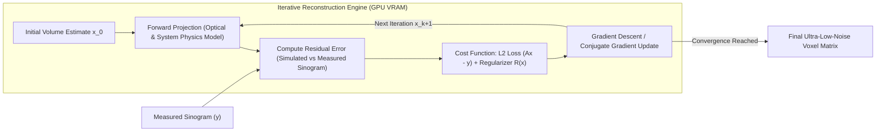

You lie down on a narrow carbon-fiber cantilevered bed in a room chilled to 18°C. A nurse slides an 18-gauge catheter into your antecubital vein, connects it to a dual-barrel motorized syringe that looks like industrial hydraulics, and steps behind a heavy lead-glass partition. 

A disembodied voice over an intercom tells you to hold your breath. 

Two seconds later, a warm wave hits the back of your throat. Within five seconds, it surges through your chest and pools aggressively in your pelvis. You are utterly convinced you just lost bladder control on the table. You didn't. The iodinated contrast agent is violently hyperosmolar compared to your blood; as it hits peripheral vascular beds, smooth muscle relaxes in a flash of vasodilation, firing sensory nerves that trick your brain into believing you just soaked your pants.

While you are contemplating that indignity, the beige plastic donut around your torso begins to howl. It sounds like an electric jet engine spooling up for takeoff. The table slides through the bore in a smooth three-second glide. A click, a low hum, and the intercom chirps: *"You can breathe normally."*

By the time you sit up and look through the lead glass, the technologist is already scrolling through 1,500 cross-sectional, sub-millimeter slices of your thorax on a dual-monitor workstation. They can flip the view from axial to coronal, pan down your aorta, or toggle a photorealistic 3D cinematic render of your ribcage and beating heart.

From the instant the technologist pressed the exposure switch to the moment those voxels landed on screen was less than seven seconds.

Medical imaging is treated as a routine clinical black box. But if you peel off the smooth fiberglass covers, a modern Multi-Detector Computed Tomography (MDCT) scanner is arguably the most terrifying and violent piece of high-throughput real-time systems engineering ever manufactured. It is a two-ton centrifuge pulling 30 Gs of continuous radial acceleration, bombarding a vacuum-sealed liquid-metal bearing with 100 kilowatts of electron energy, streaming 40 gigabits per second across an optical air gap, and solving millions of simultaneous integral equations on custom GPU clusters before you even have time to exhale.

Here is what is actually running under that plastic shroud.

---

## The Mechanical Nightmare: Spinning a Two-Ton Turbine at 250 RPM

A standard diagnostic X-ray is trivial: an emitter shoots a single cone of photons through your body, and a flat-panel detector underneath records a shadow. Dense bones absorb photons; soft tissue lets them pass. 

The fundamental problem with a standard X-ray is projection collapse. A three-dimensional human body is flattened into a single two-dimensional plane. A tumor hidden behind a dense rib or surrounded by dense muscle is invisible because every structure along the ray's path is summed together.

To see inside without a scalpel, you must take hundreds of separate 2D projection angles around a full 360-degree circle and mathematically reconstruct the 3D interior. That means you have to spin the X-ray tube and the detector around the patient.

And you have to spin them fast.

Early CT scanners from the 1970s (the EMI-Scanner developed by Godfrey Hounsfield) took minutes to capture a single slice. The gantry moved linearly across the patient, rotated one degree, and translated back the classic "translate-rotate" geometry. The patient had to hold still for half an hour. Respiratory motion, intestinal peristalsis, and cardiovascular pulsation turned images into unreadable smears of motion artifacts.

To freeze cardiac motion without stopping the heart, a modern scanner gantry must complete a full 360-degree rotation in **0.25 to 0.28 seconds**. That is four complete revolutions per second roughly **240 to 250 RPM**.

```mermaid
graph TB
    subgraph Gantry["Rotating Gantry (1,500 kg @ 250 RPM / 30 Gs)"]
        Tube["100 kW X-Ray Tube (Straton / Liquid-Metal Bearing)"]
        Collimator["Dynamic Pre-Patient Collimator & Bowtie Filter"]
        DetectorArray["Ultra-Fast Ceramic Scintillator Array (16 cm / 320 Rows)"]
        DAS["Multi-Channel ASIC DAS (18-24 bit ADCs @ 4 kHz)"]
        OptTx["Ring-Side Optical Laser Transceiver (10-40 Gbps)"]

        Tube -->|Preshaped X-Ray Beam| Collimator
        Collimator -->|Fan / Cone Beam| DetectorArray
        DetectorArray -->|Pico-ampere Analog Signals| DAS
        DAS -->|Digital Sinogram Data| OptTx
    end

    subgraph Stationary["Stationary Frame & Infrastructure"]
        SlipPower["Low-Voltage Contact Slip Ring (480V 3-Phase / 150 kW)"]
        OptRx["Stationary Optical Receiver Ring (Continuous Light Guide)"]
        MotorDrive["Direct-Drive Permanent Magnet Motor"]
        Chiller["Liquid-to-Air Dielectric Oil Chiller Unit"]

        SlipPower -.->|Brushes| Tube
        OptTx ==>|Free-Space Optical Beam| OptRx
        Chiller -.->|Closed-Loop Heat Exchanger| Tube
    end

    subgraph ComputeRack["Real-Time Reconstruction Engine (Industrial Host)"]
        DMABuffers["PCIe Gen 5 DMA Ring Buffers (Host RAM)"]
        GPUCluster["Multi-GPU Array (FDK Backprojection & Iterative Denoising)"]
        DICOM["DICOM Image Formatter & PACS C-STORE (TCP/IP Port 104)"]

        OptRx -->|Fiber Channel / 40GbE| DMABuffers
        DMABuffers -->|Pinned Host Memory| GPUCluster
        GPUCluster -->|Isotropic Voxel Matrix (HU)| DICOM
    end
```

The rotating assembly inside a modern CT scanner does not weigh ten pounds. Between the X-ray tube, the high-voltage generator, the oil-cooling heat exchanger, the detector arc, the balancing counterweights, and the front-end data acquisition electronics, the spinning rotor weighs between **1,200 and 1,800 kilograms**.

Consider the physics of spinning nearly two tons of precision hardware at four revolutions per second:

$$a_c = \omega^2 r = (2\pi \cdot 4)^2 \cdot 0.9 \approx 568 \text{ m/s}^2 \approx 58\text{ G}$$

At the outer radius of the gantry ring (around 0.85 to 0.95 meters from the rotational axis), components experience between **25 and 40 times the force of gravity**. 

An X-ray tube weighing 50 kilograms on a bench suddenly weighs the equivalent of nearly two tons while spinning. A single metric bolt holding an electronic chassis must endure the dynamic shear load of a small automobile. If the ring is imbalanced by even 10 grams, the harmonic resonance at 4 Hz would shear the floor anchors and tear the room apart. CT gantries are balanced with dynamic trim weights down to gram-millimeter tolerances, identical to the balance procedure for a jet turbine rotor.

### The Death of Cables: The Slip Ring Revolution

Until the late 1980s, CT gantries could not rotate continuously. They had thick umbilical cables connecting the rotating equipment to stationary wall power and control systems. The gantry would spin 360 degrees clockwise, stop, reverse, and spin 360 degrees counterclockwise while the patient table stepped forward slice by slice ("axial step-and-shoot"). It was slow, mechanically clunky, and wasted most of the scan time decelerating and accelerating.

Continuous rotation and the invention of **helical (spiral) CT**, where the table moves smoothly through the bore while the tube spins continuously required eliminating the cables entirely.

Power is transferred using **low-voltage slip rings**. High-grade electro-graphite or silver-alloy brushes ride along stationary bronze and copper concentric slip rings built into the frame circumference. The machine feeds 400 to 480 volts of three-phase AC across the sliding brushes. The heavy step-up transformers that convert that 480V into the 120,000 volts required by the X-ray tube are mounted directly onto the spinning rotor itself.

Data, however, cannot pass through mechanical brushes. 

A 64-slice or 320-slice detector array generates millions of samples per second. Sliding mechanical contacts create microscopic electrical arcs, contact bounce, and capacitive noise. Passing high-speed digital streams through mechanical slip rings is a non-starter.

Instead, modern CT gantries transfer raw telemetry over **contactless optical slip rings**. 

High-power near-infrared laser diodes mounted on the rotating gantry flash serialized digital pulses into a circular fiber-optic or reflective light-guide channel embedded along the entire perimeter of the stationary ring. As the gantry screams around at 250 RPM, the optical transmitter sweeps light continuously into stationary photodiode receivers spaced along the circumference. 

The link runs at **10 to 40 Gigabits per second**, sustained, error-free, across a free-space optical channel experiencing brutal vibration, temperature swings, and electromagnetic interference from a 120 kV spark gap mere inches away.

---

## The Photon Source: 100 Kilowatts for 1% Efficiency

You cannot take high-speed burst photos of dense human bone without an absurd quantity of raw electromagnetic flux.

To generate diagnostic X-rays, you shoot a focused beam of electrons across a vacuum gap into a dense metal target (typically an alloy of 90% tungsten, 5% rhenium, backed by molybdenum and graphite). As high-energy electrons (accelerated through a potential difference of 70 to 140 kilovolts) crash into the tungsten atoms, they decelerate violently in the nuclear electric fields of the heavy tungsten nuclei. 

This deceleration converts kinetic energy into photons a phenomenon known as **Bremsstrahlung** ("braking radiation" alongside characteristic X-ray emission lines from knocked-out inner-shell electrons.

```
       [ Cathode Filament ]
               |
        (Thermionic Emission of Electrons)
               |
              ===  High Potential Field (80 - 140 kVp)
               |
               v   e- Beam (Up to 1,000 mA)
       ___________________
      /                   \  <-- Rotating Anode Target (Tungsten-Rhenium)
     /   [Focal Spot]      \     Spinning at 10,000 RPM in Vacuum
    /          |            \
   /___________|_____________\
               |
               |--> 99% Heat (Dissipated via Liquid-Metal Bearings & Dielectric Oil)
               v
        1% Bremsstrahlung X-Ray Flux
               |
               v
     [Pre-Patient Collimator & Bowtie Filter]
```

The thermodynamic problem is horrific: **Bremsstrahlung is roughly 1% efficient.** 

Over 99% of the electrical energy injected into the tube does not become X-rays. It converts instantaneously into pure, unadulterated thermal energy at the microscopic electron focal spot (a rectangle as small as $0.6 \times 0.7\text{ mm}$).

A high-end chest or trauma scan runs the tube at 120 kV and 800 milliamps. That is **96 kilowatts of instantaneous power** roughly the power consumption of fifty residential homes dumped into an area smaller than the head of a match.

If the electron beam struck a stationary piece of tungsten, the metal would liquefy and vaporize in less than five milliseconds, destroying the vacuum tube.

To survive this, the anode is a saucer-sized disk of tungsten-rhenium rotating at **9,000 to 10,000 RPM** inside the vacuum envelope. By spinning the anode, the electron beam constantly strikes a fresh, cold path along the beveled track, spreading the heat over a much larger surface area.

Even that was not enough for multi-slice sub-second CT. Conventional ball bearings cannot survive high vacuum (lubricating grease instantly outgasses and vaporizes, seizing the bearing) and cannot conduct heat out of the rotating anode hub. 

Modern high-performance tubes (like Siemens' Straton tube or GE's Performix) abandon traditional mechanical bearings entirely. They suspend the rotating anode assembly on **hydrodynamic liquid-metal bearings** made of a gallium-indium-tin alloy (Galinstan) that is liquid at operating temperatures. Liquid metal conducts heat directly from the spinning rotor into a circulating loop of dielectric cooling oil, which pumps the heat out to an external liquid-to-air heat exchanger mounted on the back of the gantry. 

The tube does not just rotate on its internal bearings; the entire tube housing is mounted to a gantry pulling 30 Gs. The gyroscopic precession forces exerted on a 10,000 RPM anode spinning inside a 250 RPM gantry are immense. If the bearing clearances deviate by a fraction of a micron, the anode disc clips the vacuum wall and disintegrates.

---

## The Sensor Array: From X-Rays to Picoamps

On the other side of the patient, opposite the tube, sits the detector array. 

In a modern 64-, 128-, or 320-slice scanner, this is not a single camera sensor. It is an arc of thousands of discrete solid-state detector elements arranged in a two-dimensional matrix. In a 320-slice scanner (such as the Canon Aquilion ONE), the detector is 16 centimeters wide along the patient's $z$-axis, containing 320 rows of roughly 900 detector channels each nearly **300,000 individual detector elements**.

A 16 cm wide detector can cover an entire adult human heart or whole brain in a single 250 ms revolution without the table moving at all.

```mermaid
sequenceDiagram
    autonumber
    participant UI as Technologist Console
    participant Gantry as Gantry Motor & Inverter
    participant Tube as X-Ray Tube & High-Voltage Gen
    participant DAS as Scintillator & ASIC DAS
    participant OptLink as 40Gbps Optical Slip Ring
    participant GPU as PCIe DMA & GPU Recon Cluster
    participant PACS as Hospital PACS Archive

    UI->>Gantry: Arm Protocol (kVp, mA, Pitch, Helical Trajectory)
    Gantry->>Gantry: Spin up rotor to 250 RPM (Sync rotor encoder)
    UI->>Tube: Push Exposure Switch (Button Fired)
    Note over Tube: High-Voltage ramp to 120 kVp in <10 ms
    
    rect rgb(30, 40, 60)
        Note over Tube,DAS: Active Scan Interval (3 to 5 seconds)
        loop Every 80 microseconds (~4,000 views/sec)
            Tube->>DAS: Pulsed X-Ray photons penetrate patient
            DAS->>DAS: Scintillator converts photons to light -> Photodiode picoamps -> 24-bit ADC
            DAS->>OptLink: Serialize parallel channel data into packet streams
            OptLink->>GPU: Stream across free-space optical gap -> Host PCIe DMA Ring Buffers
            GPU->>GPU: Pipelined Streaming: FFT Filtering & 3D FDK Backprojection on GPU VRAM
        end
    end

    Tube->>Tube: Exposure Ends (Filament cut)
    GPU->>GPU: Finalize Isotropic Voxel Volume & Scale to Hounsfield Units (-1000 to +3000 HU)
    GPU->>UI: Stream Axial, Coronal, Sagittal viewport slices (Latency < 2s post-scan)
    GPU->>PACS: Format DICOM Part 10 series -> C-STORE push over TCP/104
```



How does each microscopic element detect an X-ray photon?

1. **Scintillation Crystal**: High-energy X-ray photons cannot be directly measured by standard silicon without rapid radiation damage. Instead, the incoming photon strikes an ultra-fast ceramic scintillator typically **Gadolinium Oxysulfide ($Gd_2O_2S$)** doped with rare-earth activators (Praseodymium, Cerium, Fluorine) or **Cadmium Tungstate ($CdWO_4$)**. The crystal absorbs the high-energy X-ray photon and re-emits its energy as a burst of hundreds of visible-spectrum green photons within nanoseconds.
2. **Photodiode Array**: Directly beneath each crystal sits a high-efficiency silicon PIN photodiode. When the green scintillation photons strike the depletion region, they generate electron-hole pairs, producing a tiny, analog electric current proportional to the intensity of the received X-rays.
3. **The Multi-Channel ASIC DAS (Data Acquisition System)**: The currents coming out of the photodiodes are microscopic fractions of a nanoampere down to picoamperes. The DAS consists of custom mixed-signal ASICs mounted directly behind the photodiodes. Each ASIC integrates charge, amplifies the signal, applies temperature compensation, and converts the analog current into a high-precision digital value using an **18-bit to 24-bit Analog-to-Digital Converter (ADC)**.

This conversion does not happen at 60 frames per second. 

To prevent motion blur across a 360-degree rotation spinning at 4 Hz, the DAS samples the entire 300,000-channel array roughly **2,000 to 4,500 times per rotation**. That is a sample every **60 to 100 microseconds**.

$$300,000 \text{ channels} \times 4,000 \text{ views/sec} \times 24 \text{ bits/sample} \approx 28.8 \text{ Gigabits per second}$$

Nearly 30 gigabits of raw floating-point and fixed-point data stream off the rotating arc every second, continuous, unbuffered, serialized across the optical slip ring straight into the reconstruction computer.

---

## The Math: How to Invert a Shadow

At this stage in the pipeline, the computer does not possess an image of your liver, lungs, or spine. It possesses a terrifyingly massive 2D array of raw numbers called a **Sinogram**.

If you look at raw CT data before reconstruction, it looks like an incomprehensible, psychedelic pattern of overlapping sine waves. A single high-density point inside the patient (like a metal surgical clip or a dense tooth filling) traces an exact sine curve on the detector as the gantry rotates around it.

```
Detector Channel (s)  -->
   +------------------------------------+
   |   ~.~.~                            |
A  |      ~.~.~                         |
n  |         ~.~.~                      |  <-- High-density objects trace
g  |            ~.~.~                   |      sine waves across projection angles
l  |               ~.~.~                |
e  |                  ~.~.~             |
   |                     ~.~.~          |
(θ)|                        ~.~.~       |
   +------------------------------------+
```

The fundamental physics governing this data is the **Beer-Lambert Law of Attenuation**. 

When a monochromatic beam of X-ray photons with initial intensity $I_0$ passes through a heterogeneous material with varying linear attenuation coefficients $\mu(x,y)$, the intensity $I$ that survives and hits the detector is:

$$I = I_0 \exp\left( -\int_{L} \mu(x, y) \, ds \right)$$

Where $L$ is the line path through the patient's body. Taking the natural logarithm of both sides transforms the exponential decay into a linear line integral:

$$p = \ln\left(\frac{I_0}{I}\right) = \int_{L} \mu(x, y) \, ds$$

The value $p$ measured by every single detector channel at every single angular view is nothing more than the **line integral of tissue attenuation** along that specific ray.

In mathematics, the mapping of a 2D function $f(x,y)$ to its set of line integrals across all angles $\theta$ and radial offsets $s$ is known as the **Radon Transform**, formulated by Austrian mathematician Johann Radon in 1917 fifty-five years before the first physical CT scanner existed:

$$R[f](s, \theta) = \int_{-\infty}^{\infty} \int_{-\infty}^{\infty} f(x, y) \, \delta(x\cos\theta + y\sin\theta - s) \, dx \, dy$$

The engineering task of the CT computer is the **Inverse Radon Transform**: given millions of line integrals $p(s, \theta)$, reconstruct the original 2D distribution of attenuation coefficients $f(x,y)$.

### Why Naive Backprojection Fails

The intuitive approach to solving this is backprojection. If a detector channel recorded high attenuation along a line, you take that value and smear it back across the digital image grid along that same line. Do that for all 4,000 projection angles, add them together, and the intersecting lines should build up the object.

If you do that, the resulting image looks terrible. It is surrounded by a dense, milky halo of blur.

Mathematically, simple backprojection is equivalent to convolving the true image with the point spread function $1/r$, where $r$ is the distance from the point:

$$f_{\text{unfiltered}}(x, y) = f(x, y) * \frac{1}{r}$$

Low spatial frequencies are severely over-represented. The center of the image is artificially amplified, edges are smeared, and fine structures disappear into fog.

### The Fourier Slice Theorem & Filtered Back Projection (FBP)

The breakthrough that made modern medical imaging computationally viable is the **Fourier Slice Theorem** (or Central Slice Theorem).

The theorem proves a breathtaking mathematical duality: **The 1D Fourier transform of a parallel projection of an object taken at angle $\theta$ is mathematically identical to a 1D slice through the center of the 2D Fourier transform of the original object, evaluated along the same angle $\theta$.**

```
Spatial Domain:                             Frequency Domain (2D Fourier Space):
+-----------------------+                   +-----------------------+
|                       |                   |           \           |
|     Human Body        |   1D FFT of       |            \  Slice   |
|       f(x, y)         |   Projection      |             \   at    |
|                       |  ==============>  |      --------+--------| Angle θ
|                       |    at angle θ     |               \       |
|                       |                   |                \      |
+-----------------------+                   +-----------------------+
         |                                              |
      Projects 1D Array                              2D IFFT
      p(s) at Angle θ                              Reconstructs
                                                    Full Image!
```

If you collect projections across all angles from $0$ to $\pi$, you can, in theory, populate the entire 2D Fourier space of the patient and take an inverse 2D Fast Fourier Transform to recover the image.

In practice, interpolating polar coordinates onto a Cartesian grid in frequency space introduces interpolation errors and artifacts. Instead, engineers use **Filtered Back Projection (FBP)**.

To cancel out the $1/r$ blurring before smearing the projection back across the grid, the 1D projection data must be pre-filtered with a high-pass ramp filter (known as the **Ram-Lak filter**, or modified versions like **Shepp-Logan** or **Hann** filters):

$$H(\omega) = |\omega|$$

The math executed for every slice is:

1. Take the 1D Fourier transform of the projection $p(s, \theta)$ with respect to $s$.
2. Multiply by the ramp filter $|\omega|$ in the frequency domain (or convolve with its spatial inverse kernel $h(s)$). This sharpens edges and suppresses low-frequency DC bias.
3. Backproject the filtered projections across the image plane:

$$f(x, y) = \int_0^{\pi} \tilde{p}(x\cos\theta + y\sin\theta, \theta) \, d\theta$$

For 3D cone-beam geometry (where wide multi-row detectors capture rays that diverge along the patient's longitudinal axis like a cone rather than a flat fan), this is extended into the **Feldkamp-Davis-Kress (FDK)** algorithm a 3D weighted backprojection that handles rays intersecting the tilted detector planes.

### The Modern Shift: Iterative Reconstruction & Neural Denoising

For thirty years, FBP reigned supreme because it was computationally cheap: a series of 1D FFTs, element-wise multiplications, and parallel backprojections that could run on DSP boards.

The fatal flaw of FBP is that it assumes an idealized mathematical universe. It assumes zero noise, infinitely small focal spots, and monochromatic X-ray spectra. When photon counts drop (which happens when you lower the radiation dose to protect the patient), Poisson quantum noise explodes. In FBP, that noise turns into harsh, streaky artifacts that obscure tumors.

Today, high-end scanners use **Model-Based Iterative Reconstruction (MBIR)** marketed under names like GE's ASiR-V, Siemens' ADMIRE, and Canon's AIDR 3D and deep learning reconstruction engines (GE TrueFidelity, Philips Precise Image).



Instead of inverting the math in one blind pass, MBIR turns reconstruction into an optimization problem:

$$\hat{x} = \arg\min_{x} \left\{ \| A x - y \|_{W}^2 + \beta R(x) \right\}$$

- $y$ is the actual noisy sinogram captured by the detectors.
- $x$ is the estimated 3D voxel volume of the patient.
- $A$ is the high-fidelity forward projection matrix, which models the finite focal spot size, photon scatter, detector channel crosstalk, and polychromatic X-ray absorption.
- $W$ is a statistical weighting matrix based on Poisson photon statistics (trusting high-count rays more than low-count rays).
- $R(x)$ is a regularization term (like Total Variation or a trained deep convolutional neural network prior) that penalizes unnatural noise while preserving anatomical edges.

The GPU cluster synthesizes an artificial scan of an empty volume, compares the simulated sinogram to the measured reality, computes the gradient error, updates the voxels, and repeats the loop. 

Running five to ten iterations of forward-and-backward projection across hundreds of gigabytes of volumetric data used to take hours. Today, multi-GPU clusters crunch these numerical optimizations in **under five seconds**, allowing clinics to cut patient radiation doses by **70% to 80%** while producing images with higher signal-to-noise ratios than old high-dose FBP scans.

---

## The Voxel Engine: Hounsfield Units & Isotropic Planes

Once the reconstruction engine solves for the linear attenuation coefficients $\mu(x,y,z)$, it does not store them as arbitrary floating-point numbers. It normalizes them against the physical attenuation of pure water and air, mapping them onto the **Hounsfield Unit (HU)** scale:

$$\text{HU} = 1000 \times \frac{\mu_{\text{tissue}} - \mu_{\text{water}}}{\mu_{\text{water}} - \mu_{\text{air}}}$$

Because air has an attenuation coefficient near zero ($\mu_{\text{air}} \approx 0$), the scale is permanently anchored to universal physical constants:

| Material | Hounsfield Unit (HU) | Appearance on Standard CT |
| :--- | :--- | :--- |
| **Air** | **-1,000 HU** | Pitch Black |
| **Lung Parenchyma** | **-700 to -500 HU** | Very Dark Gray (Spongy) |
| **Fat** | **-120 to -80 HU** | Dark Gray |
| **Water** | **0 HU** | Baseline Neutral Gray |
| **Cerebrospinal Fluid (CSF)** | **+15 HU** | Translucent Gray |
| **Blood / Soft Tissue / Muscle** | **+35 to +50 HU** | Mid Gray |
| **Iodine-Enhanced Blood** | **+200 to +400 HU** | Bright White |
| **Cortical Bone** | **+1,000 to +3,000 HU** | Solid Chalk White |
| **Titanium / Surgical Clips** | **+3,000+ HU** | Blinding White (Star/Streak Artifacts) |

Because these numbers are absolute physical calibrations, radiologists do not adjust brightness and contrast like on a television. They set precise mathematical **Windows** defined by Window Width (WW) and Window Center/Level (WL). 

To inspect soft liver parenchyma for subtle metastases, they set a narrow window: $\text{WL} = +40\text{ HU}, \text{WW} = 150\text{ HU}$. Everything above +115 is clamped to pure white; everything below -35 is clamped to black. The entire 8-bit monitor display range is dedicated to resolving tiny 2 HU density variations inside liver cells.

To inspect fine fracture lines in bone, they switch to a bone window: $\text{WL} = +500\text{ HU}, \text{WW} = 2000\text{ HU}$.

```
Standard Soft Tissue Window (WW: 350, WL: 40)
[-135 HU ------------------------ 40 HU ------------------------ +215 HU]
Black                              Mid Gray                         White
(Fat/Air clamped)                 (Muscle/Organs)               (Bone clamped)

Bone Window (WW: 2000, WL: 500)
[-500 HU ------------------------ 500 HU ----------------------- +1500 HU]
Black                              Mid Gray                         White
(All soft tissues black)          (Trabecular bone)             (Dense cortex)
```

### The Power of Isotropic Voxels

In older CT systems, slices were thick. A voxel might measure $0.5\text{ mm} \times 0.5\text{ mm}$ in the axial plane, but the slice thickness along the table ($z$-axis) was $5.0\text{ mm}$ or $10.0\text{ mm}$. The voxels were elongated bricks. If you tried to re-slice those images vertically (coronal or sagittal views), the image looked like a jagged, stair-stepped low-resolution mess.

Modern multi-detector scanners achieve **sub-millimeter isotropic resolution**. 

A voxel is a perfect mathematical cube for example, exactly $0.4\text{ mm} \times 0.4\text{ mm} \times 0.4\text{ mm}$. 

Because the voxels are isotropic cubes, the 3D volume in GPU memory has no preferred spatial orientation. The workstation can slice through the data along any arbitrary plane in three dimensions with zero interpolation distortion:

- **Axial (Transverse)**: Looking up from the patient's feet toward their head.
- **Coronal**: Slicing front-to-back (like looking at a patient face-to-face).
- **Sagittal**: Slicing left-to-right (profile view).
- **Curved Planar Reformation (CPR)**: The radiologist drops points along the meandering, twisting course of a patient's Left Anterior Descending (LAD) coronary artery. The software computationally unrolls the curved blood vessel into a perfectly straight horizontal cylinder, letting the clinician spot a 1-millimeter calcified plaque choking the lumen in seconds.
- **Maximum Intensity Projection (MIP)**: The GPU casts parallel rays through the voxel grid and renders only the single highest HU value encountered along each ray. Contrast-filled arteries and dense bones light up instantly while organs fade into transparency.
- **Cinematic / Volume Rendering Technique (VRT)**: Full 3D Monte Carlo path tracing through the voxel density grid, using opacity transfer functions to render translucent muscle, photorealistic skeletal geometry, and metallic stents with realistic ambient occlusion and depth shadows.

---

## The Zero-Latency Pipeline: Why It Takes Five Seconds

The most remarkable engineering feat is not that these computations occur; it is that they finish almost before the gantry has finished spinning down to a stop.

How do you ingest 30 Gbps of raw scintillation telemetry, run multiple iterations of 3D backprojection across 300,000 channels, scale to Hounsfield units, slice isotropic orthogonal views, and display them on screen in less than five seconds?

The secret lies in **pipelined streaming execution**.

```
Time ---->
Gantry Rotation 0: [ Acquisition ]
Gantry Rotation 1:                 [ Acquisition ]
Gantry Rotation 2:                                 [ Acquisition ]

PCIe DMA:          [ Stream to Host RAM ]--------> [ Stream to Host RAM ]
GPU Recon Pipeline:                [ FFT/FDK R0 ]                [ FFT/FDK R1 ]
Display Viewport:                                 [ Slices 0-250 Ready ]
```

The system does not wait for the entire scan to finish before starting computation. 

The moment the optical receiver picks up the first 80-microsecond projection chunk from rotation zero, it transfers it directly across the PCIe bus into pinned host memory buffers using zero-copy DMA (Direct Memory Access). The software architecture mirrors the streaming pipelines found in high-frequency trading, real-time audio DSP, and high-throughput network engines (much like the principles behind [Zero-Copy Networking in Linux](/posts/zero-copy) and latency-sensitive CPU core pinning we analyzed in our [Systems Engineer's Field Guide on x86-64 vs. aarch64](/posts/when-to-choose-x86-64-vs-aarch64)):

1. **Ring-Buffered Ring-Pass**: The host runs an ultra-low-latency real-time Linux kernel with CPU core pinning. Worker threads bypass standard OS overhead, consuming raw packets straight from FPGA-governed PCIe ring buffers. Much like avoiding scatter-gather bottlenecks in [distributed query engines](/posts/the-lifecycle-of-a-sharded-postgres-query), the CT host pipeline is designed so no intermediate stage ever blocks on another.
2. **Pipelined GPU Kernels**: Raw chunks are staged into GPU VRAM using asynchronous memory copies (`cudaMemcpyAsync` streams). As the gantry completes projection angle $180^\circ$, the GPU is already running 1D FFT ramp filters on angle $0^\circ$ through $90^\circ$.
3. **Voxel Splatting Across Thread Blocks**: 3D backprojection is embarrassingly parallel. Every voxel $(x,y,z)$ in the reconstruction matrix is independent. In CUDA/OpenCL terms, a 3D grid of thread blocks is mapped directly across the $512 \times 512 \times N$ voxel space. Each thread accumulates attenuation values by calculating the ray intersection back to the known focal spot position for each view angle.
4. **DICOM Formatting on the Fly**: As volumetric blocks settle in GPU memory, background CPU threads package slices into standard DICOM Part 10 files (Complete with Patient ID, Series UID, Slice Location, Rescale Slope, and Window Width/Center metadata) and dispatch them across the local hospital subnet via DICOM **C-STORE** (TCP/IP port 104) to the enterprise PACS archive.

By the time the technologist moves their hand from the gantry control button to the workstation mouse, slice #1 through slice #1,500 are already decoded, cached in display VRAM, and responsive to immediate mousewheel scrubbing at a locked 60 frames per second.

---

## The Physics Tradeoffs We Cannot Outrun

For all its engineering triumphs, computed tomography is locked in an unrelenting tug-of-war against fundamental physics. Every diagnostic scan is an optimization problem balancing three hostile parameters: **Spatial Resolution**, **Temporal Resolution**, and **Ionizing Radiation Dose**.

```
             Spatial Resolution (Voxel Size / MTF)
                         /\
                        /  \
                       /    \
                      /      \
                     /   CT   \
                    /  Trilemma\
                   /            \
                  /______________\
   Temporal Resolution            Radiation Dose
   (Rotation Speed /             (ALARA / Photon Flux /
    Cardiac Freezing)             Cancer Risk)
```

1. **The Dose Dilemma (ALARA)**: Unlike MRI (which uses radiofrequency pulses and magnetic fields) or Ultrasound (sound waves), CT uses ionizing X-radiation. High-energy photons strip electrons from atoms, creating free radicals that can break DNA strands. Clinical scanning is strictly bound by the ALARA principle: *As Low As Reasonably Achievable*. You can achieve razor-sharp, zero-noise images simply by cranking the tube current to 1,000 mA, but at the cost of unacceptable patient cancer risk. Every algorithm introduced in the last two decades from bowtie filters that attenuate peripheral rays, to automatic tube current modulation ($z$-axis auto-mA that dims the beam over lungs and brightens it over dense pelvic bone), to deep learning reconstruction exists to lower photon dose without losing diagnostic signal.
2. **Beam Hardening & Metal Artifacts**: A real-world X-ray tube produces a polychromatic spectrum of photon energies (from 30 keV up to the peak 120 keV). As the beam passes through human tissue, lower-energy ("soft") photons are absorbed much more rapidly than higher-energy ("hard") photons. The average energy of the beam increases it "hardens" as it penetrates deeper. This creates dark streaking artifacts between dense bones. Worse, if a patient has a titanium hip replacement or dental amalgam, the metal absorbs nearly 100% of the photons across all projection angles. The sinogram values hit zero (total photon starvation), producing dramatic, blinding starburst streaks across the reconstructed slice.
3. **The Mechanical Ceiling**: Can we spin the gantry at 10 revolutions per second (600 RPM) to freeze ventricular heart motion even cleaner? Probably not with mechanical gantries. Centripetal force scales with the **square** of rotational velocity ($\omega^2$). Doubling the rotation speed quadruples the G-forces, pushing outer components past 150 Gs. The structural mass required to contain an accidental rotor burst at those speeds would make scanners prohibitively heavy for hospital floors.

### The Next Frontier: Photon-Counting Detectors

The industry's answer to these mechanical and physical limits is not spinning the gantry faster; it is fundamentally reinventing the detector crystal.

In 2021, the FDA cleared the first commercial **Photon-Counting CT (PCCT)** systems (such as the Siemens NAEOTOM Alpha). 

PCCT replaces the two-step scintillation process (X-ray $\to$ visible light $\to$ photodiode current) with direct-conversion semiconductors made of **Cadmium Telluride (CdTe)** or **Cadmium Zinc Telluride (CZT)**. 

When an X-ray photon hits a CdTe crystal, it creates a cloud of electron-hole pairs that drift across an electric field, producing an instantaneous pulse of electrical charge. The ASIC DAS does not integrate total current over time; it **counts individual photons one by one** and measures the exact energy (in keV) of every single photon detected.

By categorizing photons into energy bins:
- Electronic noise (which sits at very low energies) is discarded entirely with a digital discriminator threshold.
- Contrast agents (like iodine, bismuth, or gadolinium) can be isolated based on their specific K-edge absorption energy profiles.
- Spatial resolution shrinks from $0.4\text{ mm}$ down to **$0.11\text{ mm}$ (110 microns)**, revealing bronchial airways and coronary micro-vessels never before visible in living human patients.

---

## The Machine That Inverts Shadows

The next time you or someone you know lies on a cold CT table and experiences that bizarre, fleeting sensation of contrast warmth, listen to the gantry housing.

Behind the polite automated voice and the sterile hospital plastic sits a marvel of distributed systems and mechanical violence: 

A two-ton carousel spinning at the physical limits of materials science, an anode disc glowing cherry-red as it dissipates 100 kilowatts into liquid gallium, an optical transmitter spraying tens of gigabits of raw data per second across an invisible air gap, and an array of GPUs solving the Radon transform across millions of intersecting line integrals in real time.

It is a machine that takes a thousand fleeting shadows and, before you can catch your breath, computes them back into human life.

---

### Architectural References & Foundational Specs

1. **Radon, J.** (1917). *"Über die Bestimmung von Funktionen durch ihre Integralwerte längs gewisser Mannigfaltigkeiten"* (On the determination of functions from their integrals along certain manifolds). *Berichte über die Verhandlungen der Königlich-Sächsischen Akademie der Wissenschaften zu Leipzig*, 69, 262–277.
2. **Feldkamp, L. A., Davis, L. C., & Kress, J. W.** (1984). *"Practical cone-beam algorithm"*. *Journal of the Optical Society of America A*, 1(6), 612–619. [DOI: 10.1364/JOSAA.1.000612](https://doi.org/10.1364/JOSAA.1.000612)
3. **NEMA / DICOM Standards Committee.** (2024). *Digital Imaging and Communications in Medicine (DICOM) PS 3.3: Information Object Definitions CT Image IOD*. [DICOM Standard PS 3.3](https://dicom.nema.org/medical/dicom/current/output/html/part03.html)
4. **Hounsfield, G. N.** (1973). *"Computerized transverse axial scanning (tomography): Part 1. Description of system"*. *British Journal of Radiology*, 46(552), 1016–1022. [DOI: 10.1259/0007-1285-46-552-1016](https://doi.org/10.1259/0007-1285-46-552-1016)
5. **International Electrotechnical Commission.** (2020). *IEC 60601-2-44: Medical electrical equipment - Part 2-44: Particular requirements for the basic safety and essential performance of X-ray equipment for computed tomography*.
