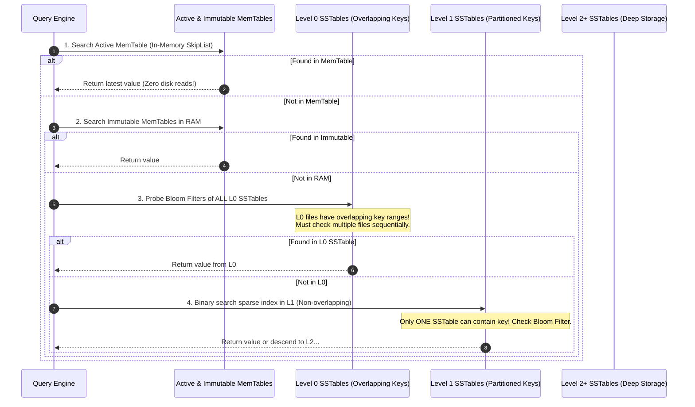
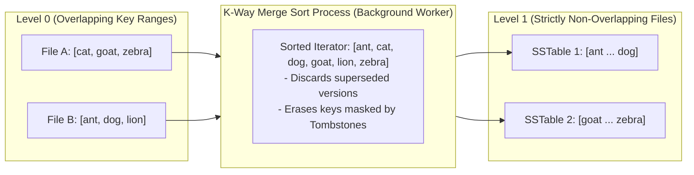

For nearly forty years, the database industry lived in a monoculture governed by a single data structure: the **B-Tree** (and its ubiquitous variant, the **B+ Tree**).

Invented by Rudolf Bayer and Edward McCreight at Boeing in 1970, the B-Tree was a triumph of mechanical sympathy. In an era dominated by spinning magnetic hard drives with mechanical read/write arms, B-Trees optimized for page-aligned block access. PostgreSQL, MySQL's InnoDB, Oracle, Microsoft SQL Server, and SQLite built entire database dynasties on top of them. 

The contract was simple: data was updated **in place**. When you updated a row in a Postgres table, the storage engine traversed the balanced tree from the root down to the leaf node, read the 8KB disk page into memory, modified the bytes in place, and flushed the dirty page back to disk.

Then, the world changed.

Two simultaneous hardware and architectural revolutions broke the B-Tree's hegemony:

1. **The Rise of Write-Heavy Distributed Architectures**: Time-series telemetry, user event streaming, distributed message brokers, financial audit ledgers, and massive search indexes completely inverted the traditional 80/20 read-to-write ratio. Modern systems spend 80% to 95% of their CPU and I/O cycles writing fresh data, not reading old data.
2. **The Shift from Spinning Platters to Solid-State NVMe**: Magnetic disks penalized random seeks because a physical actuator arm had to travel across platters. Flash memory (NAND flash) has no mechanical arm, but it introduced a new physical constraint: **erase blocks**. In NAND flash, you can read and write in 4KB or 8KB pages, but you can only erase memory in massive 2MB to 8MB blocks. Writing small, random 8KB pages in place triggers the flash controller's internal garbage collection, causing catastrophic **Flash Write Amplification (WA)** and wearing out SSD silicon prematurely.

In 1996, Patrick O'Neil, Edward O'Neil, and Gerhard Weikum published a paper that offered a radical alternative: **The Log-Structured Merge-Tree (LSM-Tree)**.

Today, LSM-Trees power the foundational storage engines of modern distributed systems: RocksDB (Meta), LevelDB (Google), Cassandra, ScyllaDB, ClickHouse, Apache Kafka's local state stores, CockroachDB (Pebble), and Bigtable.

Here is the unvarnished systems engineering breakdown of how LSM-Trees actually work under the hood, how they turn chaotic random writes into blazing sequential throughput, and the brutal operational price you pay in read amplification and compaction debt.

---

## The Core Philosophy: Never Mutate In Place

The fundamental philosophical divergence between a B-Tree and an LSM-Tree can be stated in a single sentence:

**A B-Tree treats storage as an mutable array of pages; an LSM-Tree treats storage as an immutable, append-only historical log.**

```mermaid
graph TB
    subgraph BTree["B+ Tree Storage Architecture (In-Place Mutation)"]
        Root["Root Page (8KB)"] --> Node1["Branch Node"]
        Root --> Node2["Branch Node"]
        Node1 --> Leaf1["Leaf Page A (8KB)"]
        Node1 --> Leaf2["Leaf Page B (8KB)"]
        Node2 --> Leaf3["Leaf Page C (8KB)"]
        
        Update["Update Key 'X'"] -.->|Random I/O Seek| Leaf2
        Leaf2 ==>|Rewrite entire 8KB page to disk in-place| DiskPages["Random Disk Pages (High Write Amplification)"]
    end

    subgraph LSMTree["LSM-Tree Storage Architecture (Append-Only Ingestion)"]
        WAL["Write-Ahead Log (WAL)<br/>Append-Only Disk Write (O_DIRECT)"]
        MemTable["Active MemTable (In-Memory SkipList / Red-Black Tree)"]
        ImmMemTable["Immutable MemTable (Flushing to Disk)"]
        SSTableL0["SSTable Level 0 (Immutable Sorted Files)"]
        SSTableL1["SSTable Level 1 (Compacted Non-Overlapping Files)"]

        LSMWrite["Write Key 'X'"] -->|Sequential Append| WAL
        LSMWrite -->|Insert / Update| MemTable
        MemTable -->|Freeze when full| ImmMemTable
        ImmMemTable -->|Sequential Flush (Zero Random Seeks)| SSTableL0
        SSTableL0 -->|Background Compaction Merger| SSTableL1
    end
```

In an LSM-Tree, you **never** update an existing record on disk. You never seek out a leaf node to overwrite bytes.

- If you **insert** a record, you append it.
- If you **update** a record, you append the new version with a higher timestamp or sequence number.
- If you **delete** a record, you do not remove it; you append a specialized marker called a **Tombstone** indicating that the key has been deleted.

By eliminating random in-place overwrites, the LSM-Tree converts almost all incoming write operations into sequential disk access. 

As we explored in our deep-dive on [asynchronous I/O mechanics and NVMe controllers](/posts/exploring-io-uring-in-rust), sequential writes saturate the raw theoretical bus bandwidth of PCIe Gen 4/5 storage, bypassing the flash translation layer (FTL) bottlenecks that cripple random in-place writes.

---

## The Four Pillars of an LSM-Tree Engine

To make an append-only architecture capable of fast range scans and point lookups, an LSM-Tree organizes its data into four coordinated components:

```
+-------------------------------------------------------------------------------+
| THE LIFECYCLE OF AN LSM-TREE WRITE PATH                                       |
+-------------------------------------------------------------------------------+
  Client Write -> [ 1. Write-Ahead Log (WAL) on Disk (Crash Durability) ]
               -> [ 2. MemTable in RAM (Concurrent SkipList / Sorted Memory) ]
                       |
                       | (MemTable exceeds size threshold, e.g. 64MB)
                       v
                  [ 3. Immutable MemTable in RAM ]
                       |
                       | (Background Flush Thread)
                       v
                  [ 4. SSTable on Disk (Sorted String Table, Level 0) ]
                       - Data Block (Sorted Key-Values)
                       - Index Block (Sparse Index for Binary Search)
                       - Filter Block (Bloom Filter for Fast Negative Probes)
+-------------------------------------------------------------------------------+
```

### 1. The Write-Ahead Log (WAL)
When a write request hits an LSM engine, it is immediately appended to a disk-based **Write-Ahead Log (WAL)**. 

The WAL is a pure append-only file. It does not sort keys. It performs no balancing. It simply writes the raw bytes of the operation to disk using `O_APPEND` (or buffered sequential I/O followed by an `fdatasync()` call). 

Its sole purpose is **crash recovery**: if the machine loses power five microseconds later, the database replays the WAL on reboot to reconstruct the volatile in-memory state.

### 2. The MemTable (Memory Buffer)
Simultaneously, the key-value pair is inserted into an in-memory data structure called the **MemTable**.

Unlike the WAL, the MemTable maintains all entries in strictly **sorted order** by key. 

Because standard arrays or B-Trees require heavy rebalancing locks during concurrent insertions, modern production engines (such as RocksDB and Pebble) implement the MemTable using a **Concurrent SkipList** (or a lock-free cache-conscious SkipList). 

A SkipList provides $O(\log N)$ probabilistic insertion, deletion, and lookup time without requiring massive subtree locks. Multiple writer threads can insert keys concurrently using atomic compare-and-swap (CAS) operations on forward pointers, avoiding the heavy mutex contention that throttles traditional B-Tree buffer pools under high core counts a dynamic we analyzed in our [systems guide on multi-core topologies and weak memory models](/posts/when-to-choose-x86-64-vs-aarch64).

### 3. The Flush: From RAM to SSTable
A MemTable cannot grow indefinitely; it is typically capped at 32MB, 64MB, or 128MB. 

When the active MemTable reaches its memory threshold:
1. It is frozen and marked as an **Immutable MemTable**.
2. A fresh, empty MemTable is allocated immediately to continue accepting new incoming client writes with zero downtime.
3. A background worker thread iterates through the sorted keys of the Immutable MemTable and flushes them sequentially to disk as a brand-new file: an **SSTable (Sorted String Table)**.
4. Once the flush finishes, the corresponding obsolete segment of the WAL is safely truncated or deleted.

Because the MemTable was already sorted in RAM, writing the SSTable requires zero sorting on disk. It is a single, continuous, streaming sequential write at the full wire speed of your NVMe drive.

### 4. Anatomy of an SSTable
An SSTable is an immutable disk file divided into distinct physical blocks (typically 4KB to 64KB each):

```
+-----------------------------------------------------------------------+
| ANATOMY OF A SINGLE SSTABLE FILE (.sst)                               |
+=======================================================================+
| [ Data Block 0 ]   : Key: "account:0001" -> Val: {...}                |
|                    : Key: "account:0014" -> Val: {...}                |
+-----------------------------------------------------------------------+
| [ Data Block 1 ]   : Key: "account:0028" -> Val: {...}                |
|                    : Key: "account:0052" -> Val: {...}                |
+-----------------------------------------------------------------------+
| [ Filter Block ]   : Bit-vector Bloom Filter (Probabilistic Presence) |
+-----------------------------------------------------------------------+
| [ Index Block ]    : Sparse index mapping last key of each block      |
|                    : "account:0014" -> Offset 0                       |
|                    : "account:0052" -> Offset 4096                    |
+-----------------------------------------------------------------------+
| [ Footer / Meta ]  : Magic number, pointer to Index & Filter blocks   |
+-----------------------------------------------------------------------+
```

- **Data Blocks**: Chunks of sorted key-value pairs, often compressed using lightweight, high-throughput compression algorithms like LZ4 or Zstandard.
- **Index Block**: A sparse index loaded into RAM. Instead of indexing every single key, it stores the highest key in each data block and its byte offset. To find key `"account:0030"`, the engine performs an in-memory binary search on the index block, determines that the key must live inside Data Block 1, and reads only that single 4KB block from disk.
- **Filter Block (The Bloom Filter)**: A probabilistic bit array that answers the question: *Is this key definitely NOT in this SSTable?* 
- **Footer**: A fixed-size trailer at the end of the file containing byte offsets to the index and meta blocks.

---

## The Read Path: The Penalty of Fragmentation

If writes in an LSM-Tree are virtually free, where does the bill come due?

The bill arrives on the **Read Path**.

In a B-Tree, reading a single key requires traversing from the root to a single leaf page: exactly $O(\log_B N)$ page reads. If you have a 3-level B-Tree with an 8KB page size, a database of 100 million rows can resolve any key in at most three disk reads (and because the root and internal branch nodes are almost permanently cached in the OS page cache, it usually takes exactly **one** physical disk read).

In an LSM-Tree, data is scattered across time and disk levels. The latest version of key `"user:9823"` might be sitting in the active MemTable. Or it might be in an Immutable MemTable. Or in an SSTable in Level 0. Or buried in an older SSTable down in Level 4.



To read a key, the storage engine must execute a multi-tier search:

1. **Check the Active MemTable**: In-memory SkipList lookup ($O(\log N)$).
2. **Check the Immutable MemTables**: If present, return immediately.
3. **Check Level 0 SSTables**: Level 0 files are direct dumps of MemTables. Because they were flushed at different times, **their key ranges overlap**. If you have four files in Level 0, key `"user:9823"` could theoretically exist in any of them. The engine must check all Level 0 files, from newest to oldest.
4. **Check Lower Levels (Level 1, Level 2, ...)**: Lower levels are partitioned into mutually exclusive key ranges. Only one SSTable per level can contain the key.

If you had to read every SSTable on disk to confirm that a non-existent key doesn't exist, your read throughput would plunge into single digits.

### The Savior: Bloom Filters
This read penalty is mitigated by **Bloom Filters**.

A Bloom filter is a space-efficient probabilistic data structure added to every SSTable header (typically requiring only 10 bits per key). It uses multiple hash functions ($h_1, h_2, \dots, h_k$) to set bits in a bit array during file creation.

When checking an SSTable:
- If the Bloom filter returns `false`, the key is **guaranteed not to exist** in that file. The engine skips the file completely without making a single disk read or touching the OS page cache.
- If the Bloom filter returns `true`, the key **probably exists** (with a configurable false positive rate, typically set to 1%). The engine reads the data block to confirm.

Thanks to Bloom filters, 99% of negative file lookups are discarded in RAM before ever hitting the NVMe controller.

---

## The Compaction Crisis: Garbage Collection on Disk

Because an LSM-Tree never updates data in place, obsolete data accumulates relentlessly.

If your application updates a sensor reading every second for twenty-four hours, the database stores 86,400 separate versions of that key across hundreds of SSTables on disk. Millions of dead records, obsolete versions, and tombstone markers clog your storage.

If left unchecked:
- Disk space explodes (**Space Amplification**).
- Point reads must probe dozens of stale files (**Read Amplification**).
- Range scans (`SELECT WHERE key BETWEEN A AND Z`) become agonizingly slow because they must merge dozens of overlapping iterators in a priority queue.

To restore sanity, the LSM-Tree engine runs a continuous, background maintenance process called **Compaction**.

Compaction is garbage collection for disk storage. It selects a set of SSTables, reads their sorted contents in parallel, merges them using an external $K$-way merge sort, discards overwritten versions and expired tombstones, and writes out a clean, deduplicated set of new SSTables to the next level down.



In production, how you compact determines the operational characteristics of your database. Engines rely on two primary compaction strategies:

### 1. Size-Tiered Compaction Strategy (STCS)
Pioneered by Apache Cassandra, STCS waits until a fixed number of SSTables of approximately equal size accumulate in a tier (e.g., four 100MB files). It merges all four files into a single larger file (one 400MB file).

- **Pros**: Low write amplification during ingestion. Excellent for pure write-heavy logging where data is rarely updated.
- **Cons**: Horrific **Space Amplification**. To merge four 100GB files into a single 400GB file, you must temporarily hold both the old files and the new file on disk simultaneously. Your database can suddenly require **50% free disk headroom** just to complete a compaction! If your disk utilization hits 60%, the database can run out of disk space and crash during routine maintenance.

### 2. Leveled Compaction Strategy (LCS)
Pioneered by Google's LevelDB and popularized by RocksDB, LCS organizes SSTables into discrete, exponential levels ($L_1, L_2, L_3, \dots$):

```
Level 0: [ 64MB ] (Overlapping key ranges; direct flush from MemTable)
Level 1: [ 10MB ][ 10MB ][ 10MB ] ... Total: 256MB (Non-overlapping)
Level 2: [ 10MB ][ 10MB ][ 10MB ] ... Total: 2.5GB (10x Level 1)
Level 3: [ 10MB ][ 10MB ][ 10MB ] ... Total: 25GB  (10x Level 2)
```

- Each level beyond $L_0$ is guaranteed to have **zero overlapping key ranges**.
- Each level has a strict maximum capacity (e.g., $L_1 = 256\text{MB}$, $L_2 = 2.5\text{GB}$, $L_3 = 25\text{GB}$).
- When Level 1 exceeds 256MB, a background thread selects an SSTable from $L_1$, finds the overlapping SSTables in $L_2$, merges them, and writes them to $L_2$.

- **Pros**: Exceptional space efficiency (Space Amplification is bounded to ~1.1x to 1.2x). Blazing point reads, because a key can exist in at most **one** SSTable per level!
- **Cons**: High **Write Amplification**. A single byte written by the client may be rewritten by the compaction process 10 to 30 times as it cascades down through the levels.

---

## The RUM Conjecture: The Fundamental Physics of Storage

There is no magical storage engine that optimizes everything. 

In database theory, this trade-off is formalized as the **RUM Conjecture** (formulated by Manos Athanassoulis, Michael S. Kester, and Stratos Idreos at Harvard in 2016).

The RUM Conjecture states that when designing a data structure for access, you can optimize for two of three fundamental resource amplifications, but you **always** sacrifice the third:

```
                      Read Amplification (R)
                               /\
                              /  \
                             /    \
                            /      \
                           /  RUM   \
                          / Conjecture
                         /            \
                        /______________\
          Write (W)                       Space (S)
        Amplification                   Amplification
```

1. **Read Amplification (R)**: The number of physical bytes read from disk to return a single byte requested by the application. (B-Trees optimize for $R \approx 1$; LSM-Trees have higher $R$).
2. **Write Amplification (W)**: The number of physical bytes written to storage for every byte submitted by the application. (LSM-Trees optimize for low initial $W$; B-Trees have catastrophic $W$ due to writing entire 8KB pages for 50-byte row updates).
3. **Space Amplification (S)**: The ratio of total physical disk space consumed to the size of the uncompressed active data. (Leveled Compaction optimizes for low $S$; Size-Tiered Compaction sacrifices $S$).

| Engine Topology | Read Amplification (R) | Write Amplification (W) | Space Amplification (S) | Ideal Workload |
| :--- | :--- | :--- | :--- | :--- |
| **B+ Tree (Postgres, InnoDB)** | **Low** ($O(\log N)$) | **Catastrophic** ($10\times - 50\times$) | **Moderate** (Page internal fragmentation ~30%) | Read-heavy OLTP, complex transactions, relational joins. |
| **LSM-Tree (STCS - Cassandra)** | **High** (Must probe multiple files) | **Low** ($2\times - 8\times$) | **Horrific** (Requires up to 50% free disk space) | Pure append-only streaming, time-series telemetry, write spikes. |
| **LSM-Tree (LCS - RocksDB)** | **Moderate** (Bounded by levels & Bloom filters) | **High** ($10\times - 30\times$ due to cascade) | **Low** (~1.1x to 1.2x; tight deduplication) | High-throughput distributed key-value stores, mixed read/write. |

---

## The Production Landmines: Why LSM-Trees Melt Down

If you run an LSM-based database in production (like ScyllaDB, Cassandra, or an embedded RocksDB instance), you will eventually face three operational failure modes that never occur in traditional B-Trees:

### 1. Write Stalls (Compaction Debt)
What happens if your client application writes data to the MemTable at 150 megabytes per second, but your disk compaction thread can only merge SSTables at 80 megabytes per second?

Level 0 fills up with uncompacted files. 

If Level 0 grows past a safety threshold (e.g., 20 or 32 files in RocksDB), the read path begins to degrade catastrophically because it must check every single file. 

To protect itself from total read collapse, the LSM-Tree engine executes an emergency self-defense maneuver: **it throttles or freezes incoming writes**. 

Suddenly, your API gateway observes p99 latency spike from 2 milliseconds to 8,000 milliseconds. Your client threads back up, connection pools exhaust, and services time out across the fleet. This is known as **Compaction Debt**. 

Preventing write stalls requires over-provisioning disk I/O bandwidth specifically to give compaction workers the headroom to absorb write bursts without falling behind.

### 2. Tombstone Saturation (The Range Scan Trap)
A software engineer decides to implement a queue or ephemeral cache inside an LSM database: records are inserted with a 1-hour TTL, and subsequently deleted.

Tens of millions of tombstones are appended to the storage engine. 

A client then issues a simple range scan:  
`SELECT * FROM orders WHERE user_id = 'bob' LIMIT 10`.

The storage engine opens an iterator. It reads an SSTable. It encounters a tombstone. It advances the iterator. It reads another tombstone. It advances again. 

Because tombstones are not physically eradicated until an SSTable undergoes a full compaction with the level below it that contains the original key, the query must read **hundreds of thousands of consecutive tombstone markers from disk** just to find the ten surviving active records! 

A query that took 4 milliseconds yesterday now runs for 28 seconds, burning 100% of a CPU core scanning ghosts of dead records.

### 3. Flash Wear-Out in Cloud Disks
In cloud environments (AWS EBS gp3, GCP Hyperdisk, Azure Managed Disks), you pay for both allocated gigabytes and provisioned IOPS. 

Because Leveled Compaction rewrites data repeatedly across levels, a sustained ingest of 50 MB/s can generate an internal background compaction write stream of 750 MB/s! 

On physical NVMe drives, this write amplification exhausts the flash controller's **Total Bytes Written (TBW)** endurance rating years ahead of schedule. In the cloud, it quietly burns through your IOPS credit balance, triggering aggressive cloud provider throttling that cascades into production outages.

---

## Architectural Decision Framework: B-Tree or LSM?

When should you build or deploy on an LSM-Tree instead of a traditional B-Tree?

```
+-------------------------------------------------------------------------------+
| ARCHITECTURAL SELECTION MATRIX                                                |
+-------------------------------------------------------------------------------+
  Requirement / Characteristic      | B-Tree (PostgreSQL, InnoDB) | LSM-Tree (RocksDB, Cassandra)
+-----------------------------------+-----------------------------+-----------------------------+
  Workload Profile                  | Read-heavy (80% reads)      | Write-heavy (50%+ writes)   
  Secondary Indexes                 | First-class native support  | Clunky; requires global maps
  Range Scan Predictability         | Locked p99 latency          | Variable due to iterators   
  Memory Overhead for Buffering     | High (Page Cache 8KB pages) | Lean (MemTables + Bloom)    
  Crash Recovery Time               | Instant (Checkpoint WAL)    | Replay MemTable WAL logs    
  Storage Medium                    | DRAM / Cached Fast Block    | NVMe Flash / Append Storage 
+-----------------------------------+-----------------------------+-----------------------------+
```

### Choose an LSM-Tree When:
- Your system ingestion profile is write-dominated: telemetry ingestion, activity audit trails, metric aggregation, clickstreams, or distributed ledgers.
- You are building high-scale distributed storage engines where data must be partitioned, moved, and compacted as immutable chunks across nodes (as we saw in our analysis of [sharded distributed database execution](/posts/the-lifecycle-of-a-sharded-postgres-query)).
- You require aggressive data compression: because SSTables are written once and never mutated, block compression algorithms (ZSTD, LZ4) achieve 50% to 70% higher compression ratios than mutable B-Tree pages plagued by internal fragmentation.

### Choose a B-Tree When:
- Your workload is traditional relational OLTP: bank accounts, inventory systems, ERP platforms where point reads, immediate updates, and complex multi-table relational joins dominate.
- You require rock-solid, predictable p99 read latencies without the threat of background compaction latency spikes or write stalls.
- Your data model depends heavily on complex secondary indexing, foreign key constraints, and transactional consistency across multiple tables.

---

## The Immutable Future

The B-Tree is far from dead; it remains the most battle-tested, versatile data structure in software history. 

But the era of its universal monopoly has passed. 

The modern computing landscape defined by non-volatile flash memory, massive distributed topologies, and unprecedented write volumes belongs to the architecture that embraced the physics of immutability. 

By treating updates as history rather than overwrites, the LSM-Tree unlocked the true potential of solid-state hardware. Understanding its inner mechanics the dance between MemTables, SSTables, Bloom filters, and compaction is how you ensure your storage architecture doesn't just write fast, but survives the weight of its own history.

---

### Foundational References & Papers

1. **O'Neil, P., O'Neil, E., & Weikum, G.** (1996). *"The Log-Structured Merge-Tree (LSM-Tree)"*. *Acta Informatica*, 33(4), 351–385. [Springer Link](https://doi.org/10.1007/s002360050048)
2. **Chang, F., Dean, J., Ghemawat, S., Hsieh, W. C., Wallach, D. A., Burrows, M., Chandra, T., Fikes, A., & Gruber, R. E.** (2008). *"Bigtable: A Distributed Storage System for Structured Data"*. *ACM Transactions on Computer Systems (TOCS)*, 26(2), 1–26. [USENIX OSDI 2006](https://www.usenix.org/conference/osdi-06/bigtable-distributed-storage-system-structured-data)
3. **Athanassoulis, M., Kester, M. S., Maas, L. M., Stoica, R., Idreos, S., Ailamaki, A., & Callaghan, M.** (2016). *"Designing Access Methods: The RUM Conjecture"*. *EDBT: 19th International Conference on Extending Database Technology*, 217–228. [Harvard DASH Repository](https://dash.harvard.edu/handle/1/28552579)
4. **Dong, S., Callaghan, M., Galanis, L., Borthakur, D., Sankar, T., & Akyildiz, S.** (2017). *"Optimizing Space Amplification in RocksDB"*. *CIDR: Conference on Innovative Data Systems Research*. [CIDR Paper](http://cidrdb.org/cidr2017/papers/p82-dong-rocksdb-final.pdf)
5. **Bayer, R., & McCreight, E.** (1970). *"Organization and Maintenance of Large Ordered Indices"*. *Record of the 1970 ACM SIGFIDET Workshop on Data Description, Access and Control*, 107–141. [ACM Digital Library](https://doi.org/10.1145/1734663.1734671)

