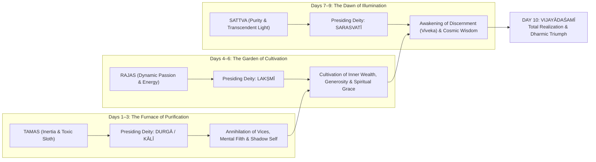

## 1. The Supreme Inversion: Divinity as Primordial Mother

In the religious imagination of the Western and Mediterranean antiquity, divinity was almost universally cast in the image of the dominant patriarch. 

From the thunder-wielding Zeus atop Mount Olympus and the imperious Jupiter of the Roman Capitoline, to the jealous, solitary desert deities of the Semitic monotheisms, godhood was male. He was a father, a warrior-king, an imperial judge issuing commandments from on high. The feminine, where it was tolerated at all, was relegated to a derivative, subordinate status: Eve fashioned from a stolen rib to serve man, the passive maiden, or the sorrowful mother weeping at the foot of the gallows.

Then cross the Indus and step into the living, vibrant sanctuary of Sanātana Dharma.

Here, in the oldest unbroken spiritual tradition on earth, the supreme, uncreated, dynamic kinetic reality of the universe is worshipped unabashedly, fiercely, and tenderly as **Woman**:

> या देवी सर्वभूतेषु शक्तिरूपेण संस्थिता ।  
> नमस्तस्यै नमस्तस्यै नमस्तस्यै नमो नमः ॥  
> 
> *"To that Divine Goddess who abides in all living beings as pure Primordial Energy (Śakti):  
> Reverence unto Her, reverence unto Her, repeated reverence again and again."*  
> *Devī Māhātmyam (5.32–34)*

The Indic mind accomplished an audacious metaphysical inversion. It posited that consciousness without dynamic energy is utterly impotent. The Shaiva-Shakta philosophers formulated this truth with mathematical bluntness:

$$\text{शिवः शक्त्या युक्तो यदि भवति शक्तः प्रभवितुं न चेदेवं देवो न खलु कुशलः स्पन्दितुमपि ।}$$
*(Śivaḥ śaktyā yukto yadi bhavati śaktaḥ prabhavituṃ, na cedevaṃ devo na khalu kuśalaḥ spanditumapi)*  
*"Only when united with Śakti is Śiva capable of creation; without Her, the Divine cannot even stir."*  
*Ādi Śaṅkarācārya, Saundaryalaharī (Verse 1)*

Without Śakti, Śiva is literally **Śava** a lifeless, inert corpse. Pure static consciousness (*Puruṣa*) requires dynamic, vibrating, creative energy (*Prakṛti*) to project, sustain, and dissolve the infinite multidimensional multiverse.

Nowhere is this metaphysical architecture celebrated with greater aesthetic grandeur, communal ecstasy, and psychological depth than during **Śāradīya Navarātri** the Nine Nights of the Divine Mother.

Falling across the autumn transition of the lunar calendar, beginning on the pristine dawn following the dark moon of Mahalaya, Navaratri is not mere festive folklore. It is a nine-day alchemical technology of the human soul. It maps the progressive annihilation of demonic egoic calcification and charts the systematic ascent of human awareness from primeval inertia (*Tamas*) to dynamic creative vitality (*Rajas*), culminating in the transcendent serenity of pure non-dual wisdom (*Sattva*).

---

## 2. The Mahāsura Within: The Deconstruction of Mahishasura

To dismiss the central scripture of Navaratri the **Devī Māhātmyam** (also known as the *Durgā Saptaśatī* from the *Mārkaṇḍeya Purāṇa*) as an ancient fairy tale about a woman slaying a monster is to fundamentally misunderstand how Indic myth functions.

The text is an allegorical treatise on clinical psychology and spiritual warfare, cloaked in the vivid, roaring poetry of cosmic combat.

```mermaid
graph TB
    subgraph TheCosmicCrisis["The Crisis of Adharma"]
        Mahisha["Mahishasura (The Buffalo Demon)<br/>Symbol of: Inertia (Tamas), Brute Obstinacy, Arrogant Materialism"]
        Devas["The Male Devas (Indra, Agni, Varuna)<br/>Paralyzed by Egoic Fracture; Stripped of Heaven"]
        Mahisha -->|Conquers & Subjugates| Devas
    end

    subgraph TheEmergence["The Coalescence of Pure Śakti"]
        Devas -->|Surrender Egos & Emit Radiant Energy (Tejas)| Fusion["Cosmic Confluence of Divine Rays"]
        Fusion --> Durga["MĀ DURGĀ (The Invincible Goddess)<br/>Ten Arms, Riding the Lion of Courage"]
    end

    subgraph TheWarfare["The Nine Nights of Combat"]
        Durga -->|Destroys Chanda & Munda (Covetousness & Cynicism)| Kali["Emergence of Kālī / Chāmuṇḍā"]
        Durga -->|Annihilates Raktabīja (The Replicating Mind-Loops)| Blood["Vanquishing the Recursive Ego"]
        Durga -->|Beheads the Buffalo Form| Victory["VIJAYĀDAŚAMĪ: The Self Triumphant"]
    end
```

Consider the primary antagonist: **Mahiṣāsura**.

He is not an ordinary demon. He is a shape-shifter whose original form is a colossal water buffalo (*Mahiṣa*). 

What does the water buffalo signify in the taxonomy of Indic symbology? 
- It represents **Tamas** in its grossest physical state: thick-skinned, obstinate, slow to move, revelling in stagnant mud, impervious to subtle guidance, and relying solely on brute, unreflective physical mass. 
- Furthermore, Mahishasura is a master of deceptive shape-shifting (*Māyā*). When cornered by truth, he transforms from an elephant to a lion, from a warrior with a sword back into a raging beast. 

He is the exact mirror of the **human ego**: when attacked with logic, the ego disguises itself as righteous indignation; when confronted with humility, it transforms into spiritual pride; when exposed in its vanity, it retreats into sulking depression.

Notice how the crisis unfolds in the text:

Mahishasura wages war on the gods and drives them out of heaven (*Svarga*). The male deities Indra (the intellect), Agni (will), Varuna (instinct), and Yama (order) fight with all their martial might, and they are utterly humiliated and routed. 

Why? Because the male deities represent fragmented, specialized faculties of the mind. The intellect alone cannot slay primal animalistic greed; willpower alone cannot extinguish deep subconscious compulsions.

Desperate, humiliated, and stripped of their domains, the gods assemble before Shiva and Vishnu. As they acknowledge their total helplessness, an extraordinary phenomenon occurs:

From the face of Brahma, from the brow of Shiva, and from the body of Vishnu, blinding incandescent rays of energy (*Tejas*) burst forth. The radiant auras of all the gathered gods fuse into a single, blinding mountain of white light that illuminates the three worlds. 

And from that unified conflagration of cosmic energy emerges **Maa Durgā**.

She is not created by any god; she is the latent, primordial matrix of all their energies unified into a single conscious force. Shiva places his trident in her hands; Vishnu bestows his Sudarshana Chakra; Varuna hands her the conch; Agni gives her the fiery spear; Vayu offers the bow and quiver; Indra tears the thunderbolt from his own side; the Himalaya mountains gift her a magnificent, roaring lion to serve as her mount.

The message of the scripture is staggering: **When evil becomes systemic, structural, and shape-shifting, fragmented individual efforts fail. Only the integration of all latent spiritual energies into the unified, fierce, maternal force of Dharma can annihilate the tyrant.**

---

## 3. The Triadic Alchemical Architecture of the Nine Nights

The nine nights of Navaratri are not nine identical celebrations. They are grouped into a precise triadic progression of three days each, mirroring the three fundamental qualities of cosmic nature (**Guṇas**):



### Phase I: Days 1 to 3 The Invocations of Durgā and Kālī (The Slaying of Tamas)
Before you can plant a garden of rare flowers, you must root out the poisonous weeds, haul away the stones, and burn the brambles. 

The spiritual journey does not begin with gentle hymns; it begins with the terrifying necessity of **purification**. 

During the first three days, the seeker invokes the Goddess in Her most ferocious, unyielding manifestations: Durgā and Kālī. She is approached not as an indulgent comforter, but as the surgeon who cuts away the malignant tumor of our ancient conditioning (*Saṃskāras*).

It is in this phase that the scripture recounts the slaying of **Raktabīja** the demon whose every fallen drop of blood instantly spawned a thousand clones of himself on the battlefield. 

Raktabīja is the definitive psychological metaphor for the **obsessive, looping mind**: you try to suppress a desire or an anxious thought with willpower, and ten new desires and anxieties sprout from the struggle. 

How does the Divine Mother conquer Raktabīja? 

From Durgā’s brow bursts forth **Kālī** naked, midnight-black, terrifying, Her tongue outstretched. As Durgā strikes the demon, Kālī drinks every drop of blood before it can touch the soil of awareness, starving the recursive ego to death. 

In the first three days of Navaratri, we offer our inner Raktabījas our looping obsessions, our ancient resentments, our hidden vices into the wide, devouring mouth of Kālī.

### Phase II: Days 4 to 6 The Invocations of Lakṣmī (The Transmutation of Rajas)
Purification leaves an empty vessel. But an empty vessel, if left uncultivated, quickly fills again with dust. 

Having cleared the subconscious battlefield of demonic debris, the seeker spends the next three days invoking **Mā Lakṣmī**.

Lakshmi is tragically misunderstood in modern consumer culture as a celestial ATM dispensing fiat currency. In the Shakta ontology, Lakshmi is **Śrī** the generative, luminous abundance of the cosmos. She represents the cultivated virtues of the heart:
- Generosity (*Dāna*)
- Forbearance (*Kṣamā*)
- Inner richness (*Ātmika Śrī*)
- Loving-kindness (*Maitrī*)
- Devotional sweetness (*Bhakti*)

In this second phase, the raw, aggressive energy of **Rajas** which drove our earthly ambitions and egoic desires is transfigured into creative, productive, compassionate action. We invite the Mother to fill our cleaned mind with the golden light of ethical prosperity and aesthetic harmony.

### Phase III: Days 7 to 9 The Invocations of Sarasvatī (The Culmination in Sattva)
Even material and moral prosperity are not the final destination. A human being can be physically pure and materially abundant, and yet remain bound by the ultimate cage: spiritual ignorance (*Avidyā*).

The final three days of Navaratri are dedicated to **Mā Sarasvatī** the Goddess clothed in spotless white, seated upon a white lotus, holding the sacred palm-leaf scripture (*Pustaka*), the string of meditative counting beads (*Japamālā*), and playing the divine lute (**Vīṇā**).

White represents pure **Sattva** unclouded transparency. The Veena represents the tuned mastery of the human nervous system: if the strings are too loose, they emit no sound; if they are too tight, they snap. Only when the mind is tuned with mathematical precision through discernment (*Viveka*) does it play the cosmic melody of *Brahman*.

On these days, the student places their books, the musician their instrument, the artisan their tools, and the engineer their technology at the feet of the Mother. We surrender the delusion of our intellectual pride and pray for the dawn of **Jñāna** the direct experiential knowledge that liberates the soul from the wheel of birth and death.

### The Climax: Vijayādaśamī (The Tenth Day of Victory)
On the tenth day, the alchemical process is complete. 

The demon is vanquished; the buffalo carcass lies lifeless upon the sand. The Mother stands triumphant upon Her lion, Her face shining with the serenity of a thousand suns. 

It is **Vijayādaśamī** the Day of Total Victory. 

In the North, it is the day **Shri Rama** shoots the fiery arrow that pierces the navel of Ravana, destroying the ten heads of lust, pride, and greed. 

Across India, it is **Vidyārambham** the day children are seated on their parents' laps and trace their very first sacred letters in a plate of uncooked rice, initiating their minds into the eternal stream of human learning. 

The darkness has been traversed; the light reigns supreme.

---

## 4. The Navadurgā: The Ninefold Evolutionary Ladder of Consciousness

The *Devī Kavacam* (the Armor of the Goddess) delineates the nine distinct manifestations of Durgā worshipped on each sequential night of Navaratri: the **Navadurgā**.

These nine forms are not an arbitrary catalog of names; they constitute an astonishing phenomenological map of spiritual evolution, tracing the journey of the soul from dormant, grounded matter to supreme supernatural realization.

```
+-----------------------------------------------------------------------------------------+
| THE NAVADURGĀ: THE NINEFOLD CHRONOLOGICAL PHENOMENOLOGY                                 |
+=======+==================+======================+=======================================+
| Day   | Form of Durgā    | Chakra / Principle   | Metaphysical Significance             |
+-------+------------------+----------------------+---------------------------------------+
| Day 1 | ŚAILAPUTRĪ       | Mūlādhāra (Root)     | The Daughter of the Mountain.         |
|       |                  | Earth Element        | Grounding, primal stability, root.    |
+-------+------------------+----------------------+---------------------------------------+
| Day 2 | BRAHMACĀRIṆĪ     | Svādhiṣṭhāna (Sacral)| The Ascetic Seeker of Truth.          |
|       |                  | Tapasya & Vows       | Relentless contemplative practice.    |
+-------+------------------+----------------------+---------------------------------------+
| Day 3 | CANDRAGHAṆṬĀ     | Maṇipūra (Solar)     | The Bell of the Crescent Moon.        |
|       |                  | Radiance & Courage   | Serene awareness amid readiness.      |
+-------+------------------+----------------------+---------------------------------------+
| Day 4 | KŪṢMĀṆḌĀ         | Anāhata (Heart)      | The Cosmic Golden Egg.                |
|       |                  | Prāṇic Luminosity    | The silent burst of creation.         |
+-------+------------------+----------------------+---------------------------------------+
| Day 5 | SKANDAMĀTĀ       | Viśuddha (Throat)    | Mother of the Warrior of Light.       |
|       |                  | Maternal Courage     | Nurturing divine potential in self.   |
+-------+------------------+----------------------+---------------------------------------+
| Day 6 | KĀTYĀYANĪ        | Ājñā (Third Eye)     | Born of the Rage of the Sages.        |
|       |                  | Divine Intuition     | Righteous indignation slaying evil.   |
+-------+------------------+----------------------+---------------------------------------+
| Day 7 | KĀLARĀTRI        | Sahasrāra (Crown)    | The Dark Night of Dissolution.        |
|       |                  | Transcending Time    | Slaying death; raw existential truth. |
+-------+------------------+----------------------+---------------------------------------+
| Day 8 | MAHĀGAURĪ        | Transcendent Heart   | The Luminous Dawn of Compassion.      |
|       |                  | Absolute Purity      | Serene purification after the storm.  |
+-------+------------------+----------------------+---------------------------------------+
| Day 9 | SIDDHIDĀTRĪ      | Nirvikalpa Samādhi   | The Bestower of Supreme Attainment.   |
|       |                  | Non-Dual Perfection  | The realization that You are the All. |
+-------+------------------+----------------------+---------------------------------------+
```

1. **Śailaputrī (The Daughter of the Mountain)**: Born to Himavat, the king of the Himalayas, She represents the **Mūlādhāra (Root Chakra)**. She rides a bull, holding a trident and a lotus. Spiritual evolution cannot launch from volatile, ungrounded fantasy. Like a mountain, the seeker must first establish rock-solid psychological stability, physical rootedness, and unshakeable patience.
2. **Brahmacāriṇī (The Ascetic Student)**: She walks barefoot through the forest, holding a rosary and a water pot. She personifies **Tapasya** unflinching, self-willed austerity. Having established a grounded base, the seeker must commit to disciplined inner labor, enduring discomfort without complaint to burn off mental dross.
3. **Candraghaṇṭā (The Sound of the Crescent Bell)**: Adorned with a half-moon shaped like a temple bell upon Her brow, She rides a tiger. The sound of Her bell strikes terror into demons while radiating profound peace upon Her devotees. She represents the balance of alertness and serenity: internal calmness combined with absolute martial readiness against delusion.
4. **Kūṣmāṇḍā (The Cosmic Spark)**: Her name literally means "The Little Warm Cosmic Egg." The scripture states that when the universe was nonexistent, plunged in total darkness, She flashed a silent, radiant smile, and the cosmic egg exploded into luminosity. She represents the awakening of the heart’s creative fire the realization that the universe is sustained by joy.
5. **Skandamātā (The Mother of the Warrior)**: Holding the infant Lord Skanda (Kārttikeya, the general of the divine armies) upon Her lap, She illustrates that true maternal love is not weak sentimentality; it is the courage to nurture, train, and dispatch the warrior of light to vanquish the forces of darkness.
6. **Kātyāyanī (The Daughter of the Seer)**: Born of the accumulated contemplative rage (*Krodha*) of the rishis against tyranny, She is the form that directly attacks Mahishasura. She represents righteous, principled fury the refusal of the enlightened consciousness to remain a passive bystander in the face of structural injustice.
7. **Kālarātri (The Black Night of Eternity)**: Her skin is pitch black, Her hair dishevelled, Her eyes blazing with fire, wearing a garland of lightning around Her neck. She is the most terrifying form of Durgā. She is **Kāla** Time and Death that swallows everything. She teaches the seeker to look straight into the face of mortality, to confront the terror of physical dissolution, and to realize that which lies beyond death.
8. **Mahāgaurī (The Radiant Dawn)**: After the terrifying night of Kalaratri, the sun rises. Mahagauri is eight years old, radiant as jasmine and snow, dressed in white robes. Having burned through all karmic impurities in the crucible of Kalaratri, the soul returns to its pristine, unblemished, childlike innocence and unconditional compassion.
9. **Siddhidātrī (The Bestower of Mastery)**: Seated upon a bloomed lotus, worshipped by gods, demons, and sages alike, She is the supreme crown of realization. The Shiva Purana states that Lord Shiva worshipped Siddhidatri to obtain all eighteen supreme supernatural masteries (*Siddhis*), and by Her grace, His left half became the Goddess, manifesting as the magnificent non-dual form of **Ardhanārīśvara**. 

With Siddhidatri, the seeker realizes the non-dual truth: **The seeker, the path, and the Mother were never separate; all along, there was only Śakti.**

---

## 5. The Mosaic of Ecstasy: Regional Polymorphism of the Festival

Nowhere does the open-source, polymorphic genius of Sanātana Dharma reveal itself more vividly than in the radically divergent regional expressions of Navaratri across the Indian geography. 

There is no standardized central liturgy enforced by a papal decree. Instead, the festival acts as an open canvas upon which each regional culture paints its deepest emotional longing:

```
                                  [ THE SACRED CONTINUUM OF NAVARATRI ]
                                                    |
         +------------------------------------------+------------------------------------------+
         |                                          |                                          |
         v                                          v                                          v
   EASTERN INDIA                             WESTERN INDIA                              SOUTHERN INDIA
  (Bengal / Assam)                         (Gujarat / Rajasthan)                     (Tamil Nadu / Karnataka)
DURGĀ PŪJĀ:                               GARBĀ & DANDIYA:                           BOMMAI GOLU & DASARA:
The homecoming of the daughter;           Dancing in concentric circles              The cosmic stepped assembly;
the deafening roar of the Dhaak;          around the womb-lamp (Garbha Dīpa);        worship of books & tools;
Sindoor Khela & emotional immersion.       celebrating the wheel of cosmic time.     Mysore royal victory procession.
```

### The Eastern Crucible: The Homecoming of the Daughter in Bengal
In Bengal, Assam, and Odisha, Navaratri culminates in **Durgā Pūjā** recognized by UNESCO as an Intangible Cultural Heritage of Humanity. 

Here, an astonishing emotional transposition takes place: Durgā is not approached merely as the transcendent conqueror of demons; She is welcomed as **Umā** the beloved, married daughter who returns from Her austere mountain home in the Himalayas with Her four children (Lakshmi, Saraswati, Kartikeya, Ganesha) to visit Her maternal parents for just four days.

The pandals are architectural marvels of clay, bamboo, and fabric. The neighborhood echoes with the hypnotic, primal thunder of the **Dhaak** (large open drums) and the fragrant white clouds of frankincense (*Dhunuchi Nāc*). 

And on the tenth day, **Vijayādaśamī**, tears flow openly across Bengal as the idols are carried to the rivers for immersion (*Visarjana*). Women perform **Sindoor Khela**, smearing brilliant red vermilion on the Mother’s cheeks and on each other’s foreheads, celebrating the indomitable power of feminine auspiciousness. 

As the murti slips beneath the waters, the crowd shouts in an agony of sweet longing:  
*"Aschhe bochhor abar hobe!"* *"Next year, Mother, You will come again!"*

### The Western Ecstasy: The Dance of the Womb in Gujarat
Cross the subcontinent to Gujarat and Rajasthan, and the quiet devotion transforms into a colossal, multi-colored nocturnal dance: **Garbā**.

Tens of thousands of people dance in swirling, synchronized concentric circles through the cool desert nights. 

What is the metaphysical center of the Garba dance? 

In the center of the dancing ground sits the **Garbha Dīpa** an earthen pot with delicate perforated holes, inside which burns a steady, solitary oil flame. The word *Garbā* derives directly from the Sanskrit **Garbha** meaning **The Womb**. 

The earthen pot is the womb of Mother Nature (*Prakṛti*); the flame within is the spark of unborn divine consciousness (*Puruṣa*). 

As the dancers spin in circles around the stationary flame, they enact the eternal dance of the cosmos: galaxies, stars, planets, and human lives wheeling around the still, silent, immortal center of the Divine Mother.

### The Southern Reverence: The Cosmic Steps in Tamil Nadu and Mysore
Travel south to Tamil Nadu, Karnataka, and Andhra Pradesh, and the celebration adopts a contemplative, artistic dignity in the home through **Bommai Golu** (or *Kolu*).

Families construct temporary wooden staircases of odd numbers (three, five, seven, nine steps) draped in white cloth. Upon these steps, they arrange intricate displays of clay dolls depicting the entire evolutionary hierarchy of the cosmos:
- The bottom steps house simple plants, insects, and animals.
- The middle steps display human artisans, merchants, farmers, and kings.
- The upper steps enshrine sages, rishis, and avatars.
- The highest step houses the divine pair: **Marapachi Dolls** (wooden effigies of the cosmic couple, symbolizing Shiva and Shakti).

In Karnataka, the historic city of **Mysore** erupts in the royal splendor of the **Mysuru Dasara**. The magnificent Mysore Palace is illuminated with nearly one hundred thousand incandescent light bulbs, and the murti of **Goddess Chamundeshwari** the slayer of Mahishasura, from whom the city Mysore (Mahishuru) takes its very name is carried atop a royal tusker in a golden howdah through streets packed with hundreds of thousands of devotees.

In Kerala, the final days are marked by profound scholarship: **Ayudha Puja** and **Vidyārambham**. Tools of livelihood, from the farmer’s sickle to the surgeon’s scalpel and the programmer’s laptop, are cleaned, blessed, and laid to rest before the Mother, recognizing that all human skill is a borrowed spark of Her infinite intelligence.

---

## 6. The Living Mirror: Reclaiming the Sacred Feminine in the 21st Century

We live in an era characterized by profound ecological pathology, institutional alienation, and a hollowed-out corporate caricature of female empowerment.

Modernity has attempted to rectify centuries of patriarchal oppression by assimilating women into the aggressive, hyper-competitive, extractive molds of late-stage industrial capitalism. Women are told that "empowerment" means acquiring the ruthless, commodifying behaviors historically displayed by men competing in an economic machine that treats both the human body and the living earth as disposable raw material.

It is in this precise civilizational exhaustion that the philosophy of **Śakti** offers a radical, revolutionary alternative.

The Indic vision never asked woman to imitate man to achieve dignity. It recognized that the feminine principle is the primal, sovereign matrix of all existence:
- Nature is not an inert warehouse of dead resources to be raped and fracked; She is **Bhūdevī** the living Earth Mother who must be revered with trembling awe.
- Power is not tyrannical dominance; it is **Durgā** protective, righteous, boundaries-enforcing maternal courage.
- Abundance is not hoarded luxury; it is **Lakṣmī** circulating, generative, shared flourishing.
- Wisdom is not sterile technocratic jargon; it is **Sarasvatī** the white lotus of contemplative illumination.

When an Indian bows before a little girl on the eighth day of Navaratri during **Kanyā Pūjā** washing her tiny feet, offering her sweets, and bowing his forehead to her toes he is not performing an empty social courtesy. 

He is executing a radical psychological reprogramming of the male gaze: **He is training his consciousness to perceive every woman not as an object of biological desire or commodified labor, but as an incarnation of the Supreme Cosmic Mother of the Universe.**

The nine nights are over. 

The drums have fallen silent along the Hooghly; the Garba dancers have laid down their painted sticks; the lamps upon the steps of the Golu are guttering in the morning breeze. 

Yet the true battle of Navaratri never ends on the calendar. 

The battlefield is the human heart. The buffalo of lazy, obstinate inertia still wallows in our subconscious; the demons of lust, cynicism, and recursive pride still whisper in our ears.

Take up the trident of unwavering discernment. Mount the roaring lion of moral courage. Kindle the light of the Mother within the womb of your heart.

Let the buffalo fall. 

Let the Mother reign.

---

### Authoritative References & Classical Scriptural Citations

1. **Mārkaṇḍeya Purāṇa.** (c. 4th–6th Century CE). *Devī Māhātmyam (Durgā Saptaśatī)*. Chapters 1–13. (The supreme canonical narrative of the emergence of Durgā, the slaying of Mahiṣāsura, and the annihilation of Raktabīja).
2. **Ādi Śaṅkarācārya.** (c. 8th Century CE). *Saundaryalaharī (The Wave of Beauty)*. Verse 1: The foundational formulation of the non-dual interdependence of Śiva and Śakti.
3. **Śrīmad Devī Bhāgavatam.** (c. 11th Century CE). *Skandha 3 & 7*. (The comprehensive Shakta philosophical exposition of the Navadurgā, the nature of Prakṛti, and the cosmology of the cosmic Mother).
4. **Coburn, Thomas B.** (1984). *Devī-Māhātmya: The Crystallization of the Goddess Tradition*. Motilal Banarsidass. (The definitive academic study of the textual, theological, and historical development of the Goddess tradition in India).
5. **Woodroffe, Sir John (Arthur Avalon).** (1918). *Śakti and Śākta: Essays and Addresses on the Śākta Tantraśāstra*. Ganesh & Co., Madras. (Pioneering Western scholarship demystifying the profound philosophical, energetic, and ritual systems of Shakta metaphysics).
6. **Bhattacharyya, N. N.** (1974). *History of the Śākta Religion*. Munshiram Manoharlal Publishers. (Authoritative historical analysis of the evolutionary origins of Goddess worship from tribal indigenous shrines to classical Sanskrit treatises).
