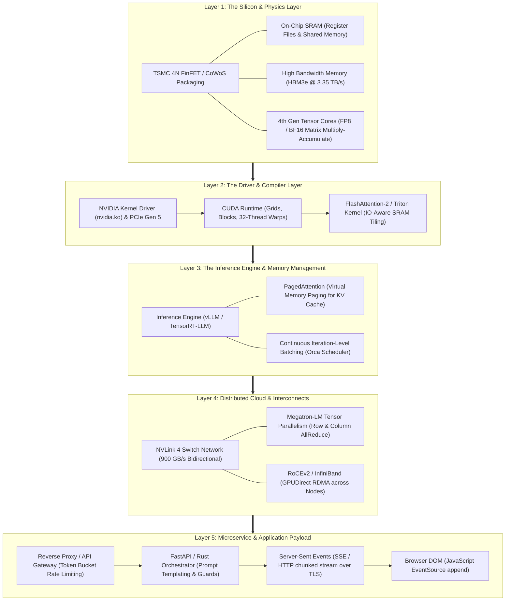
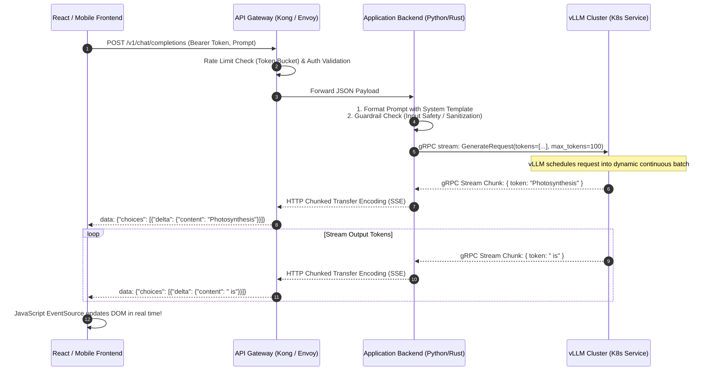

Open your browser, navigate to a chat interface, and type:

`"Explain photosynthesis in one sentence."`

Hit Enter. 

Less than two hundred milliseconds later, words start streaming across your screen at sixty tokens per second:

> *"Photosynthesis is the biological process where green plants transform sunlight, water, and carbon dioxide into glucose and oxygen."*

To most people, this feels like software magic: text goes into a cloud server, and answers come out. 

If you peel back the layers, however, those eleven words are the culmination of the most sophisticated, high-density, multi-billion-dollar engineering stack ever constructed in human history. 

In that fraction of a second, your prompt traversed fiber-optic transoceanic cables, terminated at an API gateway, was routed to an inference cluster, was sliced across multiple GPUs over a 900 GB/s NVLink interconnect, and executed roughly **eighty trillion mathematical operations** on microscopic silicon transistors etched at the scale of human DNA all before your thumb even lifted off the keyboard.

How does an electric charge traveling through etched silicon turn into a coherent English sentence on your screen?

Let us trace the entire journey from first principles: starting from physical sand and copper wires, moving up through drivers and memory hierarchies, into distributed cloud backends, and finally reaching the application layer.

---

## The Journey at a Glance: The Five Layers

The modern AI compute stack can be cleanly divided into five physical and logical tiers:



---

## Layer 1: The Silicon and the Physics (The Metal)

At its absolute mathematical foundation, a Large Language Model is not "thinking." It is a massive, multi-dimensional array of numbers called **weights** (or parameters). 

A 70-billion-parameter model (like Llama-3-70B) is literally a collection of 70,000,000,000 numbers stored in memory. Every single token generated requires multiplying the input vector representing your prompt by these massive matrices:

$$Y = X \cdot W + B$$

To generate a single word, the hardware must perform tens of billions of **Multiply-Accumulate (MAC)** operations: taking two numbers, multiplying them together, and adding the result to an accumulator ($a \times b + c$).

### Why CPUs Fail and GPUs Rule
A high-end desktop CPU (like an Intel Core i9 or AMD Ryzen) is an extraordinary piece of engineering designed for **latency-optimized sequential tasks**. It has 16 to 24 large cores, massive multi-level caches (L1, L2, L3), and sophisticated out-of-order execution pipelines with branch predictors. It is built to execute a single, unpredictable thread of instructions as fast as humanly possible.

A GPU (such as an NVIDIA H100) is built for **throughput-optimized embarrassingly parallel tasks**. 

Instead of 16 heavy cores, an H100 packs **16,896 arithmetic logic units (ALUs)** organized into 132 Streaming Multiprocessors (SMs) on a single 814 mm² slab of silicon manufactured by TSMC on its 4N (5-nanometer class) process. 

A CPU is like a Ferrari: it can carry one passenger across town at 200 miles per hour. A GPU is like a freight train with 16,000 flatbeds: each flatbed moves at 40 miles per hour, but it transports an entire mountain of cargo in a single trip.

```
CPU Architecture:                              GPU Architecture:
+------------------------------------+         +------------------------------------+
|  [ Heavy Core 0 ]  [ Heavy Core 1 ]|         | [SM 0] [SM 1] [SM 2] [SM 3] [SM 4] |
|  (Out-of-Order Execution, Branch)  |         | (Hundreds of Tiny ALU Cores each)  |
|  [ Heavy Core 2 ]  [ Heavy Core 3 ]|         | [SM 5] [SM 6] [SM 7] [SM 8] [SM 9] |
+------------------------------------+         | ... 132 Streaming Multiprocessors  |
|       Large Shared L3 Cache        |         +------------------------------------+
+------------------------------------+         |         Shared 50MB L2 Cache       |
|    DRAM Controller (100 GB/s)      |         +------------------------------------+
+------------------------------------+         |     HBM3e Stack (3,350 GB/s!)      |
                                               +------------------------------------+
```

### Inside the Tensor Core
Standard ALUs process one calculation at a time. In 2017, computer architects introduced **Tensor Cores** specialized execution units hardwired directly into the silicon to perform matrix multiplication in hardware.

A 4th-Generation Tensor Core on an H100 does not calculate numbers one by one. In a single clock cycle, it loads a $4 \times 4$ matrix $A$, a $4 \times 4$ matrix $B$, and a $4 \times 4$ matrix $C$, and computes:

$$D = A \times B + C$$

It calculates **64 floating-point operations in a single clock tick**. Running at a boost clock of ~1.8 GHz across hundreds of Tensor Cores, an H100 delivers nearly **2,000 TeraFLOPS (two quadrillion floating-point operations per second)** of theoretical FP8 compute.

### The Number Formats: From FP32 to FP8
In standard computer programming, numbers are stored in 32-bit floating point (IEEE 754 `float`, or **FP32**): 1 sign bit, 8 exponent bits, and 23 mantissa (precision) bits.

In deep learning, you do not need 23 bits of decimal precision to know if a token means "cat" or "dog." Extra precision simply wastes electricity and memory bandwidth. The industry has progressively compressed precision:
- **FP16 / BF16 (16-bit)**: BF16 (Bfloat16) keeps the 8-bit dynamic range of FP32 but truncates the mantissa to 7 bits. It cut memory consumption in half with zero loss in training stability.
- **FP8 (8-bit)**: Standardized in the NVIDIA Hopper architecture. Divided into two formats: **E4M3** (4 exponent, 3 mantissa bits for weights and activations) and **E5M2** (5 exponent, 2 mantissa bits for gradients). 

By moving from FP16 to FP8, you cut the memory footprint of a 70B model from 140 gigabytes down to **70 gigabytes**, while doubling the computational throughput of the Tensor Cores.

### The Memory Wall and the Roofline Model
Here is the dirty secret of modern AI hardware: **Compute is cheap. Moving bytes is brutally expensive.**

This fundamental limitation is captured by the **Roofline Model** (Williams, Waterman, & Patterson, 2009). The model evaluates whether a computation is **Compute-Bound** (limited by how fast the ALUs can multiply) or **Memory-Bound** (limited by how fast memory can feed numbers to the ALUs).

This is quantified by **Arithmetic Intensity**:

$$\text{Arithmetic Intensity} = \frac{\text{Floating Point Operations (FLOPs)}}{\text{Memory Bytes Transferred}}$$

An H100 SXM5 GPU provides:
- **Compute Throughput**: ~1,000 TFLOPS (FP16).
- **Memory Bandwidth**: 3.35 Terabytes per second (HBM3e).

To keep the Tensor Cores 100% saturated, your algorithm must perform:

$$\frac{1,000 \times 10^{12} \text{ FLOPs/sec}}{3.35 \times 10^{12} \text{ Bytes/sec}} \approx 298 \text{ FLOPs per Byte}$$

If an algorithm performs fewer than 298 calculations for every single byte it reads from RAM, the Tensor Cores sit idling, waiting for data!

This is why modern AI GPUs do not use standard DDR5 RAM (which tops out at ~100 GB/s). They use **High Bandwidth Memory (HBM3e)**. HBM stacks memory dies vertically on top of each other using Through-Silicon Vias (TSVs), mounted directly alongside the GPU processor die on a microscopic silicon substrate called a **CoWoS (Chip-on-Wafer-on-Substrate)** interposer. 

The wires connecting HBM to the GPU are microscopic and measured in millimeters, allowing 3.35 Terabytes of data to flood the chip every second.

---

## Layer 2: The Driver and Kernel Layer (From Silicon to CUDA)

How does software command this massive engine?

When your operating system boots, the Linux kernel loads `nvidia.ko` the proprietary kernel module that establishes memory mappings over the PCI Express (PCIe Gen 5) bus using **Base Address Registers (BAR)**. 

### The CUDA Programming Model
Developers do not write machine code directly for the GPU. They write in **CUDA** (or high-level compilers like OpenAI's **Triton**).

CUDA organizes execution into a three-tier hierarchy:
1. **Threads**: The basic unit of execution.
2. **Warps**: The fundamental hardware unit. The GPU groups exactly **32 threads into a Warp**. All 32 threads in a warp execute the exact same instruction at the exact same clock tick across different data (**SIMT**: Single Instruction, Multiple Threads). If your code contains an `if-else` branch where 16 threads take the `if` path and 16 take the `else` path, the hardware serializes both branches (**warp divergence**), cutting throughput in half!
3. **Thread Blocks**: Groups of warps mapped to a specific Streaming Multiprocessor (SM).
4. **Grids**: The entire array of thread blocks launched across the whole GPU chip.

```
       [ GRID: Entire Kernel Launch (e.g., Matrix Multiplication) ]
                                    |
            +-----------------------+-----------------------+
            |                                               |
     [ Thread Block 0 ]                             [ Thread Block 1 ]
  Mapped to physical SM 0                        Mapped to physical SM 1
            |                                               |
     +------+------+                                 +------+------+
     |             |                                 |             |
  [ Warp 0 ]    [ Warp 1 ]                        [ Warp 0 ]    [ Warp 1 ]
 (32 Threads)  (32 Threads)                      (32 Threads)  (32 Threads)
```

### The On-Chip Memory Hierarchy
Just like a CPU, the GPU has its own internal memory tiers:
- **Registers**: Ultra-fast storage directly inside each SM (hundreds of KB per SM, single-cycle latency).
- **Shared Memory (SRAM)**: A dedicated, software-managed scratchpad memory built directly on each SM (up to 228 KB per SM on Hopper). It boasts an astonishing aggregate bandwidth of **~30 Terabytes per second** ten times faster than HBM3e!
- **L2 Cache**: A 50MB on-chip cache shared across all SMs (~12 TB/s).
- **HBM3e (Global Memory)**: The off-chip 80GB pool (3.35 TB/s, ~200-cycle latency).

### The FlashAttention Breakthrough
In 2022, Stanford researcher Tri Dao published **FlashAttention** (NeurIPS 2022), arguably the most consequential algorithmic optimization in modern AI systems engineering.

In standard Transformer attention (Vaswani et al., 2017), the model computes:

$$\text{Attention}(Q, K, V) = \text{softmax}\left(\frac{Q K^T}{\sqrt{d_k}}\right) V$$

For an input sequence of length $N$, the term $Q K^T$ generates an $N \times N$ matrix. 

If your input prompt is 8,000 tokens long:

$$8,000 \times 8,000 = 64,000,000 \text{ elements} \times 2 \text{ bytes (FP16)} \approx 128 \text{ Megabytes}$$

In naive PyTorch code, this intermediate $N \times N$ matrix was written out to slow HBM, read back into the SM to compute `softmax`, written back out to HBM, and read *again* to multiply by $V$. 

The algorithm was completely starved by memory bandwidth.

Dao realized that while the $N \times N$ matrix is too large to fit inside an SM’s fast on-chip SRAM (228 KB), the query ($Q$), key ($K$), and value ($V$) vectors can be sliced into small tiles. 

By applying an online mathematical reformulation of the softmax function, **FlashAttention computes the attention output tile-by-tile entirely within fast SRAM**, without ever writing the massive $N \times N$ attention matrix to off-chip HBM!

FlashAttention-2 increased training and inference speeds by **200% to 400%**, cutting memory consumption from $O(N^2)$ to $O(N)$ purely by respecting the physical memory hierarchy of the silicon.

---

## Layer 3: The Inference Engine and the KV Cache

Now we climb up into user space. When your prompt `"Explain photosynthesis in one sentence"` arrives at the inference server, it does not hit a raw PyTorch script. It hits a specialized inference engine like **vLLM** or **NVIDIA TensorRT-LLM**.

To understand why an inference engine exists, you must understand the two fundamentally different phases of LLM generation:

```mermaid
sequenceDiagram
    autonumber
    participant Client as User Browser
    participant Engine as vLLM Engine (Scheduler)
    participant GPU as H100 Tensor Cores & HBM

    Client->>Engine: Send Prompt (7 tokens: "Explain photosynthesis in one sentence")
    
    rect rgb(35, 45, 60)
        Note over Engine,GPU: PHASE 1: PREFILL (Compute-Bound)
        Engine->>GPU: Parallel GEMM over all 7 prompt tokens simultaneously
        GPU->>GPU: Slices weights across Tensor Cores, populates initial KV Cache
        GPU-->>Engine: Emits First Token: "Photosynthesis" (Time to First Token: ~50ms)
    end

    rect rgb(50, 35, 40)
        Note over Engine,GPU: PHASE 2: DECODE (Memory-Bandwidth-Bound)
        loop Token by Token Loop (Autoregressive Generation)
            Engine->>GPU: Input: Single Token ("Photosynthesis") + KV Cache
            GPU->>GPU: Reads 70GB of Model Weights from HBM to emit ONE token!
            GPU-->>Engine: Emits next token: "is" (Inter-Token Latency: ~15ms)
            Engine-->>Client: Stream chunk over SSE: "is"
        end
    end
```



### Phase 1: The Prefill Phase (Compute-Bound)
Your prompt contains seven tokens. In the prefill phase, the engine processes all seven tokens **in parallel**. 

Because all input tokens are known upfront, matrix operations collapse into large, dense General Matrix Multiplications (GEMMs). The Tensor Cores are fully saturated with high arithmetic intensity. The engine quickly generates the very first output token: `"Photosynthesis"`. 

The time it takes to produce this first token is the **Time-To-First-Token (TTFT)**.

### Phase 2: The Decode Phase (Memory-Bound)
Once the first token is generated, the game changes completely. 

Language models are **autoregressive**: the model predicts the next token based on all previous tokens. To generate the second token (`"is"`), the model can only feed the previous token (`"Photosynthesis"`) back into the network. 

To generate that **single word**, the GPU must read **the entire 70-gigabyte model weights from HBM3e into its SMs!**

Calculate the arithmetic intensity of generating a single token on a 70B FP8 model:
- Operations per token: $\approx 2 \times 70 \times 10^9 = 140 \text{ GFLOPs}$.
- Memory read per token: $70 \text{ Gigabytes}$.

$$\text{Arithmetic Intensity} = \frac{140 \text{ GFLOPs}}{70 \text{ GB}} = 2 \text{ FLOPs per Byte}$$

Recall our H100 saturation threshold: **298 FLOPs per Byte**. 

During the decode phase, the Tensor Cores are running at less than **1% of their theoretical compute capacity**! The GPU is almost entirely stalled waiting for bytes to travel from HBM into the chip. 

This is why text streams word by word.

### The KV Cache and PagedAttention
During the decode phase, every layer calculates Key ($K$) and Value ($V$) attention vectors for the new token. To attend to all previous tokens, the model must not recompute past keys and values. It stores them in a memory buffer called the **KV Cache**.

The KV cache grows linearly with every generated token. For an 8,000-token context on a 70B model, the KV cache alone consumes over **20 gigabytes of VRAM per concurrent user**!

In legacy inference runtimes, memory for the KV cache was allocated contiguously in VRAM based on the maximum possible request length (e.g., reserving space for 4,096 tokens upfront). 

As proven by Woosuk Kwon et al. at UC Berkeley (**PagedAttention**, ACM SOSP 2023), this caused **60% to 80% of GPU memory to be wasted** due to internal and external fragmentation!

```
Traditional Contiguous VRAM Allocation:
[ User A: 120 tokens | ......... 3,976 wasted empty pre-allocated slots ......... ]
[ User B: 45 tokens  | ......... 4,051 wasted empty pre-allocated slots ......... ]
Result: GPU runs out of VRAM and rejects new requests while 70% of RAM sits empty!

PagedAttention (Virtual Memory Paging):
Physical VRAM Blocks (16 tokens per block):
Block 0: [User A: tokens 0-15]   Block 1: [User B: tokens 0-15]
Block 2: [User A: tokens 16-31]  Block 3: [User A: tokens 32-47]
Logical Page Table maps non-contiguous physical blocks dynamically!
Result: Zero wasted memory. Serving throughput increases by 200% to 400%.
```

Inspired by virtual memory paging in operating systems, **PagedAttention** breaks the KV cache into fixed-size physical blocks (e.g., 16 tokens per block). 

Logical page tables translate token positions to physical blocks allocated on the fly. When a new token is generated, the engine allocates only one 16-token page when needed. 

By eliminating memory fragmentation, engines like vLLM pack three to four times more concurrent requests onto the same physical GPU.

---

## Layer 4: The Distributed Cloud (Scaling Beyond One Chip)

A 70-billion-parameter model in standard FP16 precision requires:
- Model Weights: $70 \times 10^9 \times 2 \text{ bytes} = 140\text{ GB}$.
- KV Cache & Activation Buffers: $\approx 40\text{ GB}$.
- Total Memory: $\approx 180\text{ GB}$.

An NVIDIA H100 has **80 gigabytes** of VRAM. 

The model physically cannot fit inside a single GPU. It must be chopped up and distributed across multiple chips.

### Tensor Parallelism (Megatron-LM)
Pioneered by Shoeybi et al. at NVIDIA (Megatron-LM, 2019), **Tensor Parallelism (TP)** splits individual weight matrices across multiple GPUs working in lockstep.

```
Incoming Vector X
       |
       +-----------------------+-----------------------+
       |                                               |
       v                                               v
[ GPU 0: Left Half of Matrix W_1 ]             [ GPU 1: Right Half of Matrix W_1 ]
  Computes Y_0 = X * W_1_left                    Computes Y_1 = X * W_1_right
       |                                               |
       +-----------------------+-----------------------+
                               |
               [ AllReduce over NVLink Interconnect ]
               (Both GPUs synchronize and sum vectors)
                               |
                               v
               Unified Output Vector Y = [Y_0 + Y_1]
```

To multiply a hidden vector by a large multi-head attention weight matrix:
1. The matrix $W$ is sliced into two or eight shards across GPUs.
2. In the first layer (**Column-Parallel**), each GPU multiplies the full input vector by its local slice of the matrix.
3. In the second layer (**Row-Parallel**), the GPUs execute an **AllReduce** collective communication primitive, broadcasting and summing their partial products over the interconnect to reconstruct the final vector.

This AllReduce operation must execute **twice per transformer layer**. With 80 layers in a model, the GPUs must synchronize **160 times for every single token generated**!

If this synchronization occurred over a standard PCIe bus (which tops out at ~64 GB/s), the communication latency would choke performance. 

Instead, GPUs within a server communicate over **NVLink 4**. An H100 provides 18 fourth-gen NVLink links delivering **900 Gigabytes per second of bidirectional bandwidth** nearly fourteen times faster than PCIe Gen 5. 

Cross-GPU communication becomes as fast as reading internal memory.

### Scaling Across Nodes: GPUDirect RDMA
When models scale into hundreds of billions of parameters (like 405B models or frontier mixtures-of-experts), they exceed a single 8-GPU chassis. 

Data must travel across different servers in a data center.

Standard TCP/IP networking is useless here: routing packets through the Linux kernel network stack, copying buffers to host CPU RAM, and incurring software interrupts introduces tens of microseconds of latency.

Distributed AI clusters run on **InfiniBand** (e.g., 400 Gbps Quantum-2) or **RoCEv2 (RDMA over Converged Ethernet)**. 

Using **GPUDirect RDMA (Remote Direct Memory Access)**, an NVIDIA ConnectX-7 network card can read data directly out of the VRAM of a GPU in Server A and write it directly into the VRAM of a GPU in Server B across the optical fabric, with **zero CPU involvement, zero kernel context switches, and sub-microsecond latency**.

---

## Layer 5: The Microservice and Application Layer (The Payload)

We have finally reached the top of the mountain. How does a web or mobile application talk to this distributed silicon beast?



### 1. The API Gateway & Rate Limiting
Your HTTP `POST` request hits an edge ingress gateway (like Envoy or Cloudflare). 

The gateway:
- Verifies your cryptographic JWT or API key.
- Evaluates **Token Bucket** rate-limiting algorithms to prevent server starvation.
- Terminates the TLS 1.3 handshake.

### 2. The Orchestration Service
The request is routed to an internal microservice written in Rust, Go, or Python (FastAPI). 

This service performs:
- **Prompt Templating**: It wraps your raw text into the model’s specific conversational markup format (e.g., `<|begin_of_text|><|start_header_id|>user<|end_header_id|>\n\nExplain photosynthesis...<|eot_id|>`).
- **Safety & Guardrail Filtering**: Lightweight classifier models or heuristic filters verify that the prompt does not contain malicious injection payloads or prohibited content.

### 3. The gRPC Streaming Transport
The orchestrator dispatches the formatted token IDs over an internal **gRPC** stream (using Protocol Buffers over HTTP/2 multiplexed sockets) to the vLLM inference cluster running in Kubernetes.

Inside the Kubernetes cluster:
- The **NVIDIA GPU Operator** manages kernel drivers, CUDA container runtimes, and DCGM (Data Center GPU Manager) telemetry.
- The vLLM scheduler receives the token IDs, assigns them slots in its continuous batching queue, and submits the execution command to the GPU.

### 4. Server-Sent Events (SSE) to the User Interface
As the GPU emits tokens one by one, waiting for the entire sentence to complete before sending a response would degrade user experience. 

The inference server flushes each token immediately as a **Server-Sent Event (SSE)**:

```http
HTTP/1.1 200 OK
Content-Type: text/event-stream
Cache-Control: no-cache
Transfer-Encoding: chunked

data: {"choices": [{"delta": {"content": "Photosynthesis"}}]}

data: {"choices": [{"delta": {"content": " is"}}]}

data: {"choices": [{"delta": {"content": " the"}}]}

data: [DONE]
```

On your phone or laptop, a simple JavaScript snippet listens to the incoming stream:

```javascript
const eventSource = new EventSource("/v1/chat/completions?stream=true");

eventSource.onmessage = (event) => {
    if (event.data === "[DONE]") {
        eventSource.close();
        return;
    }
    const payload = JSON.parse(event.data);
    const newWord = payload.choices[0].delta.content;
    
    // Append the newly arrived token directly to the screen!
    document.getElementById("chat-box").innerText += newWord;
};
```

The browser receives the chunk, triggers a DOM redraw, and your eyes perceive the illusion of a digital mind typing back to you in real time.

---

## The End-to-End Latency Budget

Where did those 200 milliseconds go?

Here is the exact real-world engineering telemetry budget for your single prompt:

| Step / Pipeline Stage | Mechanism / Physics | Typical Latency |
| :--- | :--- | :--- |
| **1. Edge Transit** | Client Wi-Fi $\to$ Fiber backbones $\to$ Data Center | **30 – 50 ms** |
| **2. Ingress & Auth** | Envoy TLS termination, JWT validation, Rate Limiter | **2 – 5 ms** |
| **3. Guardrails & Templating** | Tokenization (BPE tokenizer) & Safety classifiers | **3 – 8 ms** |
| **4. Queue Scheduling** | vLLM continuous batching iteration wait | **5 – 15 ms** |
| **5. Prefill Execution** | Parallel GEMM over prompt tokens on Tensor Cores | **15 – 35 ms** |
| **6. Decode (Token 1)** | First token emitted, NVLink AllReduce synchronization | **10 – 15 ms** |
| **7. Return Transit** | gRPC chunk $\to$ SSE serialization $\to$ Internet $\to$ DOM | **30 – 50 ms** |
| **TOTAL Time-to-First-Token (TTFT)** | **From physical keypress to first rendered character** | **~120 – 180 ms** |
| **Subsequent Token Streaming** | Autoregressive decode iteration loop (Inter-Token Latency) | **15 – 25 ms / token** |

---

## The Symphony of Modern Engineering

The next time you open a terminal or a chat prompt and ask a model to write code, debug a function, or explain a concept, take a moment to look through the screen.

You are not looking at software. 

You are looking at an unbroken, harmonious chain of human physics and computer engineering:

From quartz sand purified into monocrystalline silicon ingots and patterned with extreme ultraviolet light at 13.5 nanometers...  
To vertical copper vias passing through high-bandwidth memory stacks submerged in dielectric coolant...  
To Tensor Cores calculating 64 matrix products in a single clock tick...  
To FlashAttention and PagedAttention orchestrating SRAM tiles and virtual memory pages...  
To optical transceivers flashing infrared pulses across 900 GB/s NVLink fabrics...  
To gRPC network sockets and HTTP streaming connections delivering tokens straight into your browser's memory.

It is a machine comprising billions of parts, operating across nanoseconds, spanning continents and it worked flawlessly, just to answer your question.

---

### Foundational References & Peer-Reviewed Papers

1. **Dao, T., Fu, D. Y., Ermon, S., Rudra, A., & Ré, C.** (2022). *"FlashAttention: Fast and Memory-Efficient Exact Attention with IO-Awareness"*. *Advances in Neural Information Processing Systems (NeurIPS 2022)*, 35, 16344–16359. [NeurIPS Paper](https://proceedings.neurips.cc/paper_files/paper/2022/hash/67d57c32e20fd0a7a302cb81d36e40d5-Abstract.html)
2. **Kwon, W., Li, Z., Zhuang, S., Sheng, Y., Zheng, L., Yu, C. H., Gonzalez, J. E., Zhang, H., & Stoica, I.** (2023). *"Efficient Memory Management for Large Language Model Serving with PagedAttention"*. *Proceedings of the 29th ACM Symposium on Operating Systems Principles (SOSP '23)*, 611–626. [DOI: 10.1145/3600006.3613165](https://doi.org/10.1145/3600006.3613165)
3. **Shoeybi, M., Patwary, M., Puri, R., LeGresley, P., Casper, J., & Catanzaro, B.** (2019). *"Megatron-LM: Training Multi-Billion Parameter Language Models Using Model Parallelism"*. *arXiv preprint arXiv:1909.08053*. [arXiv Link](https://arxiv.org/abs/1909.08053)
4. **Yu, G. I., Jeong, J. S., Kim, G. W., Kim, S., & Chun, B. G.** (2022). *"Orca: A Distributed Serving System for Transformer-Based Generative Models"*. *16th USENIX Symposium on Operating Systems Design and Implementation (OSDI '22)*, 521–538. [USENIX OSDI 2022](https://www.usenix.org/conference/osdi22/presentation/yu)
5. **Williams, S., Waterman, A., & Patterson, D.** (2009). *"Roofline: An Insightful Visual Performance Model for Multicore Architectures"*. *Communications of the ACM*, 52(4), 65–76. [DOI: 10.1145/1498765.1498785](https://doi.org/10.1145/1498765.1498785)
6. **NVIDIA Corporation.** (2022). *NVIDIA H100 Tensor Core GPU Architecture Overview (Whitepaper)*. [NVIDIA Technical Docs](https://images.nvidia.com/aem-dam/en-zz/Solutions/data-center/h100/nvidia-h100-tensor-core-gpu-whitepaper.pdf)
7. **Vaswani, A., et al.** (2017). *"Attention Is All You Need"*. *Advances in Neural Information Processing Systems (NeurIPS 2017)*, 30, 5998–6008. [NeurIPS Paper](https://proceedings.neurips.cc/paper/2017/hash/3f5ee243547dee91fbd053c1c4a845aa-Abstract.html)
