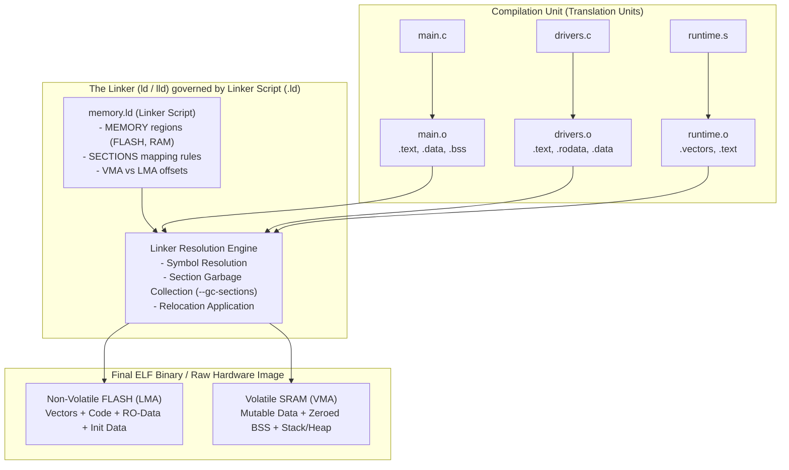
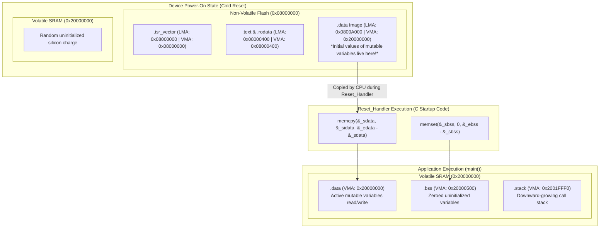

Ask a modern AI coding assistant to write a distributed microservice in Go, an async web server in Rust, or a React state machine, and it will churn out reasonably idiomatic code in seconds. 

Now, give that same state-of-the-art LLM a datasheet for an ARM Cortex-M7 or a custom RISC-V SoC with tightly coupled memory (TCM), non-volatile flash, and an external QSPI interface, and ask it to write a production GNU `ld` linker script.

Watch what happens. 

The model will hallucinate with breathtaking confidence. It will mix up Virtual Memory Addresses (VMA) with Load Memory Addresses (LMA). It will align the location counter inside an output section instead of outside, causing silent 4-byte padding shifts that brick your bootloader. It will forget `KEEP()` on the interrupt vector table, so `--gc-sections` strips your entire firmware down to zero bytes. And it will happily define stack symbols in C as pointers, guaranteeing a runtime `HardFault` the microsecond your microcontroller comes out of reset.

Linker scripts are the dark matter of systems programming. 

Every software engineer relies on them every single time they invoke `gcc`, `clang`, or `rustc`, yet fewer than one in a thousand understand how they work. We treat the linker as an invisible, boring plumbing step that resolves symbols and spits out an ELF binary.

When you step out of the cozy illusion of virtual memory provided by a Linux kernel and into the unforgiving universe of bare-metal embedded firmware, operating system kernels, bootloaders, or custom hypervisors, the compiler is no longer your master. 

The linker script is the only document that tells the silicon where reality begins and ends.

Inspired by Marisa Young’s seminal essay, here is the unvarnished systems engineering breakdown of the GNU linker script: its obscure DSL syntax, its memory mapping mechanics, and how to write memory layouts that survive reality.

---

## 1. What a Linker Actually Does: Sections vs. Segments

To write a linker script, you must first unlearn a common misconception about object files.

When you compile a source file (`main.c` or `lib.rs`) with `gcc -c main.c -o main.o`, the compiler does not produce executable machine code ready to run on physical hardware. It produces an **ELF (Executable and Linkable Format)** relocatable object file.

Inside that `.o` file, the compiler has chopped your code and variables into distinct labeled buckets called **Sections**:
- `.text`: Compiled machine instructions.
- `.rodata`: Read-only constants, string literals, and lookup tables.
- `.data`: Initialized global and static variables.
- `.bss`: Uninitialized global and static variables (which occupy zero bytes in the file, but must be allocated and zeroed out at runtime).
- Debugging sections (`.debug_info`), symbol tables (`.symtab`), and string tables (`.strtab`).



The compiler had no idea where this code would live in physical memory. It placed all `.text` instructions starting at offset `0x00000000`, left blank placeholders for cross-module function calls, and generated **relocation entries** (e.g., `R_ARM_THM_CALL` or `R_X86_64_PLT32`) saying: *"Dear Linker, when you figure out where `uart_init()` actually ends up, patch this instruction with the correct relative offset."*

This is where the linker enters. 

The linker performs two jobs:
1. **Symbol Resolution**: Matching undefined external symbol references (`extern int buffer_size;`) to their actual definitions across thousands of translation units.
2. **Section Placement & Relocation**: Concatenating all matching input sections from all `.o` files into contiguous **output sections**, assigning them physical memory addresses, and rewriting the relocation instructions.

### The Critical Distinction: Sections vs. Segments
In ELF terminology, engineers constantly confuse **Sections** with **Segments**:

- **Sections** are for the **Linker** (viewed through the **Section Header Table**). They provide fine-grained granular categorization: `.text.hot`, `.data.rel.ro`, `.bss.hardware_regs`. Sections have zero operational meaning to the CPU hardware.
- **Segments** (or **Program Headers**) are for the **Operating System Loader or Hardware MMU** (viewed through the **Program Header Table**). Segments group sections into coarse, page-aligned chunks with uniform permission bits: `PT_LOAD (Readable + Executable)` or `PT_LOAD (Readable + Writable)`.

The linker script is the exact blueprint that instructs `ld` how to fuse hundreds of fine-grained input sections from scattered object files into cohesive, hardware-aligned memory segments.

---

## 2. The Anatomy of a Linker Script: MEMORY and SECTIONS

A GNU `ld` script is written in a dedicated domain-specific language. Stripped of comments, every linker script consists of two foundational blocks: the `MEMORY` command and the `SECTIONS` command.

```
/* 1. MEMORY Block: Defines the physical hardware geometry */
MEMORY
{
    FLASH (rx)  : ORIGIN = 0x08000000, LENGTH = 512K
    RAM   (rwx) : ORIGIN = 0x20000000, LENGTH = 128K
    CCMRAM(rw)  : ORIGIN = 0x10000000, LENGTH = 64K
}

/* 2. SECTIONS Block: Defines where input sections are placed */
SECTIONS
{
    /* Output section definitions go here... */
}
```

### The MEMORY Command: Defining Physical Real Estate
The `MEMORY` command informs the linker of the physical boundaries of your chip's address space. It acts as an address guardrail: if your combined code exceeds 512KB, the linker halts with:  
`region 'FLASH' overflowed by 1420 bytes`.

Each memory region is defined with three parameters:
1. **Name**: An arbitrary identifier (`FLASH`, `RAM`, `ROM`, `QSPI`).
2. **Attributes**: A string of permission flags enclosed in parentheses:
   - `r`: Read-only.
   - `w`: Read/Write.
   - `x`: Executable code.
   - `a`: Allocatable memory.
   - `i`: Initialized section.
   - `!`: Inverts the following attributes.
3. **`ORIGIN` (`org`, `o`)**: The base physical byte address of the memory bank.
4. **`LENGTH` (`len`, `l`)**: The total size of the region (supporting suffixes like `K` or `M`).

### The SECTIONS Command: The Mapping Engine
The `SECTIONS` block tells the linker how to aggregate input sections from object files into output sections, and which memory region should host them.

The syntax for an output section is:

```
section-name [address] [(type)] : [AT(lma)]
{
    output-section-command
    output-section-command
    ...
} [>region] [AT>lma_region] [:phdr] [=fillexp]
```

Let's dissect this with an actual basic block:

```
SECTIONS
{
    .text :
    {
        *(.vectors)         /* Take .vectors from ALL input files */
        *(.text)            /* Take .text from ALL input files */
        *(.text.*)          /* Take functions compiled with -ffunction-sections */
        *(.rodata*)         /* Take constants and string literals */
    } > FLASH
}
```

Look at the wildcards:
- `*(.text)`: The first `*` is a file wildcard matching any object file (`main.o`, `libc.a`, `driver.o`). The string in parentheses is the section name.
- `*(.text.*)`: If you compile your C code with `-ffunction-sections` (or Rust's `-C link-arg=-ffunction-sections`), the compiler places every single function into its own isolated section: `.text.main`, `.text.uart_write`, `.text.memcpy`. This wildcard catches all of them.

---

## 3. The Location Counter (`.`): The Treacherous Variable

The single most consequential—and frequently misunderstood—primitive in linker scripts is the **Location Counter**, represented simply by a period: `.`.

The location counter is an internal cursor that tracks the current virtual memory address during the linking process. You can inspect it, assign to it, and increment it:

```
. = 0x20000000;    /* Set the current address to base of RAM */
. = . + 0x1000;    /* Reserve 4KB of empty padding space */
. = ALIGN(4);      /* Advance '.' to the next 4-byte boundary */
```

### The Pitfall: Relative vs. Absolute Context
Here is the landmine where AI models and junior engineers invariably crash:

**The behavior of `.` depends entirely on whether it appears INSIDE or OUTSIDE an output section.**

```
/* CASE A: OUTSIDE AN OUTPUT SECTION */
. = 0x20000000;
_start_of_ram = .;   /* Absolute address: 0x20000000 */

SECTIONS
{
    .my_section :
    {
        /* CASE B: INSIDE AN OUTPUT SECTION */
        . = ALIGN(4);       /* Aligns relative to the start of .my_section! */
        _section_sym = .;   /* Tracks VMA within this section */
    } > RAM
}
```

If you assign to `.` inside an output section, the linker treats the assignment as an offset relative to the beginning of that output section! 

If you attempt to write:
```
.my_section :
{
    . = 0x20004000; /* DANGER! */
} > RAM
```
The linker will not set the physical address to `0x20004000`. It will attempt to pad the section by `0x20004000` bytes from its starting address, causing your binary to explode into gigabytes of empty zero-padded space!

### The Alignment Trap: `ALIGN(4)` Inside vs. Outside
Consider this subtle bug that has cost systems engineers thousands of collective debugging hours:

```
/* BUGGY SNIPPET */
.data :
{
    _sdata = .;
    *(.data*)
    _edata = .;
    . = ALIGN(4);   /* WARNING: Padding placed INSIDE the section */
} > RAM AT > FLASH
```

If the combined `.data` input sections ended at address `0x20000101` (an unaligned byte address), and you place `. = ALIGN(4)` *inside* the section, `_edata` points to `0x20000101`, but the section's actual allocated size is padded to `0x20000104`.

When your C startup code copies `.data` from Flash to RAM using a 32-bit word copy loop based on `_sdata` and `_edata`:
```c
uint32_t *src = &_sidata;
uint32_t *dst = &_sdata;
while (dst < &_edata) {
    *dst++ = *src++;
}
```
Because `_edata` was not aligned to a 4-byte boundary before being assigned, `dst < &_edata` terminates one word early, dropping the last global variable in memory!

The correct, production-grade pattern is:
```
.data :
{
    . = ALIGN(4);
    _sdata = .;
    *(.data*)
    *(.data.*)
    . = ALIGN(4);
    _edata = .;
} > RAM AT > FLASH
```
Every symbol boundary must be explicitly aligned before *and* after the section payload.

---

## 4. The Master Concept: VMA vs. LMA

If you only take away one concept from this guide, make it this: **every single byte of memory has two completely distinct addresses.**

1. **Virtual Memory Address (VMA)**: The address the code expects to use when it is running. This is where pointer lookups, variable reads, and jump destinations point.
2. **Load Memory Address (LMA)**: The address where the byte is actually stored in physical storage at the moment the device powers on.



In a standard Linux desktop application, VMA and LMA are identical because the Linux kernel ELF loader reads your binary from disk and maps it directly into virtual memory pages via the MMU.

On bare-metal embedded silicon (ARM Cortex-M, RISC-V, ESP32), **VMA and LMA diverge violently.**

### The Dilemma of Initialized Data (`.data`)
Consider this global variable in C:
```c
int packets_received = 42;
```
Think about what this variable requires:
1. When the microcontroller loses power, the initial value `42` cannot evaporate. Therefore, the value `42` must be permanently burned into **non-volatile Flash/ROM**.
2. When the firmware boots, the CPU needs to increment `packets_received++`. But Flash memory cannot be overwritten like RAM (writing to Flash requires erasing entire 128KB sectors via slow hardware flash controllers). 
3. Therefore, during program execution, `packets_received` must live in **volatile SRAM**.

This is the dual-address paradox:
- The **LMA** of `packets_received` is in **Flash** (e.g., `0x08005420`).
- The **VMA** of `packets_received` is in **SRAM** (e.g., `0x20000000`).

### The Linker Script Syntax for VMA/LMA
How do you express this in GNU `ld`? 

Using the `> VMA_REGION AT > LMA_REGION` directive:

```
.data :
{
    . = ALIGN(4);
    _sdata = .;         /* VMA start in RAM: 0x20000000 */
    *(.data)
    *(.data.*)
    . = ALIGN(4);
    _edata = .;         /* VMA end in RAM:   0x20000450 */
} > RAM AT > FLASH
```

Look at that single line: `> RAM AT > FLASH`.

It tells the linker:
- Assign all symbol addresses and pointer references in `.data` to addresses inside the `RAM` region (`0x20000000`).
- But pack the actual raw bytes of this section into the final binary image directly behind `.text` inside the `FLASH` region (`0x08000000`).

To enable the C startup code to copy the data, the linker provides a built-in function: `LOADADDR(.section_name)`.

```
_sidata = LOADADDR(.data); /* Returns the LMA (Flash address) of .data */
```

Now, the mystery of the classic embedded `Reset_Handler` is demystified. 

When your chip boots, the very first assembly/C code that executes before `main()` is:

```c
extern uint32_t _sidata; /* LMA: Start of .data in Flash */
extern uint32_t _sdata;  /* VMA: Start of .data in RAM */
extern uint32_t _edata;  /* VMA: End of .data in RAM */
extern uint32_t _sbss;   /* VMA: Start of .bss in RAM */
extern uint32_t _ebss;   /* VMA: End of .bss in RAM */

void Reset_Handler(void) {
    // 1. Copy initialized data from Flash (LMA) to SRAM (VMA)
    uint32_t *p_src = &_sidata;
    uint32_t *p_dst = &_sdata;
    while (p_dst < &_edata) {
        *p_dst++ = *p_src++;
    }

    // 2. Zero-fill the uninitialized .bss section in SRAM
    uint32_t *p_bss = &_sbss;
    while (p_bss < &_ebss) {
        *p_bss++ = 0;
    }

    // 3. Jump to application entry point
    main();
}
```

If your linker script has even a single 1-byte mismatch between `_sdata`, `_edata`, and `_sidata`, global variables will boot with corrupt garbage values, and your program will crash before reaching `main()`.

---

## 5. Symbols Are Not Variables: The C-Declaration Trap

Here is another trap where developers waste days chasing phantom memory bugs:

**Linker script symbols do NOT allocate storage. They are pure memory addresses.**

Consider this line in your linker script:
```
_stack_top = 0x20020000;
```

A junior developer (or an LLM) imports this symbol into C like this:

```c
/* FATAL C CODE */
extern uint32_t _stack_top;

void init_stack(void) {
    uint32_t current_top = _stack_top; // HARD FAULT!
}
```

What went wrong?

In C, when you declare `extern uint32_t foo;` and read `foo`, the compiler generates an instruction to read the 4 bytes of memory stored **at the address named `foo`**.

In a linker script, `_stack_top` does not hold a value. `_stack_top` **is the address itself!** 

The linker’s symbol table contains pairs of `(symbol_name, address)`:
- Normal C global: `my_var` has address `0x20000010`. The bytes at that address hold `42`.
- Linker script symbol: `_stack_top` has address `0x20020000`. There are no bytes allocated for it!

When the C compiler sees `uint32_t current_top = _stack_top;`, it emits:
`ldr r0, =_stack_top; ldr r0, [r0]`

It attempts to dereference address `0x20020000`. If that address is beyond the physical boundary of SRAM, the memory controller triggers an immediate bus fault.

### The Correct Way to Access Linker Symbols
You must take the **address-of** (`&`) the symbol:

```c
/* THE CORRECT WAY */
extern uint32_t _stack_top;

void init_stack(void) {
    uint32_t *stack_ptr = &_stack_top; // stack_ptr = 0x20020000
    // OR declare it as an incomplete array:
    extern char _stack_top[];
    char *top = _stack_top;             // decays to pointer 0x20020000
}
```

Using an unsized array declaration (`extern char _stack_top[];`) is often preferred in systems code because the variable name automatically decays to a pointer, preventing accidental dereference bugs.

---

## 6. Advanced Linker Script Primitives

Beyond standard `.text` and `.data` mapping, production-grade linker scripts exploit several powerful GNU `ld` primitives:

### 1. `KEEP()` and Section Garbage Collection
Modern compilers support section garbage collection:
`gcc -ffunction-sections -fdata-sections -Wl,--gc-sections`

The linker examines the root entry point (typically `ENTRY(Reset_Handler)`) and traces all reachable function references like a mark-and-sweep garbage collector, stripping out any unused functions to save precious Flash space.

The catastrophe? 

The **Interrupt Vector Table** (which contains the Initial Stack Pointer, Reset Handler, NMI Handler, and HardFault Handler) is placed at physical address `0x08000000`. It is never called directly by software; it is read directly by the silicon hardware on reset.

To the linker's `--gc-sections` engine, the vector table appears completely unused! 

If you write:
```
.vectors :
{
    *(.isr_vector) /* BUG! Stripped by --gc-sections */
} > FLASH
```
The linker silently deletes your vector table. The resulting binary has no reset vector, and the microcontroller boots into a brick.

To prevent this, you must wrap the input section in `KEEP()`:

```
.vectors :
{
    KEEP(*(.isr_vector)) /* NEVER GARBAGE COLLECT THIS! */
} > FLASH
```

`KEEP()` instructs the linker: *Even if nobody calls this symbol in software, retain it unconditionally.*

### 2. `PROVIDE()` and `PROVIDE_HIDDEN()`
What if your runtime library needs a default implementation of an exception handler, but wants to allow application code to override it without triggering a "multiple definition of symbol" linker error?

In C, you can use `__attribute__((weak))`. In a linker script, you use `PROVIDE()`:

```
PROVIDE(Default_Handler = 0x08000400);
```

If the application defines a function named `Default_Handler`, the linker uses the application's definition. If the application does not define it, the linker uses the address specified in the linker script.

### 3. `/DISCARD/`: Purging Bloat
Compilers often emit metadata sections that have no place in a bare-metal embedded binary:
- `.comment`: Compiler version strings ("GCC: (Ubuntu 11.4.0) ...").
- `.note.gnu.build-id`: SHA-1 build hashes.
- `.ARM.exidx`: Exception unwinding tables (which consume massive Flash space if you are writing C or Rust with `panic = "abort"`).

To purge them entirely, route them to the special `/DISCARD/` output section:

```
/DISCARD/ :
{
    *(.comment)
    *(.note*)
    *(.ARM.exidx*)
}
```
Any section mapped to `/DISCARD/` is permanently evicted from the output binary.

---

## 7. A Masterclass Technique: Distributed Registration Arrays

The most elegant pattern made possible by custom linker scripts is the **Zero-Overhead Static Registration Array**—the exact architectural pattern that powers:
- The Linux kernel's `__initcall` and `module_init` system.
- Embedded command-line shells (CLI command registries).
- Custom unit test runners (registering tests without manual central lists).

```
File: driver_uart.c  -> __attribute__((section(".driver_registry"))) = { "uart", uart_init };
File: driver_spi.c   -> __attribute__((section(".driver_registry"))) = { "spi",  spi_init  };
File: driver_i2c.c   -> __attribute__((section(".driver_registry"))) = { "i2c",  i2c_init  };

           |
           v (Linker concatenates into contiguous array!)
           
Memory Layout:
[ &__driver_registry_start ]
  -> Entry 0: { "uart", uart_init }
  -> Entry 1: { "spi",  spi_init  }
  -> Entry 2: { "i2c",  i2c_init  }
[ &__driver_registry_end ]
```

### The Problem It Solves
Imagine you are building a firmware framework. Different engineers write drivers: UART, SPI, I2C, CAN, USB. 

In naive C architecture, your `main()` function must manually call every driver:
```c
void init_all_drivers(void) {
    uart_init();
    spi_init();
    i2c_init();
    can_init();
    // Every time someone adds a driver, this central file must be modified!
}
```
This violates the Open-Closed Principle. It introduces merge conflicts and tightly couples independent modules.

### The Linker Script Solution
With a custom linker script, you let the linker build the array automatically!

1. In your header file (`driver.h`):
```c
typedef void (*driver_init_func_t)(void);

typedef struct {
    const char *name;
    driver_init_func_t init;
} driver_entry_t;

#define REGISTER_DRIVER(drv_name, init_fn) \
    __attribute__((section(".driver_registry"), used)) \
    static const driver_entry_t _drv_##drv_name = { \
        .name = #drv_name, \
        .init = init_fn \
    }
```

2. In your linker script:
```
.driver_registry :
{
    . = ALIGN(4);
    __driver_registry_start = .;
    KEEP(*(.driver_registry*))
    __driver_registry_end = .;
} > FLASH
```

3. In `main.c`:
```c
extern const driver_entry_t __driver_registry_start[];
extern const driver_entry_t __driver_registry_end[];

void init_all_drivers(void) {
    const driver_entry_t *drv = __driver_registry_start;
    while (drv < __driver_registry_end) {
        printf("Initializing: %s\n", drv->name);
        drv->init();
        drv++;
    }
}
```

Now, any engineer on the team can add `driver_can.c` to the repository, write `REGISTER_DRIVER(can, can_init);`, and compile. 

They do not touch `main.c`. They do not touch a header file. 

The linker gathers every `.driver_registry` section scattered across dozens of object files, packs them into a contiguous array between `__driver_registry_start` and `__driver_registry_end`, and your startup loop executes them automatically. 

Zero runtime overhead. Zero dynamic memory allocation. Pure compiler-linker symbiosis.

---

## 8. A Complete Production Linker Script for STM32

To bring all these threads together, here is a complete, production-grade linker script for an **STM32F407 (ARM Cortex-M4)** with 1MB Flash, 128KB SRAM, and 64KB Core Coupled Memory (CCMRAM):

```
/* Entry Point */
ENTRY(Reset_Handler)

/* Memory Geometry */
MEMORY
{
    FLASH  (rx)  : ORIGIN = 0x08000000, LENGTH = 1024K
    CCMRAM (rw)  : ORIGIN = 0x10000000, LENGTH = 64K
    RAM    (xrw) : ORIGIN = 0x20000000, LENGTH = 128K
}

/* Highest address of the user mode stack (grows downwards) */
_estack = ORIGIN(RAM) + LENGTH(RAM);

/* Minimum stack and heap sizes */
_min_stack = 0x2000; /* 8 KB */
_min_heap  = 0x1000; /* 4 KB */

SECTIONS
{
    /* 1. Vector table goes at the very beginning of Flash */
    .isr_vector :
    {
        . = ALIGN(4);
        KEEP(*(.isr_vector))
        . = ALIGN(4);
    } > FLASH

    /* 2. Program code and read-only constants */
    .text :
    {
        . = ALIGN(4);
        *(.text)
        *(.text.*)
        *(.rodata)
        *(.rodata.*)
        *(.glue_7)         /* ARM/Thumb interworking glue */
        *(.glue_7t)
        . = ALIGN(4);
        _etext = .;        /* End of code in Flash */
    } > FLASH

    /* 3. Driver auto-registration table */
    .driver_registry :
    {
        . = ALIGN(4);
        __driver_registry_start = .;
        KEEP(*(.driver_registry*))
        __driver_registry_end = .;
        . = ALIGN(4);
    } > FLASH

    /* 4. Used by startup code to initialize .data */
    _sidata = LOADADDR(.data);

    /* 5. Initialized data placed in RAM, loaded from Flash */
    .data :
    {
        . = ALIGN(4);
        _sdata = .;        /* Start of .data VMA in RAM */
        *(.data)
        *(.data.*)
        . = ALIGN(4);
        _edata = .;        /* End of .data VMA in RAM */
    } > RAM AT > FLASH

    /* 6. High-speed Core Coupled Memory (CCM RAM) */
    .ccmram :
    {
        . = ALIGN(4);
        _sccmram = .;
        *(.ccmram)
        *(.ccmram.*)
        . = ALIGN(4);
        _eccmram = .;
    } > CCMRAM AT > FLASH
    _siccmram = LOADADDR(.ccmram);

    /* 7. Uninitialized data zero-filled at boot */
    .bss :
    {
        . = ALIGN(4);
        _sbss = .;         /* Start of .bss in RAM */
        __bss_start__ = _sbss;
        *(.bss)
        *(.bss.*)
        *(COMMON)
        . = ALIGN(4);
        _ebss = .;         /* End of .bss in RAM */
        __bss_end__ = _ebss;
    } > RAM

    /* 8. User stack and heap safety check */
    ._user_heap_stack :
    {
        . = ALIGN(8);
        PROVIDE(end = .);
        PROVIDE(_end = .);
        . = . + _min_heap;
        . = . + _min_stack;
        . = ALIGN(8);
    } > RAM

    /* 9. Discard unused compiler metadata */
    /DISCARD/ :
    {
        libc.a ( * )
        libm.a ( * )
        libgcc.a ( * )
        *(.comment)
        *(.note*)
        *(.ARM.exidx*)
    }
}
```

---

## 9. The Discipline of the Last Mile

In an age where AI writes boilerplates, scaffolds frontends, and synthesizes SQL queries, it is tempting to believe that software development has floated permanently into the cloud of high-level abstractions.

Linker scripts stand as a fierce, uncompromising reminder of what computing actually is.

Behind every microservice, every container, and every foundation model sits physical silicon: transistors, clock crystals, voltage rails, and memory buses. 

When your autonomous rover loses telemetry on Mars, when an automotive braking ECU crashes under hard deceleration, or when your medical diagnostic scanner stalls during patient exposure, the problem is rarely an abstract algorithmic oversight. 

It is almost always a failure of the last mile: an unaligned word boundary, a memory section collision, an interrupt vector stripped by an aggressive optimization flag, or a pointer dereferencing an unmapped address.

To write a linker script is to look physical silicon in the eye and state with mathematical certainty where every byte must live. It is a craft of absolute accountability—a discipline that no software engineer who truly loves the machine should ever surrender.

---

### Foundational References & Technical Specifications

1. **Young, Marisa (mcy).** (2021). *"Everything You Never Wanted to Know About Linker Script"*. [mcyoung.xyz Linker Script Deep-Dive](https://mcyoung.xyz/2021/06/01/linker-script/)
2. **Free Software Foundation.** (2024). *Using LD, the GNU Linker: Linker Scripts Command Language*. [GNU ld Manual](https://sourceware.org/binutils/docs/ld/Scripts.html)
3. **Levine, John R.** (2000). *Linkers and Loaders*. Morgan Kaufmann Publishers. (The classic, definitive textbook on binary file formats, relocation tables, and linker mechanics).
4. **Tool Interface Standard (TIS) Committee.** (1995). *Executable and Linking Format (ELF) Specification Version 1.2*. [Refspecs Linux Foundation](https://refspecs.linuxfoundation.org/elf/elf.pdf)
5. **ARM Limited.** (2020). *Arm Cortex-M4 Processor Technical Reference Manual*. ARM DDI 0439D. [ARM Developer Documentation](https://developer.arm.com/)
