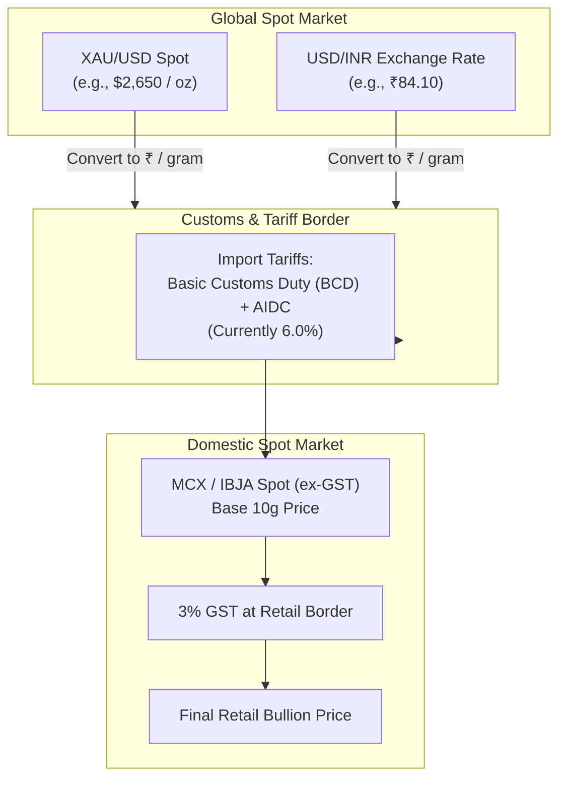
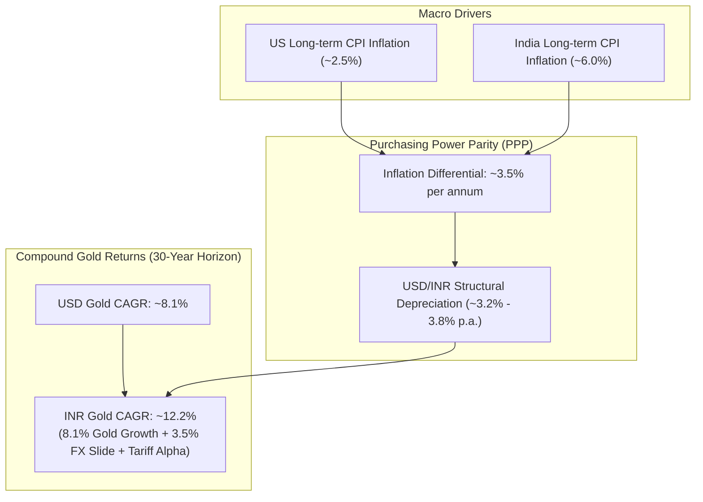
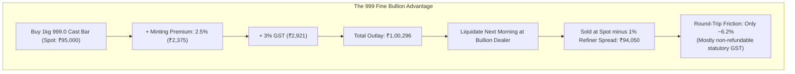
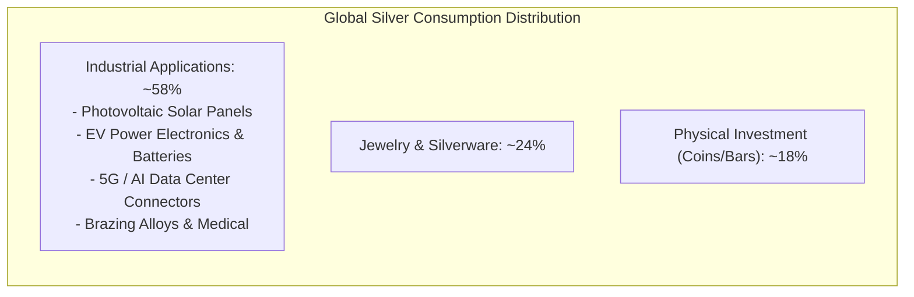

In Indian households, gold is treated as cultural sentiment. In global macroeconomics, gold is treated as a currency. But in engineering and finance, precious metals must be treated as what they truly are: **the only liquid financial asset on earth that carries zero counterparty risk.**

When we analyzed equity investing in [Index Fund Investing in India: The Engineer's Guide to Passive Wealth](/posts/index-funds-india), the core thesis was ruthless cost minimization: eliminate active manager fees, accept market returns, and let compounding operate unhindered.

When investing in gold and silver, investors routinely abandon this analytical rigor. They confuse consumption with capital preservation. They buy high-markup ornamental jewelry, pay exorbitant making charges, fall for city jeweller association pricing gimmicks, or blindly park capital in paper ETFs without reading the custodial fine print.

If you are allocating capital to precious metals as an economic insurance policy, you need to understand the underlying mechanics from first principles:
1. How domestic Indian gold prices are mathematically derived from international spot rates, FX shifts, and tariffs.
2. Why physical bullion coins and minted bars structurally outperform paper Gold ETFs over generational horizons.
3. Why buying 925 sterling silver from retail jewellers is a guaranteed 30% capital destruction on day one, and why investment-grade 999 fine silver is the only rational alternative.

Here is the seasoned investor's blueprint for navigating the Indian bullion market.

---

## 1. The Landed Cost Formula: How Indian Gold Prices Actually Work

A common question among retail buyers is: *"Why does gold in Mumbai or Delhi cost more than gold in London, Zurich, or New York?"*

Gold is globally priced in US Dollars per **Troy Ounce** ($1 \text{ oz t} = 31.1034768 \text{ grams}$). But domestic Indian spot prices (quoted by the Multi Commodity Exchange, or MCX, and the India Bullion and Jewellers Association, or IBJA) are quoted in Indian Rupees per **10 grams**.

The domestic price is not an arbitrary number set by local cartels. It is a strict mathematical derivative of international spot prices, currency exchange rates, government import tariffs, and local supply-demand basis.

### The Exact Mathematical Derivation

To calculate the landed cost of 999 fine gold per 10 grams:

$$\text{Landed Cost (₹/10g)} = \left( \frac{\text{XAU/USD} \times \text{USD/INR}}{31.1034768} \right) \times 10 \times (1 + \text{Import Duty Rate})$$

$$\text{Final Retail Spot (₹/10g)} = \text{Landed Cost} \times (1 + \text{GST}) \pm \text{Local Basis Premium/Discount}$$

Let us run the real numbers using baseline parameters:
- **International Spot:** $\$2,650.00$ per troy ounce
- **USD/INR Rate:** $₹84.15$
- **Total Import Duty:** $6.0\%$ (5% Basic Customs Duty + 1% Agriculture Infrastructure and Development Cess)
- **GST:** $3.0\%$

$$\text{Base Price per gram (USD)} = \frac{\$2,650}{31.1034768} \approx \$85.1995 / \text{g}$$

$$\text{Base Price per gram (INR)} = \$85.1995 \times ₹84.15 \approx ₹7,169.54 / \text{g}$$

$$\text{Base 10g Price} = ₹71,695.40$$

$$\text{Landed Price (with 6% duty)} = ₹71,695.40 \times 1.06 = ₹75,997.12$$

$$\text{Retail Spot (with 3% GST)} = ₹75,997.12 \times 1.03 = ₹78,277.03 \text{ per 10 grams}$$

### The July 2024 Tariff Shock: A Case Study in Policy Risk

Before the Union Budget of July 2024, India's effective import duty on gold was **15.0%** (10% Basic Customs Duty + 5% AIDC). The government abruptly slashed it to **6.0%** to curb cross-border smuggling.

Overnight, the landed cost equation contracted by $9\%$. 

Even though international gold in London held steady at $\$2,400/\text{oz}$, domestic gold prices on the MCX plunged from $\approx ₹73,500/10\text{g}$ to $\approx ₹68,000/10\text{g}$ in a matter of hours. Investors who did not understand the tariff component of the formula were baffled by why their gold "crashed" during an international bull market.

If you invest in gold in India, you are not just taking a position on international gold you are implicitly taking a position on Indian customs duty policy.

---

## 2. The Rupee Cushion: Why Domestic Gold Beats International Gold

Over the last 30 years (1995 to 2025), international gold denominated in US Dollars delivered a Compound Annual Growth Rate (CAGR) of roughly **8.1%**. 

Yet, during that exact same 30-year window, domestic gold denominated in Indian Rupees delivered a CAGR of **11.8% to 12.5%**.

Where did that extra ~4% annual return come from? 

It came from the **Rupee Cushion** the relentless, structural depreciation of the Indian Rupee against the US Dollar.

Under the economic doctrine of **Purchasing Power Parity (PPP)**, a currency with higher chronic domestic inflation must depreciate against a currency with lower inflation to maintain trade equilibrium. 

Because India's historical inflation has averaged ~6% compared to the US Federal Reserve's ~2.5% target, the INR naturally depreciates against the USD by roughly $3.2\% \text{ to } 3.8\%$ annually over multi-decade cycles (moving from ₹31.40/USD in 1995 to >₹84/USD today).

### The Sensitivity Matrix

Because the domestic price is a product of two variables ($P_{\text{USD}} \times E_{\text{INR}}$), gold acts as an automatic, localized currency hedge:

$$\Delta P_{\text{Domestic}} \approx \left( \frac{\partial P}{\partial P_{\text{USD}}} \Delta P_{\text{USD}} \right) + \left( \frac{\partial P}{\partial E_{\text{INR}}} \Delta E_{\text{INR}} \right)$$

| Market Event | International Dollar Gold ($P_{\text{USD}}$) | Rupee Exchange Rate ($E_{\text{INR}}$) | Net Domestic Impact in India |
| :--- | :--- | :--- | :--- |
| **Global Dollar Rally (Risk-off)** | Falls by -6% | Depreciates by +4% (INR weakens) | **Down only -2% (Cushioned)** |
| **Commodity Supercycle** | Rallies by +12% | Depreciates by +3% | **Surges by +15.4% (Amplified)** |
| **Stagflationary Indian Crisis** | Flat at 0% | Depreciates by +8% | **Gains +8% (Pure FX hedge)** |

For an Indian investor, gold is not merely a hedge against equity market crashes; it is an un-debaseable hedge against domestic currency inflation.

---

## 3. Physical Bullion vs. Gold ETFs: The Sovereign & Custodial Matrix

In the modern financial landscape, paper assets are marketed as superior to physical assets because of "convenience." You open a brokerage account, click a button, and buy a Gold ETF (Exchange Traded Fund). No storage problems, no bank lockers, no making charges.

For a swing trader or a 6-month tactical allocator, Gold ETFs are perfectly adequate. 

**For a serious, multi-decade capital preservationist, Gold ETFs are an illusion of security.**

```mermaid
graph TD
    subgraph PhysicalBullion["The Physical Bullion Model (Zero Counterparty Risk)"]
        Holder["Sovereign Individual"] --> PhysicalCoin["Physical 24K Minted Coin / Bar<br/>(Held in Direct Private Possession)"]
    end

    subgraph PaperSystem["The Paper Gold Chain (Layered Intermediary & Counterparty Risk)"]
        Investor["Investor (Beneficiary Claim)"] --> Broker["Demat / Broker (Zerodha / Groww)"]
        Broker --> Depository["Depository (NSDL / CDSL)"]
        Depository --> AMC["Asset Management Company (Nippon / HDFC / SBI)"]
        AMC --> Trustee["Trustee Company (Legal Oversight)"]
        Trustee --> Custodian["Third-Party Custodian Vault (Brink's / Sequel)"]
        Custodian --> GoldBar["Allocated 1kg Gold Bars (Under Vault Custody)"]
    end
```

### 1. Counterparty & Custodial Fragility

When you own a Gold ETF, you do not own gold. You own a fractional beneficiary entitlement to a trust administered by an Asset Management Company (AMC). 

Between you and the physical metal sits a chain of financial intermediaries:
$$\text{You} \rightarrow \text{Broker} \rightarrow \text{Depository (NSDL/CDSL)} \rightarrow \text{AMC} \rightarrow \text{Trustee} \rightarrow \text{Vault Custodian}$$

Every link in that chain is subject to regulatory intervention, capital controls, cyber disruptions, banking holidays, and legal freezes. If a major geopolitical crisis, sovereign financial stress, or systemic clearinghouse insolvency occurs, electronic paper claims can be halted, restricted, or cash-settled by executive decree.

Physical bullion has **zero counterparty risk**. It is not a liability on anyone else's balance sheet. It requires no electricity, no internet connection, and no clearinghouse approval to hold value.

### 2. The Compounding Drag of Expense Ratios

The primary argument against physical gold is the upfront minting charge (making charge). What retail investors fail to calculate is the insidious, compounding bleed of ETF Total Expense Ratios (TER).

- **Gold ETF Expense Ratio:** Typically $0.40\% \text{ to } 0.65\%$ annually.
- **Tracking Error:** Typically $0.10\% \text{ to } 0.25\%$ annually due to cash drag, portfolio rebalancing, and custodian auditing fees.
- **Total Annual Friction:** $\approx 0.55\% \text{ to } 0.80\%$ per year, deducted every single day from the NAV.

Contrast this with buying a certified **24K 999.9 minted bullion coin** (from refiners like MMTC-PAMP, BRPL, or accredited bullion houses):
- **Upfront Minting Charge:** $1.5\% \text{ to } 2.5\%$ (one-time fee).
- **Annual Maintenance Drag:** **0.00%**.

Let us examine the mathematical compounding over an investor's timeline:

| Holding Horizon | Physical Bullion (2.0% One-Time Fee) | Gold ETF (0.65% Annual Drag) | Net Winner |
| :--- | :--- | :--- | :--- |
| **1 Year** | Net Metal: 98.0% | Net Metal: 99.35% | ETF (+1.35%) |
| **3 Years** | Net Metal: 98.0% | Net Metal: 98.06% | Tie |
| **5 Years** | Net Metal: 98.0% | Net Metal: 96.79% | **Physical Bullion (+1.21%)** |
| **10 Years** | Net Metal: 98.0% | Net Metal: 93.68% | **Physical Bullion (+4.32%)** |
| **20 Years** | Net Metal: 98.0% | Net Metal: 87.76% | **Physical Bullion (+10.24%)** |
| **30 Years** | Net Metal: 98.0% | Net Metal: 82.21% | **Physical Bullion (+15.79%)** |

By Year 30, an ETF investor has surrendered nearly **16% of their entire physical gold weight** to fund management companies and custodian auditors! 

Physical bullion charges its toll at the door; paper ETFs charge you rent every day until you die.

### 3. The Physical Delivery Illusion: The 1kg Trap

Many investors take comfort in the fact that SEBI regulations permit physical redemption of Gold ETF units.

What they fail to read in the Scheme Information Document (SID) is the **Minimum Creation Unit**:
- For almost all Indian Gold ETFs, physical delivery requires a minimum redemption basket of **1,000 to 10,000 units**, which corresponds to **1 Kilogram of 995/999 gold**.
- At current market prices, 1 kg of gold represents an outlay of **₹78,00,000 to ₹80,00,000+ ($7.8M to $8M INR)**.

If you have ₹5,00,000 or ₹20,00,000 invested in a Gold ETF, you are contractually prohibited from taking physical delivery. You are locked into mandatory cash settlement. In a currency crisis where you actually need physical gold, you will be handed depreciating fiat currency.

### 4. The Sovereign Gold Bond (SGB) Reality

For years, Sovereign Gold Bonds (SGBs) issued by the Reserve Bank of India were the ultimate paper instrument: 2.5% annual interest, complete capital gains tax exemption at 8-year maturity, and zero storage fees.

However, the Indian Government recognized what economists pointed out from day one: **SGBs were a massive fiscal liability for the sovereign balance sheet.** 

Paying sovereign debt interest while underwriting 100% of gold's capital appreciation unbacked by actual physical gold reserves in RBI vaults was fiscally unsustainable. The government has ceased issuing new SGB tranches. 

With SGBs off the table for fresh allocations, the choice reverts to its historical purity: liquid paper proxies (ETFs) for short-term speculation, or physical bullion for sovereign generational wealth.

---

## 4. The Silver Imperative: Why 999 Fine Silver Beats 925 Sterling Silver

If retail gold investing is full of misconceptions, the retail silver market in India is outright predatory.

Walk into any traditional jewelry store in Chennai, Mumbai, Jaipur, or Kolkata. Ask to buy silver for investment. In nine out of ten cases, the sales associate will guide you toward silver dinner plates, decorative bowls, religious idols, or heavy silver chains made of **Sterling Silver (925)**.

They will point to the daily "Silver Board Rate" published by the local Jewellers Association (e.g., ₹95,000 / kg) and quote your purchase based on that price.

**Doing this is financial suicide. You are absorbing an immediate 25% to 35% capital haircut the moment you walk out the showroom door.**

```mermaid
graph TD
    subgraph SterlingTrap["The 925 Sterling Jewelry Trap"]
        Buy925["Buy 925 Silver (1,000g @ ₹95/g = ₹95,000)"]
        Making["+ Making Charges (₹20/g = ₹20,000)"]
        GST925["+ 3% GST (₹3,450)"]
        TotalPaid["Total Outlay: ₹1,18,450"]
        
        Sell925["Liquidate Next Morning at Jeweller"]
        LossMaking["- Making Charges Evaporate: -₹20,000"]
        LossGST["- GST Non-Recoverable: -₹3,450"]
        LossAlloy["- 7.5% Base Metal Deducted: -₹7,125"]
        LossTunch["- 4% 'Melting & Solder Loss': -₹3,800"]
        CashReturned["Net Cash Received: ₹84,075"]
        NetLoss["Immediate Capital Destruction: -29.0% (-₹34,375)"]
    end

    Buy925 --> Making --> GST925 --> TotalPaid
    TotalPaid --> Sell925
    Sell925 --> LossMaking --> LossGST --> LossAlloy --> LossTunch --> CashReturned --> NetLoss
```

### The Anatomy of the 925 Jeweller Arbitrage

1. **The Purity Illusion (The 7.5% Base Metal Haircut):**
   - Pure silver (Fine Silver) is denoted as **999 (99.9%)** or **999.9 (99.99%)**. It is chemically soft and ductile.
   - **Sterling Silver is 925 (92.5% silver)**. The remaining 7.5% is an alloy typically copper, nickel, or zinc added to give mechanical rigidity so utensils and jewelry hold their shape.
   - Yet, local jeweller associations routinely display a single "Silver Rate" that reflects pure bullion, while charging that full price for 925 items!
2. **The Making Charge Racket:**
   - On gold jewelry, making charges range from 6% to 14%.
   - On silver articles and jewelry, making charges range from **₹15 to ₹35 per gram**. At a silver price of ₹95/g, a ₹20/g making charge represents an instantaneous **21% markup** on the raw commodity!
3. **The Solder and "Tunch" Melting Deductions:**
   - Traditional silver utensils and jewelry require solder (kadai) to join seams and attach handles. Solder consists of cheap lead, cadmium, and zinc.
   - When you sell 925 silver back to a jeweller, they will never pay you 92.5% of the spot price. They will either:
     - Run a destructive fire assay / melt test and deduct an arbitrary **3% to 6% for "melting loss"**.
     - Discount the weight by 10% to 15% upfront for solder joints.
     - Refuse to refund a single rupee of making charges or GST.

### The 999 Bullion Solution: Pure Commodity Math

When you purchase **Investment-Grade 999 Fine Silver Bullion Bars** (100g, 250g, 500g, or 1kg cast bars from NABL/BIS-accredited refiners like MMTC-PAMP, Bangalore Refinery, or certified bullion houses):

| Dimension | 925 Sterling Articles / Jewelry | 999 / 999.9 Fine Silver Bullion Bar |
| :--- | :--- | :--- |
| **Silver Purity** | 92.5% (7.5% copper/base metals) | **99.9% to 99.99% pure elemental Ag** |
| **Upfront Making Charges** | ₹15 – ₹35 / gram (15% – 35% markup) | **₹2 – ₹3 / gram (2% – 3% minting spread)** |
| **Resale Solder Deductions** | 5% – 10% testing/melting penalty | **0.0% (Zero solder, verified assay bar)** |
| **Liquidity & Bid-Ask** | Illiquid; dependent on original jeweller | **Universally liquid across all bullion desks** |
| **Day-1 Resale Loss** | **-28% to -35% (Massive haircut)** | **-4% to -6% (Tight commercial spread)** |
| **Classification** | Decorative consumer luxury item | **Monetary & industrial asset allocation** |

Never buy silver from a jewelry counter for investment. You are paying artisan wages for labor that depreciates to zero the microsecond the invoice is generated. Buy certified 999 cast bars from bullion refiners at spot plus a tight minting spread.

---

## 5. Silver's Asymmetric Dual Nature: The Industrial Supercycle

While gold is an almost pure monetary asset (over 90% of gold sits in central bank vaults, private bullion reserves, or jewelry), silver is a **technological workhorse**.

More than **55% of global silver annual demand is strictly industrial**.

Silver possesses the highest electrical conductivity, thermal conductivity, and optical reflectivity of any metal in the periodic table. It cannot be substituted in mission-critical electronics without severe performance degradation:
1. **Photovoltaic Solar Cells:** Every solar panel manufactured globally uses silver paste to conduct electrical charges. Modern N-type TOPCon and HJT solar cells require 30% to 80% *more* silver per watt than legacy P-type cells.
2. **Electric Vehicles (EVs):** An electric vehicle uses roughly 25 to 50 grams of silver more than double the silver content of an internal combustion engine car for battery management systems, power electronics, and sensor switches.
3. **AI Data Centers and High-Speed Computing:** Server switches, PCB connectors, and high-frequency communication relays rely on silver plating to prevent latency and signal degradation under high thermal loads.

### The Structural Supply Deficit

According to data from the Silver Institute, global silver demand has exceeded total mine and scrap supply for four consecutive years. Primary silver mines are rare; over 70% of silver is mined as a secondary byproduct of copper, lead, and zinc mines. 

Because silver supply is price-inelastic (a mining company will not open an expensive copper mine simply because silver went up 20%), supply cannot quickly ramp up to meet industrial shortfalls.

### The Gold-to-Silver Ratio (GSR)

Savvy investors monitor the **Gold-to-Silver Ratio (GSR)**:

$$\text{GSR} = \frac{\text{Spot Price of Gold (per oz)}}{\text{Spot Price of Silver (per oz)}}$$

- **Historical Earth Crust Ratio:** $\approx 16:1$ (for every ounce of gold in the earth's crust, there are roughly 16 ounces of silver).
- **20th Century Historical Average:** $\approx 50:1 \text{ to } 60:1$.
- **Modern Range:** Has frequently traded between $75:1 \text{ and } 90:1$.

When the GSR spikes above $85:1$, silver is historically cheap relative to gold. Seasoned bullion allocators tilt their incremental precious metals purchases toward 999 silver, waiting for the inevitable mean-reversion cycle where silver outperforms gold on the upside due to its smaller market capitalization and higher industrial beta.

---

## 6. The Execution Checklist for Indian Investors

If you are structuring a physical precious metals allocation in India, execute with institutional discipline:

### 1. Purity and Certification Standards
* **Gold:** Insist on **24 Karat 999.9 purity** minted bars or coins with official **BIS Hallmarking** (featuring the 6-digit alphanumeric HUID Hallmark Unique Identification Number). Ensure the bar is encased in tamper-proof certicard packaging from an accredited refinery (e.g., MMTC-PAMP, BRPL, Kundan, or state-run refiners).
* **Silver:** Buy only **999.0 or 999.9 Fine Silver cast bars** with a stamped refinery weight, serial number, and purity assay certificate. Never purchase unhallmarked silver rounds from local bazaar jewellers.

### 2. Sizing and Liquidity Optimization
* **Avoid micro-units:** Buying 0.5g or 1g gold coins incurs high percentage minting premiums (often 8% to 12% above spot). The sweet spot for retail gold bullion is **5 grams, 10 grams, or 50 grams** (1.5% to 2.5% minting premium).
* **Silver sizing:** Buy **250g, 500g, or 1kg bars**. Avoid 10g silver coins where minting charges eat 10% of the metal value.

### 3. Tax Rules (Post-Budget 2024 Regime)
Precious metals taxation in India was restructured in the 2024 Union Budget:
* **Holding Period for Long-Term Capital Gains (LTCG):** Reduced from 36 months to **24 months**.
* **LTCG Tax Rate:** Standardized at **12.5% without indexation** (previously 20% with indexation).
* **Short-Term Capital Gains (STCG):** Holding for $< 24$ months is taxed at your marginal income tax slab.
* **GST:** A non-recoverable 3% GST applies to all physical gold and silver purchases upon invoicing.

### 4. Storage and Custody Architecture
* **The 3-Tier Storage Rule:**
  1. *Immediate Physical Reserve (Home Safe):* A modest quantity (1 to 2 months of household expenses in small gold coins) stored in a fireproof, bolted home safe for acute local emergencies.
  2. *Deep Reserve (Bank Locker):* High-value bullion stored in a Tier-1 public or private bank safe deposit locker. Remember: bank lockers are not insured against systemic events by default; consider third-party locker insurance.
  3. *Unallocated Diversification:* Never store all your physical bullion in a single physical location.

---

## Conclusion: Wealth That Cannot Be Programmed Away

In an era of sovereign debt expansion, central bank digital currencies (CBDCs), algorithmic banking halts, and layered counterparty risk, physical precious metals represent the ultimate financial anti-fragility.

Gold is not an investment to make you rich overnight. It is an insurance policy that guarantees you will never be poor.

Silver is its high-beta, industrial counterpart an indispensable technological element trading at an asymmetric historical discount to its sister metal.

If you choose to participate in this market:
- **Discard the paper illusion:** Avoid ETF expense ratios and custodial traps for long-term multi-decade reserves.
- **Reject the jewelry markup:** Do not subsidize retail jewellers by purchasing 925 sterling articles loaded with making charges and solder penalties.
- **Embrace pure bullion:** Accumulate certified 24K 999.9 gold and 999 fine silver bars, verify the mathematical landed cost formula, and hold your wealth outside the banking system.

True wealth is quiet, unencumbered, and permanent.
