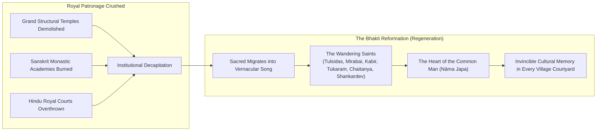
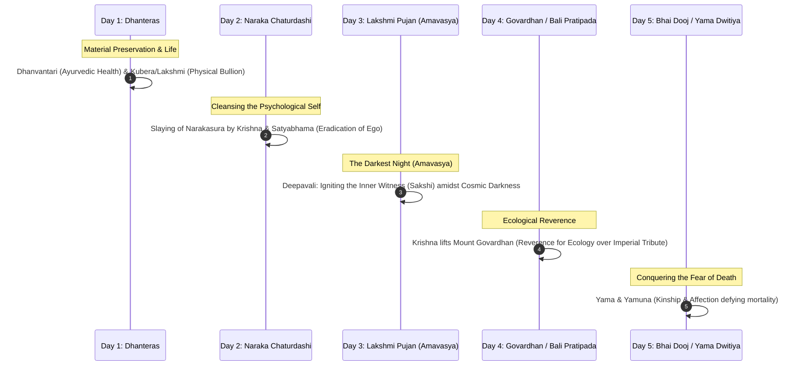

## 1. The Anomaly of Survival

Walk through the grand galleries of the British Museum, the halls of the Louvre, or the Pergamon in Berlin, and you are traversing a necropolis of human genius. 

Beneath climate-controlled glass and directional halogen spotlights lie the solemn relics of the ancient world. You behold the black basalt diorite of the Code of Hammurabi, the monumental winged bulls of Nineveh that once guarded the palaces of Ashurbanipal, the painted sarcophagi of Theban pharaohs, and the fragmented marble metopes ripped from the Parthenon. 

These artifacts command awe, but they also evoke a profound, quiet melancholia. They are dead. 

The societies that envisioned, quarried, and consecrated them have vanished from the face of the earth. In modern Alexandria and Cairo, no citizen recites the *Book of the Dead* to escort the soul through the underworld; the hieroglyphs ceased to speak to living human hearts until Jean-François Champollion deciphered the Rosetta Stone as an intellectual puzzle. In modern Athens, no priestess pours libations of honey and barley to Athena or Apollo atop the Acropolis; Olympus has been vacated for sixteen centuries. In Rome, the Temple of Vesta is a picturesque, roofless columned ruin where tourists take photographs; the sacred fire that was guarded for a thousand years was snuffed out forever by imperial decree in 394 CE. Across the Iranian plateau, the Zoroastrian fire temples of the Sassanian Empire were overwhelmed and extinguished, their sacred hymns preserved only in precarious diaspora.

Now, stand on the Manikarnika or Dashashwamedha Ghats along the Ganges in Varanasi at dawn.

The morning mist lifts over the arc of the river. A Brahmin youth, waist-deep in the cold water, cups his hands toward the rising sun and whispers the *Gāyatrī Mantra*:

> ॐ भूर्भुवः स्वः तत्सवितुर्वरेण्यं भर्गो देवस्य धीमहि धियो यो नः प्रचोदयात् ॥  
> *"O Splendor of the Cosmos, source of all illumination, we meditate upon Thy supreme light; may it awaken and inspire our intellect."*  
> — *Rig Veda (3.62.10)*

That verse was not excavated from a tomb by archaeologists. It was not deciphered through comparative philology. It has been recited in an unbroken oral chain along the banks of Indian rivers every single morning since the Bronze Age—chanted with the precise Vedic pitch (*Udātta*, *Anudātta*, *Svarita*) formulated along the Saraswati river when bronze was a cutting-edge technological alloy.

The German philosopher Georg Wilhelm Friedrich Hegel, struggling to classify India within his dialectical philosophy of history, famously dismissed it as a land existing outside linear historical progress—a timeless, stationary entity that seemed to defy the mortality that claimed all other nations. Later, in *The Story of Civilization*, Will Durant recognized the staggering gravity of what Hegel had observed:

> *"India was the motherland of our race, and Sanskrit the mother of Europe's languages: she was the mother of our philosophy; mother, through the Arabs, of much of our mathematics; mother, through the Buddha, of the ideals embodied in Christianity; mother, through the village community, of self-government and democracy. Mother India is in many ways the mother of us all."*

India is not merely an old country; it is the world’s sole surviving ancient continuum.

```
+-----------------------------------------------------------------------------------------+
| THE MORTALITY OF CIVILIZATIONS: A COMPARATIVE AUDIT                                     |
+===========================+==============================+==============================+
| Ancient Civilization      | Historical Fate              | Modern Status                |
+---------------------------+------------------------------+------------------------------+
| Mesopotamia (Sumer/Akkad) | Erased by Persian & Arab     | Archaeological exhibit; dead |
|                           | conquests; cuneiform died.   | languages (Sumerian/Akkadian)|
+---------------------------+------------------------------+------------------------------+
| Pharaonic Egypt           | Extinguished by Roman,       | Museum curiosities; demotic  |
|                           | Christian, & Arab invasions. | & hieroglyphs extinct.       |
+---------------------------+------------------------------+------------------------------+
| Classical Greece          | Swallowed by Roman conquest  | Pantheon abandoned; Athena   |
|                           | & Byzantine Christianization.| and Apollo worshipped by none|
+---------------------------+------------------------------+------------------------------+
| Imperial Rome             | Sacked by Germanic tribes;   | Architectural ruins; Latin a |
|                           | administrative collapse.     | liturgical ecclesiastical relict|
+---------------------------+------------------------------+------------------------------+
| Sassanian Persia          | Decapitated by Arab conquest;| Ancient Mazdaism displaced;  |
|                           | Zoroastrianism displaced.    | living thread largely severed|
+---------------------------+------------------------------+------------------------------+
| Indic Civilization        | Survived medieval invasions, | UNBROKEN: 1.4 billion living |
| (Sanātana Dharma)         | iconoclasm, and colonialism. | practitioners chanting Vedas.|
+---------------------------+------------------------------+------------------------------+
```

To explain this anomaly, colonial historians frequently resorted to caricatures of Indian fatalism, passivity, or geographic isolation behind the Himalayan barrier. But the historical record reveals the exact opposite: the Indian subcontinent was an epicenter of global maritime commerce, an exporter of philosophical schools across Asia, and the target of the most prolonged, relentless, and ideologically totalizing invasion campaigns in human history.

India survived not because it was shielded from historical violence, but because its civilizational operating system was built on an entirely different ontological and social blueprint than the fallen empires of antiquity.

The botanical metaphor of the **Akṣaya Vaṭa**—the Indestructible Banyan Tree—captures this architecture perfectly. A banyan tree does not depend on a single, centralized trunk for survival. It sends down aerial roots from its expansive branches into the soil. Over decades, those adventitious roots thicken into secondary and tertiary trunks. If an axe chops through the primary central bole, or if lightning incinerates the ancient base, the tree does not collapse. The secondary trunks have already anchored themselves deeply into the earth, drawing water, nourishing the canopy, and sending forth fresh foliage.

Indian civilization is an *Akṣaya Vaṭa*. It was engineered so that the political state (*Rājya*) was merely a transient protective canopy; the real civilizational engine was the society (*Samāja*)—decentralized, regenerative, and rooted in the soil of human consciousness.

---

## 2. What Differentiates the Indic Mind? The Architecture of Sanātana Dharma

Why did the civilizations of the Nile, the Tigris-Euphrates, and the Tiber snap like dry brittle timber when struck by catastrophe, while the Indic continuum bent, absorbed, endured, and regenerated?

The answer begins in the foundational epistemology of the Indic mind—an ontology radically distinct from the linear, creedal structures of the Western and Mediterranean worlds.

```mermaid
graph TB
    subgraph Abrahamic["The Monolithic Imperial Paradigm (Linear / Centralized)"]
        A_Time["Linear History (Creation -> Apocalypse)"]
        A_Truth["Exclusive Dogma (Single Prophet / Single Book)"]
        A_Structure["Hierarchical State-Church Imperium"]
        A_Failure["Vulnerability: Decapitation of the Center Destroys the System"]
        A_Time --> A_Truth --> A_Structure --> A_Failure
    end

    subgraph Dharmic["The Sanātana Paradigm (Cyclical / Polycentric Mesh)"]
        D_Time["Kāla Chakra (Cyclical Time, Yugas, Eternal Rhythm)"]
        D_Truth["Darśana (Experiential Perception: Ekam Sat Vipra Bahudha Vadanti)"]
        D_Purushartha["Integral Framework: Dharma, Artha, Kāma, Mokṣa"]
        D_Structure["Polycentric Society: Tirtha Grid, Guilds, Family Hearth"]
        D_Resilience["Resilience: Fault-Tolerant, Self-Healing, No Single Point of Failure"]
        D_Time --> D_Truth --> D_Purushartha --> D_Structure --> D_Resilience
    end
```



### The Tyranny of Linear Time vs. Kāla Chakra
Western and Near-Eastern civilizations were constructed upon an apocalyptic, linear temporal axis: a single creation event, a straight historical march toward a Day of Judgment, and an obsession with historical messianism. In such a paradigm, history is a high-stakes, brittle race. If an empire collapses, or if a church is conquered, the divine favor has been visibly revoked, and civilizational despair sets in.

The Indic mind operates within **Kāla Chakra**—the eternal wheel of cyclical cosmic time. 

Time is vast, measured in *Mahāyugas* and *Kalpas* spanning billions of solar years, matching the cosmological timescales of modern astrophysics. Creation (*Sṛṣṭi*), sustenance (*Sthiti*), and dissolution (*Pralaya*) follow one another with the natural, rhythmic certainty of the seasons. 

Because history is not a linear sprint toward a final apocalypse, the Indic mind never succumbed to existential panic when political fortunes collapsed. A dark age (*Kali Yuga*) was not the death of existence; it was an anticipated dip in the cosmic cycle, an invitation to intensify inner resistance, endure the winter, and await the inevitable regeneration of *Satya Yuga*. 

This gave the Hindu an astonishing temporal stoicism—an ability to out-wait, out-suffer, and out-live empires that measured their ambitions in decades or centuries.

### Experiential Truth (*Darśana*) vs. Exclusive Creed
Western religions were built on dogma: an intellectual subscription to a historical revelation given to a specific prophet at a specific coordinate in time, canonized in an exclusive book outside of which lies heresy and damnation. When the state enforced that book, the religion flourished; when an invader enforced another book, the entire population was converted at the tip of a sword or by royal decree.

Sanātana Dharma never recognized the concept of dogma. Its foundational texts are classified into:
- **Śruti** (that which is heard: the timeless, authorless vibrations of cosmic reality perceived by rishis in profound meditative absorption)
- **Smṛti** (that which is remembered: human laws, social customs, and institutions that are acknowledged to be time-bound, contextual, and subject to periodic revision).

Truth in the Indic world is called **Darśana**—literally, *"that which is seen."* It is experiential, empirical, and contemplative. The ultimate test of truth is not whether an ancient book commands it, but whether a human consciousness can verify it through direct spiritual realization (*Anubhūti*).

Because truth was experiential rather than institutional, the Rig Veda could utter the most revolutionary pluralistic manifesto in intellectual history:

> एकं सद्विप्रा बहुधा वदन्ति अग्निं यमं मातरिश्वानमाहुः ॥  
> *"Truth is One; the wise speak of it in varied ways—calling it Agni, Yama, or Mātariśvan."*  
> — *Rig Veda (1.164.46)*

This was not a reluctant political compromise or modern secular tolerance; it was an ontological axiom. If the Divine is infinite, non-dual, and omnipresent, then no single human vocabulary, no solitary prophet, no exclusive tribe, and no historical book can exhaust its infinite facets. 

The idea of killing another human being because they addressed the Supreme Reality by a different name, or worshipped through a different symbol, was recognized by the Indic intellect as a category error of the most infantile kind.

### The Fourfold Synthesis: The Puruṣārthas
Ascetic religions often withered because they severed the spiritual from the worldly; hedonistic empires crumbled because their material luxury corroded their moral vitality.

Sanātana Dharma achieved civilizational equilibrium by formulating the four **Puruṣārthas**—the four legitimate pursuits of human life:

```
                  [ MOKṢA ] - Spiritual Liberation (The Ultimate Goal)
                             ^
                             | (Guided by Ethics)
                  [ DHARMA ] - Cosmic Order, Duty, Righteousness
                   /        \
                  v          v
   [ ARTHA ] Material Wealth    [ KĀMA ] Aesthetic & Sensual Delight
   (Statecraft, Commerce,       (Arts, Love, Family, Culture)
    Industrial Abundance)
```

1. **Dharma**: Ethical alignment, righteousness, and cosmic responsibility.
2. **Artha**: The acquisition of material prosperity, enterprise, political power, and scientific competence.
3. **Kāma**: The pursuit of love, aesthetic delight, sensual joy, and cultural expression.
4. **Mokṣa**: The ultimate liberation of individual consciousness from the cycle of ignorance and mortality.

Under this magnificent architecture, Hinduism never condemned wealth or sensual beauty. The merchant financing a trade fleet to Rome or Southeast Asia was fulfilling *Artha*; the dancer sculpting gestures in the temple courtyard was fulfilling *Kāma*; the king defending the borders was fulfilling *Kshatra-dharma*; the sannyasi meditating in a mountain cave was pursuing *Mokṣa*. 

By integrating material abundance and spiritual transcendence into a seamless continuum, the civilization generated immense physical wealth without losing its transcendent compass.

### Decentralization of the Sacred
Most fatally for Rome, Egypt, and Persia, the sacred was centralized. Rome had its Pontifex Maximus and later the Papacy; Egypt had its Pharaoh who was the living god-king; Persia had the Sassanid Zoroastrian royal mobeds. 

Strike the emperor, capture the temple-palace complex, and the nervous system of the civilization died.

Sanātana Dharma had no Pope. It had no central Vatican, no single global council that issued catechisms, and no single city whose fall could terminate the religion. 

The sacred was radically decentralized. It was embedded in the family altar (*Pūjā Ghar*), the village banyan tree, the domestic kitchen fire, the wandering ascetic, and the local temple tank. The civilization was an invincible, distributed peer-to-peer network thousands of years before computer science formalized the term.

---

## 3. The Fire of Invasions and the Imperial Guillotine: Why Decapitation Failed

The resilience of an organism can only be measured by the virulence of the disease it repels. The survival of Indian civilization was forged in the most violent, multi-century trial by fire experienced by any culture in world history.

### The Medieval Crucible: The Fire and the Song
Beginning in the eighth century with Muhammad bin Qasim's incursions into Sindh, and intensifying with horrifying ferocity from the eleventh to the sixteenth centuries under Mahmud of Ghazni, Muhammad Ghori, the Delhi Sultanates, and the Mughal Empire, Northern India was subjected to a sustained campaign of iconoclastic destruction.

The devastation was ideological. Unlike conventional political conquests where an invading army replaces a tax collector while leaving temples and customs untouched, medieval invaders brought a theological mandate to extirpate idolatry (*Shirk*). 

The results were catastrophic:
- In 1193 CE, Bakhtiyar Khilji set fire to the monastic university of **Nalanda** in modern Bihar. Nalanda had nine million manuscripts; its library, *Dharmaganja*, burned for three continuous months. Thousands of Buddhist and Hindu monks were slaughtered in their monastic robes, obliterating the institutional epicenter of higher education across Asia.
- **Vikramashila**, **Odantapuri**, **Valabhi**, and **Jagaddala** were similarly wiped off the map.
- The great architectural centers of Northern India—the temple complexes of Varanasi, Mathura, Ayodhya, Somnath, Ujjain, and Thanesar—were systematically razed, their jewel-encrusted murtis shattered, and mosques erected upon their sanctified foundations.

Yet, despite nine centuries of foreign political dominance across the Gangetic plains, the population of India did not convert. 

Why did Persia convert from Zoroastrianism to Islam in less than two centuries, while India remained overwhelmingly Hindu?

The primary spiritual answer lies in the **Bhakti Movement**.



When royal courts fell and institutional Sanskrit universities were burned, the sacred did not perish; it migrated. It retreated into the vernacular poetry and music of the wandering Bhakti mystics:

- In the North, **Goswami Tulsidas** rewrote Valmiki’s Sanskrit epic into Awadhi as the *Ramcharitmanas*. Suddenly, the story of Rama was no longer locked in scholarly Sanskrit; it was sung on every village veranda, recited by illiterate farmers under banyan trees, and memorized by children in every household. Rama became the symbol of unyielding moral dignity against overwhelming tyrannical force.
- In Maharashtra, **Sant Tukaram**, **Jnaneshwar**, and **Eknath** sang abhangs along the banks of the Chandrabhaga, uniting peasant and artisan into the *Varkari* movement, worshipping Vithoba at Pandharpur with an egalitarian fervor that no military garrison could intimidate.
- In Bengal, **Chaitanya Mahaprabhu** filled the streets with *Sankīrtana*—collective ecstatic chanting that broke through caste hierarchies and transformed devotional remembrance into an uncontrollable public flood.
- In the South, **Basaveshwara** and the Vachana poets democratized access to the divine; **Purandara Dasa** and **Kanaka Dasa** anchored Kannada devotion; in Assam, **Mahapurush Srimanta Sankardev** established *Satras* (monastic community centers) that preserved Vaishnava drama, music, and philosophy across the Brahmaputra valley; in Rajasthan, **Mirabai** sang of an allegiance to Krishna that made the decrees of earthly kings look comical.

The Bhakti movement took the jewels of the Upanishads, forged them into vernacular songs, and planted them inside the chest of the humblest peasant. 

You could demolish a stone temple of sandstone and granite. But how do you demolish a temple of song that lives in the vocal cords of fifty million villagers? 

The invaders held the fortresses and the tax offices; the Bhakti saints held the soul of the subcontinent.

### The Armed Shield: The Reality of Military Resistance
A dangerous historical myth—often nurtured by colonial historians and amplified by naive post-colonial intellectuals—suggests that India survived purely through passive suffering and spiritual escapism.

As the great historian **R.C. Majumdar** documented across his monumental eleven-volume *The History and Culture of the Indian People*, India’s survival was paid for with a colossal, unrelenting river of Kshatriya blood.

India took nearly six hundred years to be partially subjugated. The Caliphate’s Arab armies swept across North Africa, Spain, and the entirety of the Persian Sassanid Empire in less than eighty years. Yet when they struck the borders of Sindh and Rajasthan in the eighth century, they were smashed and contained for three centuries by the confederacy of **Pratihara kings**, the **Chalukyas**, and **Bappa Rawal** of Mewar.

When the Sultanate finally breached Delhi, resistance erupted across the subcontinent:
- In the Deccan, the brothers Harihara and Bukka, guided by the sage Vidyaranya, founded the **Vijayanagara Empire** in 1336 CE—*"The City of Victory."* For more than two centuries, Vijayanagara stood as a colossal bastion of South Indian civilization, patronizing art, monumental temple architecture, and Vedic commentaries, ensuring that the temples of Madurai, Srirangam, Kanchi, and Thanjavur survived completely untouched by the iconoclasm that flattened the North.
- In Assam, the **Ahom Kingdom** defeated the Mughal armies in seventeen separate engagements. In 1671, at the famous Battle of Saraighat on the Brahmaputra, General **Lachit Borphukan** repelled the combined might of Aurangzeb's forces, ensuring that Northeast India remained an unbreached sanctuary of Dharmic culture.
- In the Western Ghats, **Chhatrapati Shivaji Maharaj** ignited the dream of *Hindavi Swarajya* (indigenous self-rule). Combining visionary guerrilla warfare (*Ganimi Kava*), naval power, administrative meritocracy, and deep devotion to Bhavani, Shivaji broke the psychological terror of the Mughal Empire. Within decades of his passing, the **Maratha Confederacy** surged across India, liberating the holy cities of Varanasi and Mathura, establishing control from Thanjavur in the south to the gates of Attock on the Indus river.

India did not survive because it was meek. India survived because its spiritual core was defended by generations of warriors who viewed the land not as mere territory, but as **Punya Bhūmi**—the sacred earth that was worth dying for.

### The British Colonial Project: Epistemic Violence and The Beautiful Tree
When the British East India Company consolidated control over India following the Battle of Plassey in 1757, they introduced a form of warfare far more insidious than the sword: **epistemic colonization**.

The material destruction was staggering. The British economic apparatus dismantled Indian village industries. Indian textiles were priced out through punitive duties, reducing the artisan to a landless laborer.

Simultaneously, they targeted the intellectual spine. The Indian civil philosopher **Dharampal**, through decades of painstaking research in British colonial archives, published his groundbreaking work, *The Beautiful Tree: Indigenous Indian Education in the Eighteenth Century*. 

Dharampal revealed a historical truth that stunned the post-colonial world: prior to British rule, India possessed an extensive, highly functional network of tens of thousands of indigenous village schools (*Gurukuls* and *Pathshalas*). In districts across Madras and Bengal surveyed by British administrators themselves in the 1820s, literacy rates were remarkably high, school enrollment was widespread across all castes, and education was supported by voluntary land endowments from local village revenues.

The British systematically defunded these village endowments, redirected tax revenues to the colonial treasury, and allowed the indigenous education system to wither into extinction.

In its place, they instituted the policy articulated by **Thomas Babington Macaulay** in his 1835 *Minute on Indian Education*:

> *"We must at present do our best to form a class who may be interpreters between us and the millions whom we govern; a class of persons, Indian in blood and colour, but English in taste, in opinions, in morals, and in intellect."*

Macaulay boasted that a single shelf of a good European library was worth the whole native literature of India and Arabia. Generations of elite Indians were educated to feel deep embarrassment for their heritage, to view the Vedas as primitive pastoral superstition, and to believe that civilization arrived on the subcontinent only on British merchant ships.

Yet, even this epistemic guillotine failed to sever the roots of the Banyan. 

The revival did not come from an imperial court; it came from the soil. Figures like **Swami Vivekananda**, roaring at the Parliament of Religions in Chicago in 1893, reawakened the dormant civilizational self-respect of the nation. **Sri Aurobindo** articulated the profound truth that India's nationalism was not a mechanical political construct, but *Sanātana Dharma* itself—the spiritual soul of the world striving for its rightful expression.

---

## 4. The Fabric That Binds: Sacred Geography, Ritual, and Festivals

How did an empire-less subcontinent, fragmented into dozens of competing regional kingdoms speaking languages as diverse as Tamil, Bengali, Marathi, and Punjabi, recognize itself as a singular civilizational reality thousands of years before passports and national anthems?

### Sacred Geography: The Landscape as Living Divinity
The answer lies in what Harvard scholar **Diana L. Eck** brilliantly coined as **Sacred Geography** in her work *India: A Sacred Geography*.

In the Indic vision, the physical geography of the subcontinent is not an accidental landmass; it is a living, conscious, consecrated body. 

```
                                [ Badrinath / Kedarnath ]
                                      (North Dham)
                                            |
         [ Dwarka ] -------------------+------------------- [ Puri Jagannath ]
        (West Dham)                    |                    (East Dham)
                                       |
                              [ Rameswaram ]
                               (South Dham)
```

India was bound together by a continental-scale grid of pilgrimage routes (*Tīrtha Yātrā*):
1. **The Chār Dhām**: Established by Adi Shankaracharya in the eighth century at the four cardinal extremities of the subcontinent: Badrinath in the icy peaks of the Himalayas, Rameswaram along the turquoise waters of the Indian Ocean, Dwarka on the western Arabian Sea, and Puri on the eastern Bay of Bengal. For twelve centuries, a simple farmer or merchant from Tamil Nadu felt his life incomplete until he had walked the length of the subcontinent to pour Ganges water over the Shivalinga in Rameswaram, and a pilgrim from Bengal traveled to Dwarka. In walking this sacred circuit, the pilgrim physically embodied the indivisible cultural geography of *Bharatavarsha*.
2. **The 51 Śakti Pīṭhas**: Mythologically rooted in the dismemberment of Sati's divine body by Vishnu’s Sudarshana Chakra, each fallen fragment sanctified the earth. The eyes fell at Nainital in the northern hills; the tongue at Jwalamukhi in Himachal; the heart at Baidyanath in Jharkhand; the reproductive organ (*Yoni*) at **Kamakhya** in the lush hills of Assam; the crown of the head at **Hinglaj Devi** in the rugged mountains of Balochistan (in modern Pakistan). Through the distributed map of the Shakti Peethas, the land itself was deified as the cosmic Mother. You cannot surrender or forget a territory when every mountain peak and riverbank is a limb of the Goddess.
3. **The 12 Jyotirlingas**: Stretching from Somnath in Gujarat and Mahakaleshwar in Ujjain, to Kedarnath in the Himalayas and Mallikarjuna in Andhra Pradesh, threading the diverse linguistic zones of the subcontinent into an electric grid of Shaiva consciousness.

When an Indian takes a morning bath, he recites the sacred river invocation:

> गङ्गे च यमुने चैव गोदावरि सरस्वति ।  
> नर्मदे सिन्धु कावेरि जलेऽस्मिन् संनिधिं कुरु ॥  
> *"O Sacred Rivers—Ganga and Yamuna, Godavari and Saraswati, Narmada, Sindhu, and Kaveri—grace this water with your divine presence."*

In that single verse, spoken by a woman drawing water from a well in a remote village in Kerala, the entire geographic expanse of India—from the Indus in the far northwest to the Kaveri in the deep south—is invoked, blessed, and preserved in living memory.

### Living Memory Through Festivals: The Multi-Sensory Convergence of Diwali
Sacred memory in India was not entrusted to cold stone monuments or archive vaults that could be destroyed by an invading army. It was encoded into **festivals**—multi-sensory, participatory, annual rhythms of communal life that renew the soul of the people.

There is no more profound demonstration of this distributed architecture than **Deepāvalī** (Diwali).



Diwali is not an isolated night of firecrackers; it is an integrated, five-day philosophical algorithm that systematically recalibrates human existence from the physical body to cosmic liberation:

1. **Dhanteras (Dhanatrayodaśī)**: The festival opens not in the clouds, but with bodily survival. It honors **Dhanvantari**, the physician of the gods and founder of Ayurveda, who emerged from the cosmic ocean bearing the vessel of immortality (*Amṛta*). The tradition recognizes that without biological vitality, spiritual pursuit is an impossibility. Only after health is invoked does the tradition welcome Lakshmi through the purchase of enduring precious metals—anchoring economic stability through physical gold and silver, a practice that preserved Indian family wealth across centuries of hyper-inflation, currency collapses, and foreign plunder.
2. **Naraka Chaturdashi**: The second day commemorates the destruction of the demon Narakasura. In Sanskrit, *Naraka* signifies hell, and *Asura* represents the bloated, tyrannical ego. The demon was vanquished by Krishna acting as the charioteer to his wife **Satyabhama**, demonstrating the essential balance of the masculine and feminine in destroying systemic evil. The pre-dawn oil bath (*Abhyaṅga Snān*) represents the physical and psychic scrubbing away of accumulated egoic pride.
3. **Lakshmi Puja on Amavasya**: The climax of Diwali occurs on the darkest night of the autumn month: **Kartika Amavasya**. 
   
   The choice of the darkest night is deliberate: it is effortless to shine when the moon illuminates the sky; the real spiritual test is to generate your own light when external reality is plunged into absolute blackness. 
   
   Families clean their homes and place rows of flickering clay lamps (*Mitti ke Diye*) on every sill. They invoke **Lakshmi**—not as vulgar currency to be hoarded, but as **Śrī**: the divine principle of auspiciousness, grace, agricultural fertility, and ethical abundance.
4. **Govardhan Puja & Bali Pratipada**: The fourth day marks an intellectual and ecological revolution. When Krishna urged the villagers of Gokul to abandon the appeasement rituals to Indra, the distant king of the heavens, he instructed them to revere the immediate, physical ecosystem that nourished them: **Mount Govardhan**, the pastures, the cattle, and the forests. 
   
   When Indra unleashed catastrophic storms in retaliation, Krishna lifted the mountain on his finger, sheltering every villager, bird, and beast. It was an unmistakable declaration of **ecological reverence** over transactional ritualism. 

   Simultaneously, the day celebrates *Bali Pratipada*, honoring King Bali, reminding rulers that even the greatest imperial power and generosity must remain humble before the cosmic law (*Vamana*).
5. **Bhai Dooj (Yama Dvitīyā)**: The algorithm concludes at the hearth of human love. Legend recounts that **Yama**, the relentless god of death, visited his sister **Yamuna** on this day. She fed him, welcomed him with an oil lamp, and applied the sacred vermilion to his brow. Touched by her unconditional affection, Yama granted her a boon: any brother who receives the blessing of a sister on this day shall be freed from the terror of untimely death. The bond of love neutralizes the fear of mortality.

Observe the extraordinary regional polymorphism woven into this single festival:
- In Ayodhya and North India, it is the triumphant return of **Shri Rama and Sita** after fourteen years of forest exile.
- In the Deccan and South India, it is the dawn victory of **Krishna and Satyabhama** over Narakasura.
- In Bengal, while the rest of India welcomes the gentle, golden Lakshmi, the courtyards are illuminated for **Maa Kali**—the naked, fearsome, cosmic Mother who dances upon the chest of Shiva, wielding a sword to sever the human head from the ego.
- In Jainism, it is the sacred anniversary of **Bhagwan Mahavira** attaining *Mokṣa* (final liberation) at Pavapuri in 527 BCE.
- In Sikhism, it is celebrated as **Bandi Chhor Divas**—commemorating Guru Hargobind Ji walking out of Gwalior prison, refusing freedom until he had secured the release of fifty-two Hindu kings imprisoned by the Mughal state.

In any other civilization, these wildly divergent mythological and philosophical traditions would have triggered sectarian inquisitions and holy wars. 

In India, they interlock harmoniously. A Sikh lighting lamps at the Golden Temple in Amritsar, a Bengali bowing before Kali in Kolkata, a Jain meditating in Palitana, and a family welcoming Rama in Ayodhya are all participating in the exact same civilizational symphony: **the triumph of Light over Darkness, Knowledge over Ignorance, and Dharma over Tyranny.**

---

## 5. Civilizational Continuity vs. Modernity: The Living Synthesis

As India enters the twenty-first century, a familiar colonial critique has resurfaced in modern academic guise: Can an ancient civilization, freighted with thousands of years of ritual and mythology, survive the corrosive solvent of hyper-individualism, secular globalization, and artificial intelligence? Must India abandon its ancient memory to become a modern technological nation?

This false binary—tradition versus progress—stems from a profound misunderstanding of what Sanātana Dharma has always been.

Sanātana Dharma was never a brittle, static museum piece preserved in formaldehyde. It was an evolving, self-correcting river that renewed itself through a perpetual process of internal churning: **Manthan**.

```
                           THE DIALECTIC OF MANTHAN
                                 (Self-Correction)
                                         |
     [ Vedic Ritualism ] --------------> | <-------------- [ Upanishadic Philosophy ]
                                         |
                                         v
     [ Structural Orthodoxies ] -------> | <-------------- [ Bauddha & Jaina Critiques ]
                                         |
                                         v
     [ Medieval Encroachment ] --------> | <-------------- [ Bhakti Vernacular Surge ]
                                         |
                                         v
     [ Colonial Enslavement ] ---------> | <-------------- [ Renaissance of Vivekananda &
                                         |                  Sri Aurobindo ]
                                         v
               THE CONTEMPORARY SYNTHESIS: SANĀTANA YET NŪTANA
                 (Timeless Wisdom Driving Cutting-Edge Science)
```

Whenever the civilization began to ossify into mechanical ritualism or social rigidity, the corrective impulse emerged not from external conquerors, but from within its own philosophical core:
- When the late Vedic period drifted into pedantic ritualism, the **Upanishadic rishis** arose to declare that rituals are unstable rafts (*plavā hyete adṛḍhā yajñarūpāḥ*), redirecting the human intellect toward the non-dual realization of *Brahman*.
- When social structures threatened to turn rigid, **Gautama Buddha** and **Mahavira** emerged from the soil of the subcontinent to reassert ethical intentionality, non-violence (*Ahiṃsā*), and psychological contemplation.
- When institutional temples were destroyed, the **Bhakti saints** shattered caste barriers and democratized divine love.
- When British colonialism attempted to reduce India to intellectual inferiority, **Swami Vivekananda**, **Sri Aurobindo**, **Rabindranath Tagore**, and **Mahatma Gandhi** retrieved the gems of the Upanishads, the Bhagavad Gita, and Buddhist ethics to forge the intellectual architecture of national liberation.

The Sanskrit language captures this dynamic balance through two words: **Sanātana** (that which is eternal and timeless) and **Nūtana** (that which is modern, dynamic, and ever-fresh). 

Dharma does not command you to freeze the world in the first century. It commands you to ground your consciousness in the timeless *Rta* (cosmic truth), and then build the most advanced mathematics, the most sophisticated software, the most just statecraft, and the most magnificent cities possible.

India sending space probes to the south pole of the Moon (*Chandrayaan-3*) while the mission scientists visit a temple to offer prayers is not a cognitive contradiction; it is the natural, healthy posture of an integrated civilizational consciousness. 

The Western mind, scarred by historical wars between ecclesiastical dogma and scientific inquiry (Galileo, the Inquisition), assumes that science and spirituality must forever remain sworn enemies. 

In the Indic world, science (*Vijñāna*) and spiritual realization (*Jñāna*) were twin wings of the same bird. Astronomy, mathematics, metallurgy, linguistics, and medicine (Ayurveda) were pursued by the very rishis who composed the philosophical Upanishads. 

India does not need to abandon its civilizational soul to master the machine; it needs to master the machine with its civilizational soul, lest the machine consume the human spirit.

---

## 6. The Awakening of the Civilizational State

On August 15, 1947, the political entity known as the Republic of India was born out of the catastrophic trauma of Partition. 

For decades, the dominant political discourse attempted to treat India as a "young nation" born on that midnight hour—a Westphalian nation-state created by constitutional fiat, having little organic connection to the sacred memory of the millennia that preceded it.

That reductionist view is crumbling.

India is not a nation-state born in 1947. India is an ancient **Civilizational State** that has recovered its political sovereignty after centuries of eclipse.

A nation-state is defined by rigid territorial borders, a uniform passport, a centralized language, and a monopoly on violence. A Civilizational State is defined by an unbroken continuum of spiritual, philosophical, and cultural values that encompass a vast family of languages, traditions, and ecosystems.

As the twenty-first century confronts the catastrophic limits of unchecked consumer capitalism, ecological collapse, the loneliness epidemic of digital atomization, and the existential perils of machine intelligence, the survival of Indian civilization ceases to be a historical curiosity. 

It becomes an indispensable sanctuary of wisdom for the entire human race.

The modern world is starving for what the Indic continuum preserved:
- It needs **Ekam Sat Vipra Bahudha Vadanti** to dismantle the totalitarian dogmas that tear human societies apart.
- It needs **Vasudhaiva Kuṭumbakam** (*"The entire earth is a single family"*) to transcend hyper-nationalistic warmongering.
- It needs **Prakṛti Reverence** (the worship of rivers, trees, and mountains) to halt the psychopathic ecological exploitation of the biosphere.
- It needs **Yoga and Dhyāna** to heal the fractured, hyper-stimulated, anxious human mind and return it to the serene sanctuary of the **Sākṣī**—the inner witness consciousness.

The Eternal Banyan has weathered the monsoons of five thousand years. 

Its leaves were scorched by the fires of burning libraries; its ancient branches were chopped by foreign swords; its sap was drained by colonial empires. Yet, deep in the subterranean soil of the subcontinent, its roots held fast. They drank from the silent waters of the Vedas; they were nourished by the devotional songs of the saints; they were shielded by the courage of its warriors.

Today, those aerial roots have settled into the earth. The ancient bole is pulsing with new life. Fresh green shoots are reaching toward the dawn.

The empires that arrived to conquer her—the Greeks under Alexander, the Huns under Toramana, the Sultanates, the Mughals, the British Empire upon which the sun allegedly never set—have all dissolved into the dustbins of history, their names remembered only on faded paper and broken stone.

Yet the Banyan stands.

On the darkest night of autumn, thirty million courtyards are ablaze with light. A child cups their hands around a clay lamp to protect it from the wind. An elder whispers a mantra to the stars. 

The flame that was lit on the banks of the Saraswati has never been extinguished. 

It burns still. It will burn forever.

---

### Foundational References & Intellectual Heritage

1. **Eck, Diana L.** (2012). *India: A Sacred Geography*. Harmony/Random House. (The seminal work on the continental pilgrimage grid and the cultural geography of Bharatavarsha).
2. **Dharampal.** (1983). *The Beautiful Tree: Indigenous Indian Education in the Eighteenth Century*. Biblia Impex / Other India Press. (Archival documentation of the destruction of the decentralized Indian education network).
3. **Durant, Will.** (1935). *The Story of Civilization: Vol. I — Our Oriental Heritage*. Simon & Schuster. (A sweeping philosophical recognition of India's foundational contributions to global civilization).
4. **Sri Aurobindo.** (1920 / 1953). *The Foundations of Indian Culture*. Sri Aurobindo Ashram, Pondicherry. (The definitive defense of the spiritual and institutional architecture of Indic civilization).
5. **Majumdar, R. C.** (Gen. Ed.). (1951–1977). *The History and Culture of the Indian People* (Vols. I–XI). Bharatiya Vidya Bhavan, Bombay. (The monumental, multi-volume authoritative history of India's intellectual, cultural, and military resilience).
6. **Tulsidas, Goswami.** (c. 1576 CE). *Ramcharitmanas*. (The Awadhi vernacular epic that sustained Northern Indian cultural memory across centuries of institutional iconoclasm).
7. **Patnaik, Utsa.** (2018). *"Revisiting the Drain, or Transfer from India to Britain in the Context of Global Diffusion of Capitalism"*. Columbia University Press. (Empirical documentation of the $45 trillion colonial extraction).
8. **Vanamali.** (2023). *"Why We Celebrate Diwali"*. *The Adiveda Newsletter*, Substack. (Spiritual and philosophical unpacking of Deepavali and the triumph of inner illumination).
