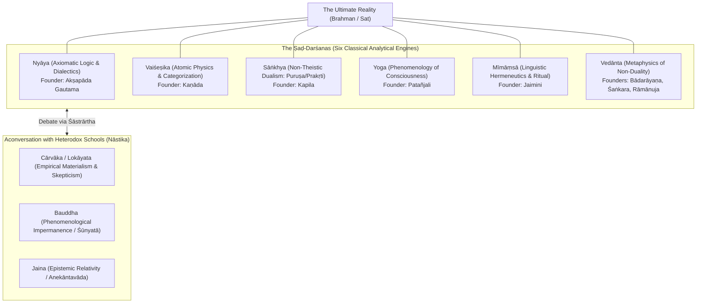
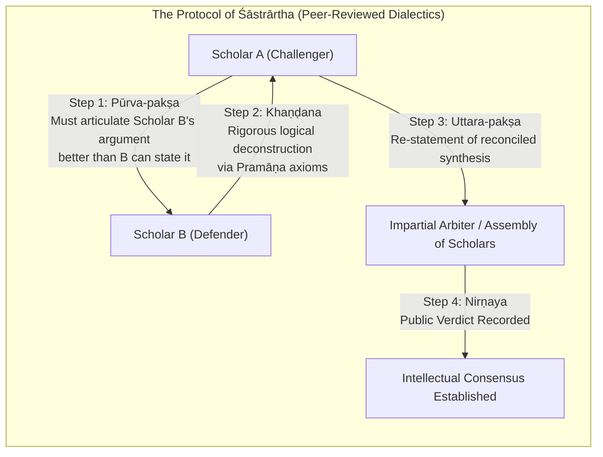

## 1. The Core Architecture: Open Source vs. Closed-Source Metaphysics

In modern software engineering, two incompatible paradigms govern the digital universe. 

On one side stands the **proprietary, closed-source system**: a centralized corporate entity holds exclusive copyright over a locked master repository. The binary executable is distributed to end-users who are forbidden from inspecting, modifying, or decompiling the source code. The software demands complete subservience to its license agreement. Any attempt to introduce foreign modules, patch the kernel independently, or run unapproved applications triggers a security exception invalidation, revocation, and permanent exclusion from the network.

On the other side stands the **open-source architecture**: there is no solitary author, no walled garden, and no administrative central server. The core kernel is transparent and public. Anyone is free to inspect the fundamental code, test it in the laboratory of their local environment, optimize specific modules for localized hardware, and create independent branches (*forks*) to address unique operational requirements. 

Translate this structural polarity from computing into the history of comparative religion, and you uncover the deepest, most radical difference between the Abrahamic creeds and the Indic spiritual continuum: **Sanātana Dharma is humanity’s original, self-correcting, open-source epistemic architecture.**

```
+----------------------------------------------------------------------------------------+
| COMPARATIVE METAPHYSICAL ARCHITECTURE                                                  |
+===========================+==============================+=============================+
| Structural Dimension      | Closed-Source Creed          | Open-Source Dharma          |
+---------------------------+------------------------------+-----------------------------+
| Origin & Authorship       | Single historical founder;   | Apauruṣeya (Authorless);    |
|                           | exclusive revelation.        | discovered cosmic laws.     |
+---------------------------+------------------------------+-----------------------------+
| Epistemic Validation      | Credo (Blind belief in an    | Anubhava (Direct empirical  |
|                           | unchallengeable dogma).      | experiential realization).  |
+---------------------------+------------------------------+-----------------------------+
| Governance Model          | Central Vatican/Caliphate;   | Polycentric, distributed    |
|                           | apostolic hierarchy.         | community of practitioners. |
+---------------------------+------------------------------+-----------------------------+
| Response to Dissent       | Heresy, apostasy, excom-     | Śāstrārtha (Peer-reviewed   |
|                           | munication, holy war.        | public dialectical debate). |
+---------------------------+------------------------------+-----------------------------+
| Modular Extensibility     | Locked canon; scriptural     | Forkable Sampradāyas;       |
|                           | literalism; closed book.     | Smṛti deprecation protocols.|
+---------------------------+------------------------------+-----------------------------+
```

A closed-source creed relies on linear historical revelation: an omnipotent creator reveals a final, unalterable text to an exclusive prophet at a single point in spacetime. Salvation is binary: allegiance to the proprietary developer guarantees eternal paradise; running foreign spiritual software guarantees eternal damnation. 

In radical contrast, the Indic kernel was never claimed to be invented by anyone. The foundational insights of the Vedas are classified as **Apauruṣeya** literally, *"unauthored by any human agency."* 

Just as Isaac Newton did not "invent" gravity but merely formulated mathematical equations for a physical law that operated long before humanity walked the earth, the ancient *Rishis* (seers) of the Vedic tradition did not invent Dharma. Through profound contemplative absorption (*Samādhi*), they perceived the eternal, vibrational resonance of cosmic order (*Ṛta*).

Because truth in the Indic world is an objective cosmic reality rather than a private copyright, Sanātana Dharma never developed the concept of **heresy**. 

In the Western ecclesiastical lexicon, questioning the divine word is a mortal sin punishable by the stake or the sword. In the Indic lexicon, questioning the divine is the foundational prerequisite of wisdom. 

Consider the climactic verses of the **Nāsadīya Sūkta** (the Hymn of Creation in the Rig Veda 10.129). Where a closed-source scripture demands unquestioning obedience to a creation narrative, the Vedic rishi looks directly into the cosmic void and concludes with breathtaking philosophical agnosticism:

> को अद्धा वेद क इह प्र वोचत्कुत आजाता कुत इयं विसृष्टिः ।  
> अर्वाग्देवा अस्य विसर्जनेनाथा को वेद यत आबभूव ॥  
> इयं विसृष्टिर्यत आबभूव यदि वा दधे यदि वा न ।  
> यो अस्याध्यक्षः परमे व्योमन्सो अङ्ग वेद यदि वा न वेद ॥  
> 
> *"Who really knows? Who will here proclaim it? Whence was it produced? Whence is this creation?  
> The gods came afterwards, with the creation of this universe. Who then knows whence it has arisen?  
> Whence this creation has arisen perhaps it formed itself, or perhaps it did not 
> He who surveys it all from highest heaven, he verily knows or perhaps even he does not know!"*  
> *Rig Veda (10.129.6–7)*

Imagine a foundational sacred text that explicitly ponders whether the Supreme Architect of the cosmos Himself might not fully comprehend the ultimate mystery of existence! 

This single hymn immunizes the Indic mind against the poison of intellectual totalitarianism. 

Faith is not *credo* the Latin submission of the intellect to an irrational assertion. Faith in the Indic paradigm is **Śraddhā** a provisional trust in a working hypothesis, held until verified through the direct, reproducible laboratory of human consciousness (**Anubhava**).

---

## 2. The Multi-Engine Logic: The Ṣaḍ-Darśanas and Epistemic Pluralism

If an operating system is to run across heterogeneous hardware, it must support modular execution engines. A single compiler cannot process every workload.

Sanātana Dharma achieved continent-scale philosophical endurance because it institutionalized the **Ṣaḍ-Darśanas** the Six Classical Systems of Indian Philosophy. These six systems are not competing sects warring for monopoly; they are six distinct computational lenses trained on reality, ranging from rigorous mathematical dualism to transcendent non-dual idealism.



Observe the staggering ontological breadth of these six engines:

1. **Nyāya (Axiomatic Epistemology & Logic)**: Founded by Akṣapāda Gautama, Nyāya is the debug environment of Indic thought. It dissects the anatomy of thought itself, establishing formal syllogisms (the five-member syllogism: *Pratijñā*, *Hetu*, *Udāharaṇa*, *Upanaya*, *Nigamana*) and identifying cognitive fallacies (*Hetvābhāsa*).
2. **Vaiśeṣika (Atomic Pluralism & Physics)**: Founded by Sage Kaṇāda, this system posits that the physical universe is composed of indivisible, indestructible atoms (*Paramāṇu*) combining into dyads and triads. It organizes all perceptible phenomena into seven ontological categories (*Padārthas*).
3. **Sāṅkhya (Radical Non-Theistic Dualism)**: Conceived by Sage Kapila, Sāṅkhya needs no personal God to explain creation. It models the cosmos through two co-eternal principles: **Puruṣa** (pure, unattached consciousness) and **Prakṛti** (dynamic, primordial matter governed by the three gunas: *Sattva*, *Rajas*, *Tamas*). Creation is the mechanical unfolding of matter in the proximity of consciousness.
4. **Yoga (The Empirical Science of Consciousness)**: Codified by Patañjali in the *Yoga Sūtras*, Yoga takes the theoretical architecture of Sāṅkhya and turns it into an applied psychological technology. Its definition of purpose is starkly clinical: *Yogaś citta-vṛtti-nirodhaḥ* "Yoga is the intentional cessation of the involuntary fluctuations of the mind-field."
5. **Pūrva Mīmāṃsā (Linguistic Hermeneutics)**: Founded by Jaimini, this school is an obsessive investigation into the physics of acoustic resonance, the eternal nature of the word (*Śabda*), and the ethical potency of sacrificial action (*Dharma*).
6. **Uttara Mīmāṃsā (Vedānta)**: Spanning the non-dualism of Adi Shankaracharya (**Advaita**), the qualified non-dualism of Ramanujacharya (**Viśiṣṭādvaita**), and the profound dualism of Madhvacharya (**Dvaita**), Vedānta addresses the ultimate integration of the individual soul (*Jīva*) with the cosmic substrate (*Brahman*).

### The Toleration of Radical Materialism: The Cārvāka Dialogue
In medieval Europe, Giordano Bruno was burned alive at the stake in 1600 for suggesting an infinite universe with inhabited worlds. In the Islamic world, philosophers who questioned prophetic revelation walked in mortal terror of apostasy laws.

In the Indic ecosphere, an openly atheist, aggressively materialist school flourished for centuries: **Cārvāka** (or *Lokāyata*). 

The Cārvākas rejected the Vedas, mocked rituals, denied reincarnation, denied karma, and proclaimed that consciousness was merely a chemical byproduct of physical elements:

> यावज्जीवेत्सुखं जीवेद् ऋणं कृत्वा घृतं पिबेत् ।  
> भस्मीभूतस्य देहस्य पुनरागमनं कुतः ॥  
> 
> *"While life remains, let a man live happily; let him borrow money and drink ghee!  
> When the body has once been turned to ashes, how can there be any return?"*  
> *Sarva-Darśana-Saṃgraha*

Did the Brahmins burn the Cārvāka philosophers? Were their books banned by royal inquisitions?

Never. The Cārvāka school was invited into the royal courts and university halls of Nalanda and Ujjain as an **honored, indispensable debate partner**. 

Every major treatise of Hindu philosophy including Madhava Vidyaranya’s 14th-century *Sarva-Darśana-Saṃgraha* devotes its opening chapter to a meticulous, respectful, and devastatingly rigorous presentation of the Cārvāka philosophy. 

Why? Because Indic philosophers understood an essential computational law: **If your metaphysical thesis cannot withstand the merciless stress-testing of a hard-nosed materialist, your thesis is defective.**

### The Engine of Validation: The Pramāṇa System
This epistemic rigor was anchored in the **Pramāṇa** system the formal taxonomy of valid means of acquiring knowledge:

```
  [ THE HIERARCHY OF EPISTEMIC PROOF (PRAMĀṆAS) ]
  1. Pratyakṣa (Direct Sensory Perception / Contemplative Observation)
  2. Anumāna   (Logical Deductive & Inductive Inference)
  3. Upamāna   (Analogy, Comparison, and Pattern Recognition)
  4. Arthāpatti (Postulation / Derivation from Contextual Circumstance)
  5. Anupalabdhi (Non-perception / Negative Cognitive Verification)
  6. Śabda     (Verbal Testimony of Proven, Verified Experts)
```

No Guru, no King, and no scripture was immune to the *Pramāṇas*. If an assertion violated direct sensory perception (*Pratyakṣa*) or contradicted sound deductive logic (*Anumāna*), it could not claim the status of truth, no matter how many ancient names were stamped on it.

---

## 3. Version Control: Śruti, Smṛti, and the Built-in Deprecation Protocol

The primary reason civilizations decay into ideological fossilization is **scriptural literalism**.

When a society declares that a single book written in a specific desert or city two thousand years ago contains the absolute, perfect, unalterable rules for all human behavior across all subsequent millennia, it plants the seeds of its own cultural stagnation. 

Society changes; technology advances; ethical sensibilities expand. If the holy book cannot be amended because it is the literal dictation of an angry deity, society faces an impossible choice: either commit cognitive dissonance by violently forcing bronze-age ethics onto modern reality, or watch the entire civilizational framework shatter.

Sanātana Dharma solved this software engineering problem thousands of years ago by decoupling the operating system into two distinct architectural tiers: **Śruti** and **Smṛti**.

```
+-------------------------------------------------------------------------------+
| THE INDIC SOFTWARE STACK: DECOUPLED PERSISTENCE LAYERS                        |
+-------------------------------------------------------------------------------+
  APPLICATION TIER (The Smṛtis: User-Space Applications)
  - Social laws, civil governance, cultural rituals, dietary rules
  - Calibrated strictly to Deśa-Kāla-Pātra (Space, Time, Context)
  - EXPLICITLY DEPRECATED & REWRITTEN across Yugas
  - Examples: Manu Smṛti, Yājñavalkya Smṛti, Parāśara Smṛti
  -----------------------------------------------------------------------------
  KERNEL TIER (The Śrutis: Core Operating System)
  - Fundamental, authorless cosmic truths (Apauruṣeya)
  - The nature of Consciousness, Brahman, Atman, Karma, Mokṣa
  - IMMUTABLE, invariant physical & metaphysical laws
  - Examples: The Ṛg, Sāma, Yajur, Atharva Vedas; The Principal Upanishads
+-------------------------------------------------------------------------------+
```

### The Invariable Kernel (*Śruti*) vs. The Mutable Driver (*Smṛti*)
- **Śruti** (The Core Kernel): Comprising the Vedas and the Upanishads, Śruti represents the immutable cosmic laws. The statement *Aham Brahmāsmi* ("I am the Infinite Consciousness") or *Tat Tvam Asi* ("Thou art That") are fundamental metaphysical laws, identical in their invariability to the laws of thermodynamics. They do not change whether you are riding a chariot in Kurukshetra or coding neural networks in Bengaluru.
- **Smṛti** (The User-Space Code): Comprising legal codes (*Dharmaśāstras*), epics (*Itihāsas*), and regional narratives (*Purāṇas*), Smṛtis govern daily social conduct, inheritance laws, dietary habits, and civic governance.

Here is the revolutionary architectural clause that prevents dogmatic fossilization: **The Smṛtis carry an intentional, built-in deprecation protocol.**

The tradition explicitly declares that Smṛtis are calibrated strictly to **Deśa-Kāla-Pātra** geography (*Deśa*), historical era (*Kāla*), and individual circumstance (*Pātra*). 

What was an appropriate social law for an agrarian clan living along the Saraswati in 2000 BCE is recognized as completely obsolete for an industrial or technological society in 2026 CE.

The tradition formalized this versioning through the doctrine of **Yuga Dharma**:
- For the *Satya Yuga*, the code of Manu was authoritative;
- For the *Tretā Yuga*, the code of Gautama held sway;
- For the *Dvāpara Yuga*, the code of Śaṅkha-Likhita governed;
- For the *Kali Yuga*, the ancient texts themselves state that the **Parāśara Smṛti** replaces previous codes:

> कृते तु मानवा धर्मास्त्रेतायां गौतमाः स्मृताः ।  
> द्वापरे शाङ्खलिखिताः कलौ पाराशराः स्मृताः ॥  
> 
> *"For the Kṛta age, the laws of Manu are ordained; for the Tretā, the laws of Gautama;  
> for the Dvāpara, those of Śaṅkha and Likhita; and for the Kali age, the laws of Parāśara."*  
> *Parāśara Smṛti (1.24)*

The text openly announces its predecessors' deprecation! 

When a modern social reformer like Dr. B.R. Ambedkar critiqued discriminatory passages in historical legal texts, or when medieval saints discarded ritual orthodoxies, they were not destroying Hinduism from the outside; **they were executing the native deprecation protocol of the Smṛti architecture.**

A Hindu is never bound to ancient sociological manuals. The kernel (*Śruti*) remains untarnished; the user-space applications (*Smṛti*) must be continually refactored, patched, and rewritten to reflect the expanding moral and intellectual horizons of humanity.

---

## 4. The Peer-Review Protocol: Śāstrārtha and the Tradition of Dialectical Debate

In closed-source creeds, orthodoxy is preserved by decree. An ecclesiastical synod meets behind closed doors, excommunicates the dissenting faction, declares anathema upon divergent interpretations, and relies on the secular arm of the state to enforce compliance.

In the Indic framework, intellectual legitimacy was established through an institutionalized peer-review protocol known as **Śāstrārtha** (systematic, public, rule-governed philosophical debate).



### The Etiquette of Pūrva-pakṣa
Modern political and intellectual discourse is poisoned by bad faith: strawmanning, ad-hominem attacks, and intentional misrepresentation of the opponent's view.

The Indic tradition of *Śāstrārtha* prohibited this through a rigorous three-step dialectical methodology:

1. **Pūrva-pakṣa (The Opponent's Thesis)**: Before you were permitted to criticize a rival philosopher, you were obligated by the rules of debate to articulate their position with complete, exhaustive accuracy. In fact, classical etiquette demanded that you state the opponent’s argument **with greater lucidity, charity, and strength** than they themselves had presented it. If the opponent did not nod in agreement that you had captured their view completely, you were disqualified from debating.
2. **Khaṇḍana (Refutation)**: Once the rival’s stance was authentically established, you deployed the *Pramāṇas* logic, empirical evidence, linguistic analysis to demonstrate where their axioms broke down, where contradictions emerged, and why their ontological assumptions were inadequate.
3. **Uttara-pakṣa (The Consequent Synthesis / Resolution)**: Having cleared the intellectual field, you presented your own positive thesis (*Siddhānta*), showing how it preserved what was valid in the opponent’s view while transcending its limitations.

This was not a parlor game; it was the mechanism of civilizational governance. 

Kings did not determine which philosophy was true. The King sat as an observer in the royal assembly, while philosophers engaged in debates that lasted weeks before thousands of spectators. 

When **Gārgī Vācaknavī** stood up in the 8th century BCE in the court of King Janaka of Videha to challenge Sage **Yājñavalkya**, she did not ask for permission because she was a woman. She fired blistering, rapid-fire cosmological cross-examinations at the greatest sage of the age, demanding to know what fabric wove space itself:

> यदिदं सर्वमप्स्वोतं च प्रोतं च, कस्मिन्नु खल्वाप ओताश्च प्रोताश्चेति...  
> *"Since all this world is woven, warp and woof, upon water, upon what, then, is water woven, warp and woof?"*  
> *Bṛhadāraṇyaka Upaniṣad (3.6.1)*

Yajnavalkya answered step by step through the elements, until she pushed him to the absolute horizon of language: *"Upon what, then, is the world of Brahman woven, warp and woof?"* 

Yajnavalkya smiled and warned her: *"Gargi, do not question too far, lest your head fall off! You are questioning beyond the divinity that lies beyond question."* 

Gargi stood tall before the assembly and proclaimed Yajnavalkya the undisputed master of Brahman. It was an intellectual duel of absolute equality, recorded in the sacred canon for eternity.

When **Adi Shankaracharya** embarked on his pan-Indian debate tour in the eighth century, he did not raise an army. He walked into the home of **Maṇḍana Miśra**, the foremost titan of the rival ritualist Mīmāṃsā school. 

Who was appointed as the sole, supreme, impartial judge of this historic debate? 

Maṇḍana Miśra’s brilliant wife, **Ubhaya Bhāratī**. 

She placed garlands of fresh flowers around both debaters’ necks, decreeing that whoever’s garland began to wither first under the heat of intellectual agitation and anger had lost the debate. When her husband’s garland withered, Mandana Mishra accepted defeat and became Shankara’s disciple. 

Then Ubhaya Bharati stood up and challenged Shankara herself: *"You have defeated only one half of Mandana; I am his other half. You cannot claim victory until you have debated me!"*

Where in the ancient or medieval world was intellectual merit, gender equality, and rigorous dialectical debate elevated to such dizzying heights of civilizational honor?

---

## 5. User-Generated Devotion: Iṣṭa-Devatā, Kuladevatā, and Decentralized Modularity

In a closed-source creed, the user interface is locked. There is one form of prayer, one orientation (facing Jerusalem or Mecca), one language of authentic scripture (Latin, Arabic), and one canonical representation of holiness.

Sanātana Dharma treats the human psyche with clinical, psychological sophistication. It understands that no two human minds possess the exact same temperament, psychological conditioning, intellectual capacity, or aesthetic inclination.

This reality is governed by the doctrine of **Adhikāra** (individual readiness and spiritual orientation). To force a highly intellectual, analytical mind into an emotional, weeping devotional ritual is psychological violence; to force an intensely devotional, heart-centered personality into dry abstract syllogisms is equally futile.

The Indic architecture solved this through the revolutionary concept of the **Iṣṭa-Devatā** (The Chosen Form of the Divine).

```
                    [ NIRGUṆA BRAHMAN ] - The Transcendent Substrate
                                 |
                 (Filtered through Human Perception)
                                 v
                    [ SAGUṆA BRAHMAN / ĪŚVARA ]
       +-------------------------+-------------------------+
       |                         |                         |
       v                         v                         v
   [ ŚIVA ]                  [ VIṢṆU ]                 [ DEVĪ ]
Cosmic Dissolution,       Preservation, Grace,      Primal Dynamic Energy,
Ascetic Meditation         Avataric Descent          Fierce Compassion
```

Because the Supreme Reality (*Nirguṇa Brahman*) is formless, infinite, and beyond mental categories, it projects itself into the human consciousness as **Saguṇa Brahman** the Divine endowed with forms, qualities, and relationships.

You are free to choose the interface that speaks directly to your inner heart:
- If your soul resonates with austere, silence-soaked meditation, you worship **Śiva** on the icy peaks of Kailash.
- If your soul resonates with royal righteousness, compassionate order, and moral duty, you worship **Rāma**.
- If your soul resonates with playful, intoxicating love and transcendent joy, you worship **Kṛṣṇa**.
- If your soul resonates with primal, maternal, fierce protection that slashes through egoic illusion, you worship **Durgā** or **Kālī**.
- If your intellect seeks wisdom and artistic eloquence, you worship **Sarasvatī**.

This modularity explains why an Indian household can sit together at a single altar where the father is a devotee of Shiva (*Śaiva*), the mother is a devotee of the Goddess (*Śākta*), and the son is a devotee of Krishna (*Vaiṣṇava*). 

There are no family schisms. There are no religious wars inside the house. 

The family understands what the Western world has struggled for centuries to grasp: **You are not worshipping different rival gods; you are accessing the exact same Infinite Substrate through different localized API endpoints.**

### The Process of Sanskritization vs. Extirpation
When Christianity arrived in Northern Europe, the sacred oak groves of Thor were cut down by Saint Boniface; the ancient gods were branded as demonic agents of Satan; the druids were slaughtered; and indigenous folklore was stamped out. When Islam spread across Arabia and North Africa, indigenous polytheistic shrines were smashed, tribal idols smashed, and sacred memories severed.

How did Sanātana Dharma spread across the Indian subcontinent?

It utilized the organic, non-violent process that sociologist M.N. Srinivas identified as **Sanskritization** a process of mutual reverence, integration, and cross-pollination.

When the Vedic civilization encountered local forest tribes, pastoral communities, and river clans, it did not proclaim: *"Your gods are demonic illusions; burn them and accept our scripture!"* 

Instead, the Indic mind looked upon the local tribal deity a river spirit, a sacred serpent (*Nāga*), a stone under a banyan tree, or a fierce local mother-goddess (*Grāmadevatā*) and whispered: 

*"We recognize this sacred light. This local goddess you worship is an auspicious manifestation of the cosmic Mahādevī! Let us learn your songs, and let us weave your rituals into the great fabric of the Purāṇas."*

- **Lord Jagannāth** of Puri one of the four supreme cardinal *Dhāms* of Hinduism did not begin as a classical Sanskrit deity. He was originally a tribal deity (*Nīlamādhava*) worshipped by the indigenous **Śabara** forest dwellers of Odisha. The classical tradition did not eradicate the tribal shrine; it elevated the wooden tribal icon into the Lord of the Universe, and to this day, the primary hereditary servitors who touch and dress Jagannath are the **Daitapatis** the direct descendants of the original tribal forest people.
- **Kṛṣṇa** was born into a pastoral community of cowherds (*Yādavas*), his dark skin reflecting the indigenous beauty of the land.
- **Murugan** (Subrahmaṇya), the beloved god of the Tamil landscape, was seamlessly integrated as the son of Shiva and brother of Ganesha, his worship unifying the northern and southern emotional contours of the subcontinent without extinguishing a single Tamil cultural idiom.

Sanātana Dharma did not conquer by erasing the local; it preserved the local by deifying it.

---

## 6. The Forking Phenomenon: How Buddhism, Jainism, and Sikhism Branched without Total Rupture

In the open-source software ecosystem, when a development community experiences a fundamental ideological divergence regarding how the system should evolve, developers do not declare holy war or burn each other's workstations. 

They execute a **fork**.

A team clones the master repository, creates a new branch, strips away the components they consider redundant, optimizes for specific operational parameters, and launches an independent project. Over decades, if the fork discovers profound performance optimizations, the parent project often folds those architectural enhancements back into the mainline trunk.

This software engineering workflow maps with mathematical precision to the emergence of **Buddhism**, **Jainism**, **Sikhism**, and **Vīraśaivism** from the womb of the Indic civilizational continuum.

```mermaid
graph TD
    subgraph Master["The Indic Master Repository (Sanātana Dharma)"]
        Veda["Vedic Cosmology & Experiential Yoga"]
        Dharma["The Axiom of Dharma & Karma"]
        Atman["The Metaphysics of Ātman & Brahman"]
    end

    subgraph Fork1["The Bauddha Fork (c. 500 BCE)"]
        Buddha["Gautama Buddha"]
        B_Change["Deprecates: Vedic Ritual Authority & Permanent Self (Anattā)"]
        B_Optimize["Optimizes: Phenomenological Mindfulness, Radical Compassion (Karuṇā)"]
    end

    subgraph Fork2["The Jaina Fork (Ancient / Mahāvīra)"]
        Jina["Bhagwān Mahāvīra & Tīrthaṅkaras"]
        J_Optimize["Optimizes: Absolute Ahiṃsā, Anekāntavāda (Epistemic Pluralism)"]
    end

    subgraph Fork3["The Khālsā Fork (1699 CE)"]
        Sikh["Guru Gobind Singh & Guru Granth Sahib"]
        S_Optimize["Optimizes: Sant-Sipāhī (Saint-Soldier), Casteless Martial Defense"]
    end

    Master ==>|git checkout -b buddhism| Fork1
    Master ==>|git checkout -b jainism| Fork2
    Master ==>|git checkout -b sikhism| Fork3

    Fork1 -.->|Merged back: Ahimsa, monasticism, Buddha in Dashavatara| Master
    Fork2 -.->|Merged back: Vegetarianism, non-absolutism (Syādvāda)| Master
    Fork3 -.->|Shared substrate: Bhakti hymns, Rama/Govinda in Gurbani| Master
```

### The Buddhist Branch
When Gautama Buddha sat beneath the Bodhi tree in Bodh Gaya, he did not introduce a foreign theology from across the oceans. He used the foundational Indic terminology: *Dharma*, *Karma*, *Saṃsāra*, *Nirvāṇa*, *Dhyāna*. 

What was his fork? 

The Buddha executed an architectural branch to optimize for individual psychological liberation:
- He stripped away the heavy, expensive outer apparatus of Vedic sacrificial ritualism (*Yajña*), which had become socially burdensome.
- He rejected the caste barriers that were calcifying around ritual hereditary entitlement.
- He bypassed metaphysical speculation on a Creator God and focused ruthlessly on the clinical eradication of human suffering (*Duḥkha*).

Was Buddhism treated as an enemy religion? 

For centuries, Nalanda and Vikramashila housed Buddhist and Hindu scholars living in adjacent rooms, dining in the same mess halls, and debating dialectics with furious intellectual brilliance. 

And look at the civilizational merge: Over centuries, Hinduism absorbed the core optimizations of the Buddhist fork. The profound ethics of **Ahiṃsā** (non-violence) were integrated deeply into mainstream Hindu practice; Buddhist monasticism influenced the founding of the Advaita *Mathas* by Adi Shankaracharya; and the civilization eventually folded Gautama Buddha himself into the **Daśāvatāra** revering him as an incarnation of Vishnu who descended to teach compassion to all living beings.

### The Jaina Branch
Jainism preserved an ancient, austere branch emphasizing absolute ascetic purity and the doctrine of **Anekāntavāda** (the multi-faceted nature of reality). 

Through the famous parable of the blind men and the elephant, Jaina philosophy demonstrated that every dogmatic human assertion is merely a partial, relative perspective (*Syādvāda*). 

This philosophical refinement was embraced by the broader Indic mind as a primary weapon against dogmatism, while the Jaina insistence on vegetarianism and environmental sanctity permanently shaped the culinary and ethical landscape of India.

### The Sikh Branch
In the seventeenth century, when Northern India was convulsing under the religious persecution of the Mughal emperor Aurangzeb, the tenth master, **Guru Gobind Singh**, founded the **Khālsā** at Anandpur Sahib.

What was the Khalsa? It was a specialized, militant, saint-soldier (*Sant-Sipāhī*) fork designed to defend the innocent against imperial tyranny. 

The *Guru Granth Sahib* the living eternal Guru of the Sikhs is a magnificent, composite monument of open-source devotion. Alongside the sublime verses of Guru Nanak and the Sikh Gurus, the scripture reverently enshrines the devotional poetry of fifteen non-Sikh Hindu and Muslim saints from across the subcontinent: **Bhagat Kabir**, **Bhagat Ravidas**, **Bhagat Namdev** of Maharashtra, **Bhagat Jaidev** of Bengal, and **Bhagat Ramanand**.

The scripture rings out with the names of the divine: *Hari*, *Rāma*, and *Govinda* are invoked thousands of times. It was an elite, martial protective shield forged from the spiritual DNA of Sanātana Dharma to protect the freedom of human consciousness.

In the Indic world, forks do not burn the master repository. They enrich it.

---

## 7. The Algorithmic Future of Faith in the 21st Century

We stand on the threshold of a historical inflection point. 

The twenty-first century is dismantling the brittle epistemologies of the past. 
- In theoretical physics, quantum mechanics has shattered the classical Cartesian-Newtonian worldview of a mechanical universe made of isolated billiard balls, replacing it with a reality of non-local entanglement, probabilistic wave functions, and observer-dependent phenomena that mirror the Upanishadic declarations of *Māyā* and *Brahman*.
- In cognitive neuroscience, researchers are abandoning the naive materialist assumption that consciousness is an accidental byproduct of brain matter, gravitating toward integrated information models that echo the phenomenological insights of *Advaita* and *Yoga*.
- In global sociopolitics, the imperial arrogance of mono-cultural worldviews is collapsing under the undeniable reality of an interconnected, multi-polar civilization.

In this climate, the **closed-source proprietary creeds** are entering an existential crisis. 

When your theology rests on an unchallengeable historical miracle, a six-thousand-year-old cosmological timeline, a geocentric biology, and an exclusive franchise on heaven, every advance in evolutionary biology, astrophysics, and historical criticism acts as a fatal virus crashing the operating system. You are forced to build increasingly desperate apologetic firewalls to protect the flock from cognitive dissonance.

Sanātana Dharma faces no such crisis. 

It has nothing to fear from the telescope of the astrophysicist, the particle accelerator of the physicist, or the brain scan of the neuroscientist. 

When science discovers that the universe is billions of years old, the Hindu smiles and points to the cosmic cycles of the *Kalpas*. 

When physics reveals that matter and energy are interchangeable vibrations ($E=mc^2$), the Hindu nods and chants of *Śiva-Śakti* consciousness dancing with energy. 

When artificial intelligence forces humanity to reconsider what constitutes the nature of mind, the Hindu pulls Patañjali’s *Yoga Sūtras* and Shankara’s *Vivekachudamani* off the shelf and explains the fundamental distinction between the computational mechanics of the intellect (*Buddhi*) and the self-luminous, non-algorithmic light of the Witness (*Sākṣī*).

Sanātana Dharma does not ask you to believe. It invites you to **explore**. 

It is not an ideology you defend with fanaticism; it is an open-source framework of algorithms you execute within yourself:
- If you seek clarity of intellect, execute **Jñāna Yoga**.
- If you seek emotional surrender and the transcendence of loneliness, execute **Bhakti Yoga**.
- If you seek ethical mastery in the storm of modern enterprise, execute **Karma Yoga**.
- If you seek direct, empirical mastery of your subconscious mind, execute **Rāja Yoga**.

The code is public. The documentation has been verified by millennia of masters. The compiler is your own heart and mind.

The empires of exclusive dogma built monumental stone cathedrals and imperial fortresses, believing their walls would hold forever. Today, their stones crumble, their pews stand empty, and their doctrines fracture under the light of modern reason.

Yet the open-source faith of the Saraswati still flows. 

It flows because you cannot destroy an architecture that has no central server. You cannot execute an author who was never born. You cannot burn a code that runs in the very nature of human awareness.

Sanātana Dharma stands not as the relic of an ancient past, but as the **algorithmic future of human spirituality** timeless (*Sanātana*), ever-fresh (*Nūtana*), and open to every soul walking under the stars.

---

### Foundational Treatises & Primary Citations

1. **Rig Veda Samhitā.** (c. 1500–1200 BCE). *Mandala 10, Sukta 129 (The Nāsadīya Sūkta)* & *Mandala 1, Sukta 164, Rik 46 (Ekam Sat Vipra Bahudha Vadanti)*.
2. **Patañjali.** (c. 400 CE). *Pātañjala Yogasūtra*. (The classical foundational phenomenology of the eight limbs of Yoga: *Aṣṭāṅga Yoga*).
3. **Śaṅkarācārya.** (c. 8th Century CE). *Brahmasūtra-Śāṅkarabhāṣyam* & *Vivekacūḍāmaṇi*. (The crowning apex of Advaita Vedāntic non-duality and experiential verification).
4. **Mādhava Vidyāraṇya.** (14th Century CE). *Sarva-Darśana-Saṃgraha*. (The exhaustive, peer-reviewed encyclopedia of sixteen Indian philosophical systems, beginning with Cārvāka).
5. **Dharampal.** (1983). *The Beautiful Tree: Indigenous Indian Education in the Eighteenth Century*. Biblia Impex. (Archival documentation of decentralized community-supported Indic education networks).
6. **Sri Aurobindo.** (1920 / 1953). *The Foundations of Indian Culture*. Sri Aurobindo Ashram, Pondicherry. (The master philosophical exposition of the spiritual, artistic, and political architecture of Sanātana Dharma).
7. **Srinivas, M. N.** (1952). *Religion and Society among the Coorgs of South India*. Oxford University Press. (The foundational sociopolitical formulation of the organic concept of *Sanskritization*).
8. **Guru Arjan Dev (Compiler).** (1604 CE). *Adi Granth / Guru Granth Sahib*. (The universal Indic synthesis of Bhakti poetry across languages, traditions, and backgrounds).
