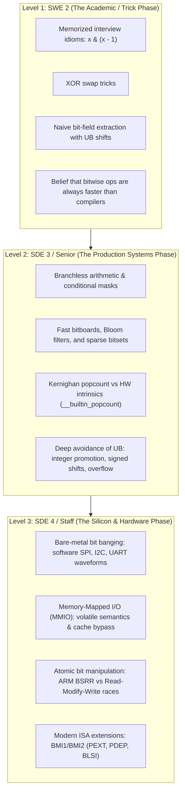

When you are a junior engineer (SWE 2), bit manipulation feels like dark magic. 

You encounter it in competitive programming problems or whiteboard interviews: clearing the lowest set bit with `x & (x - 1)`, checking for powers of two, or swapping two integers without a temporary variable using `a ^= b ^= a ^= b`. You think writing complex one-line bitwise expressions makes you look clever.

Then you deploy that code to production. 

Your "clever" XOR swap causes a silent segmentation fault or undefined behavior when two pointers alias the same memory address. Your bit-shift mask silently overflows on 32-bit integers because of C integer promotion rules. Your non-atomic bitwise OR on a hardware control register corrupts a motor controller during an interrupt service routine.

By the time you reach Senior (SDE 3) and Staff/Principal (SDE 4), your perspective inverts completely. 

You no longer care about clever tricks to impress interviewers. You care about **correctness, portability, mechanical sympathy, and the physics of the silicon**. You understand that:
1. **Bit Hacking** is the art of manipulating numbers at the register level using pure algorithmic boolean algebra (branchless code, population counts, bit-smearing, bitboards).
2. **Bit Banging** is the craft of emulating hardware transmission protocols (SPI, I2C, UART) in raw software by manually toggling physical GPIO pins with microsecond precision.
3. Compilers (LLVM, GCC) are often smarter than you at algebraic simplification, but they rely on you to avoid the catastrophic landmines of undefined behavior (UB).

Here is the unfiltered engineering journey of bit manipulation: the mental models, the battle-tested patterns, the silent traps, and the transition from software abstractions down to bare-metal registers.

---

## The Progression: SWE 2 to SDE 4



---

## 1. The SWE 2 Foundation: The Primitives and Their Illusions

Every computer architecture built on the von Neumann model provides six fundamental bitwise operators in hardware ALU instructions:
- `&` (Bitwise AND): Returns `1` only if both operand bits are `1`. (Intersection / Masking).
- `|` (Bitwise OR): Returns `1` if either operand bit is `1`. (Union / Setting).
- `^` (Bitwise XOR): Returns `1` if the operand bits differ. (Difference / Toggling / Parity).
- `~` (Bitwise NOT / One's Complement): Inverts every bit.
- `<<` (Logical / Arithmetic Left Shift): Shifts bits left, filling low bits with `0`. (Equivalent to multiplying by $2^n$ for unsigned integers).
- `>>` (Right Shift): Shifts bits right. (Logical shift fills high bits with `0`; arithmetic shift preserves the sign bit).

### The First Classic: Isolating, Setting, and Clearing Bits

In junior code, you constantly see three fundamental idioms:

```c
#include <stdint.h>
#include <stdbool.h>

// Set bit k (0-indexed)
static inline uint32_t set_bit(uint32_t x, uint8_t k) {
    return x | (1U << k);
}

// Clear bit k
static inline uint32_t clear_bit(uint32_t x, uint8_t k) {
    return x & ~(1U << k);
}

// Toggle bit k
static inline uint32_t toggle_bit(uint32_t x, uint8_t k) {
    return x ^ (1U << k);
}

// Test bit k
static inline bool test_bit(uint32_t x, uint8_t k) {
    return (x & (1U << k)) != 0;
}
```

> [!WARNING]
> Notice the literal: `1U << k`, not `1 << k`. 
> In C, `1` is a signed 32-bit `int`. If `k == 31`, `1 << 31` sets the sign bit of a signed integer, which is **Undefined Behavior** under the ISO C standard prior to C23! Always append `U` or `ULL` to bit-shift literals.

---

### The Interview Favorite: Two's Complement and `x & -x`

In two's complement arithmetic, the negative of a signed integer is formed by inverting all bits and adding 1:

$$-x = \sim x + 1$$

Consider what happens to the lowest set bit when you invert and add one:
- All bits below the lowest set bit are `0`. Inverting them turns them to `1`. Adding `1` ripples a carry through them, turning them back to `0`.
- The lowest set bit was `1`. Inverting it makes it `0`. The carry turns it back into `1`.
- All bits above the lowest set bit are inverted and unaffected by the carry.

When you compute `x & (-x)`, every bit cancels out **except the lowest set bit**:

```
x:         0010 1100   (44)
~x:        1101 0011
~x + 1:    1101 0100   (-44)
--------------------
x & -x:    0000 0100   (Isolates the bit at position 2, value = 4)
```

Similarly, subtracting `1` from `x` flips the lowest set bit to `0` and turns all lower zeros into ones. Therefore, `x & (x - 1)` **clears the lowest set bit**:

```
x:         0010 1100   (44)
x - 1:     0010 1011   (43)
--------------------
x & (x-1): 0010 1000   (40: Lowest set bit removed!)
```

This leads to the ubiquitous power-of-two check:

```c
// Returns true if x is a power of 2 (1, 2, 4, 8, 16...)
static inline bool is_power_of_two(uint32_t x) {
    // If x is a power of 2, it has exactly one bit set.
    // Clearing that bit must yield zero. x must also not be zero.
    return (x != 0) && ((x & (x - 1)) == 0);
}
```

---

## 2. The Junior Landmines: The Undefined Behavior Trapdoor

The hallmark of a SWE 2 is writing bit hacks that work fine on their local x86_64 Mac, but randomly explode in a release build on ARM or RISC-V. 

Here are the four deadly traps that every systems engineer learns the hard way.

### Trap 1: Shifting by the Width of the Type (or Greater)

Look at this common function written to extract a range of $n$ bits starting at bit offset $p$:

```c
// DANGEROUS / BUGGY IMPLEMENTATION
uint32_t naive_getbits(uint32_t x, uint8_t p, uint8_t n) {
    // Attempting to generate a mask of n ones:
    uint32_t mask = ~(~0U << n); 
    return (x >> (p + 1 - n)) & mask;
}
```

What happens when a caller asks for all 32 bits (`n = 32`)?

`~0U << 32` executes.

Under the ISO C specification (ISO/IEC 9899:2011, Section 6.5.7):
> *"If the value of the right operand is negative or is greater than or equal to the width of the promoted left operand, the behavior is undefined."*

On x86 hardware, the `SHL` assembly instruction masks the shift count by `0x1F` (31 for 32-bit registers). Shifting by 32 evaluates to `SHL x, 0` the shift is a **no-op**!

`~0U << 32` does not become `0`; it remains `0xFFFFFFFF`. Inverting it yields `0x00000000`, completely destroying your mask!

```c
// PRODUCTION-SAFE BIT-FIELD EXTRACTION
uint32_t safe_getbits(uint32_t x, uint8_t p, uint8_t n) {
    if (n == 0) return 0;
    if (n >= 32) return x;
    
    // (1U << n) - 1 safely produces n ones without shifting 32 bits
    uint32_t mask = (1U << n) - 1U;
    uint8_t shift = (uint8_t)(p + 1U - n);
    return (x >> shift) & mask;
}
```

```
Bit Extraction Anatomy:
x:              [ ... b31 ... | b_p ... b_(p-n+1) | ... b0 ]
Shift Right:                  [ ... b31 ... | b_p ... b_(p-n+1) ]
Mask (&):                     [ 00000000000 | 111 ... 111111111 ]
Result:                                     [ 000 ... Extracted ]
```

### Trap 2: Integer Promotion on Small Types

Look at this innocent-looking 8-bit inversion:

```c
#include <stdio.h>
#include <stdint.h>

void bad_invert(void) {
    uint8_t a = 0x55;      // 0101 0101
    auto b = ~a;           // You expect 1010 1010 (0xAA)
    
    printf("Size of b: %zu bytes\n", sizeof(b));
    printf("Value of b: 0x%X\n", b);
}
```

Output:
```text
Size of b: 4 bytes
Value of b: 0xFFFFFFAA
```

In C, any integer type smaller than `int` (such as `char`, `uint8_t`, `int16_t`) is automatically promoted to `signed int` (32 bits) before applying any arithmetic or bitwise operation. 

`~a` inverts the 32-bit promoted integer, turning the upper zeros into ones (`0xFFFFFFAA`). If you compare `b == 0xAA`, the condition evaluates to **false**!

Always cast back or explicitly mask when working with small integer types:
```c
uint8_t b = (uint8_t)(~a);
```

### Trap 3: Operator Precedence

In C, bitwise operators (`&`, `|`, `^`) have **lower precedence** than comparison operators (`==`, `!=`, `<`, `>`):

```c
// BUG: Evaluates as: if (flags & (STATUS_READY == STATUS_READY))
if (flags & STATUS_READY == STATUS_READY) { ... }
```

Because `==` binds tighter than `&`, the expression compares `STATUS_READY == STATUS_READY` (which is `1`), and then tests `flags & 1`. Unless your flag happens to be bit 0, your code fails silently.

**Rule of thumb:** Always wrap bitwise expressions in explicit parentheses:
```c
if ((flags & STATUS_READY) == STATUS_READY) { ... }
```

---

## 3. The Senior (SDE 3) Repertoire: Branchless Algorithms & Systems Bitmaps

When you reach the Senior level, bit hacking ceases to be an academic puzzle. It becomes an essential tool for **latency elimination, memory compaction, and cache efficiency**.

### 1. Branchless Operations: Defeating the CPU Branch Predictor

Modern out-of-order CPU pipelines (such as modern x86 cores or Apple Silicon) use deep execution pipelines (15 to 20 stages). When an `if-else` branch cannot be predicted, the CPU flushes the pipeline, incurring a **15 to 20 cycle penalty** a dynamic we analyzed in our [guide on x86 vs. ARM microarchitectures](/posts/when-to-choose-x86-64-vs-aarch64).

Bit manipulation allows you to write branch-free mathematical logic.

#### Branchless Absolute Value
Compute $|x|$ for a signed 32-bit integer without any branch:

```c
int32_t branchless_abs(int32_t v) {
    // If v >= 0, mask = 0x00000000
    // If v < 0,  mask = 0xFFFFFFFF (via arithmetic right shift)
    int32_t const mask = v >> 31;
    
    // In two's complement: -v == (v ^ -1) + 1 == (v ^ mask) - mask
    return (v ^ mask) - mask;
}
```

#### Branchless Conditional Selection
Select `a` if condition `c` is true (`1`), else `b` if `c` is false (`0`):

```c
// Return c ? a : b without branching
uint32_t branchless_select(bool c, uint32_t a, uint32_t b) {
    // If c is 1: mask = -1 (0xFFFFFFFF)
    // If c is 0: mask = 0  (0x00000000)
    uint32_t mask = (uint32_t)(-(int32_t)c);
    
    return (a & mask) | (b & ~mask);
}
```

---

### 2. Population Count (Hamming Weight): Counting 1-Bits

How many bits are set to `1` in a 64-bit integer? 

This is the **Population Count** (`popcount`). It is foundational to:
- Hamming distance calculations in cryptography and error correction.
- Bloom filters and bitmap index query execution in databases like Cassandra and RocksDB, as we explored in our [LSM-Tree architectural deep-dive](/posts/inside-the-lsm-tree).
- Chess engines (counting pieces on 64-square bitboards).

#### Level 1: Brian Kernighan's Algorithm
Instead of looping 64 times, Kernighan’s algorithm loops only as many times as there are `1` bits:

```c
uint32_t popcount_kernighan(uint64_t x) {
    uint32_t count = 0;
    while (x != 0) {
        x &= (x - 1); // Clears the lowest set bit in one instruction!
        count++;
    }
    return count;
}
```

If a 64-bit word has only 3 bits set, this loop finishes in exactly 3 iterations.

#### Level 2: Parallel Divide-and-Conquer (SWAR)
What if an integer has 50 bits set? Kernighan’s algorithm takes 50 branches.

Using **SIMD Within A Register (SWAR)**, we can count all 64 bits in parallel using constant-time masking and addition in just 12 clock cycles with zero branches:

```c
uint32_t popcount_swar(uint64_t x) {
    // Pairwise sum: count bits in groups of 2
    x = x - ((x >> 1) & 0x5555555555555555ULL);
    
    // Count bits in groups of 4
    x = (x & 0x3333333333333333ULL) + ((x >> 2) & 0x3333333333333333ULL);
    
    // Count bits in groups of 8
    x = (x + (x >> 4)) & 0x0F0F0F0F0F0F0F0FULL;
    
    // Multiply by 0x0101010101010101 sums all 8-bit bytes into the top byte!
    return (uint32_t)((x * 0x0101010101010101ULL) >> 56);
}
```

```
SWAR Popcount Step-by-Step Folding:
Level 0:  [ b63 b62 | b61 b60 | ... | b3 b2 | b1 b0 ]  (64 1-bit counts)
Level 1:  [  count  |  count  | ... | count | count ]  (32 2-bit sums via 0x55)
Level 2:  [    count4   | ... |    count4   | count4]  (16 4-bit sums via 0x33)
Level 3:  [       count8      | ... |     count8    ]  (8  8-bit sums via 0x0F)
Multiply: Sums all bytes into MSB and shifts down 56 bits!
```

#### Level 3: The Staff-Level Realization: Use Hardware Intrinsics
A Staff engineer looks at the SWAR code, smiles, and writes:

```c
uint32_t popcount_hardware(uint64_t x) {
    return (uint32_t)__builtin_popcountll(x);
}
```

Why? Because in 2008, Intel introduced the `POPCNT` instruction in SSE4.2, and ARM provides the `VCNT` instruction.

When compiled with `-O3 -march=native`, GCC and Clang replace `__builtin_popcountll` with a **single, dedicated hardware assembly instruction**:

```asm
popcnt rax, rdi    ; Executes in exactly 1 clock cycle on modern silicon!
```

If you compile for an older CPU lacking `POPCNT`, the compiler automatically falls back to the SWAR divide-and-conquer algorithm. You get optimal hardware execution when available and clean portability when not.

---

### 3. Bit-Smearing: Branchless Next Power of Two

In memory allocators (like `jemalloc` or Linux kernel slab allocators), buffers must be allocated in powers of two ($2, 4, 8, 16, 32, 64 \dots$).

Given an arbitrary integer $x$, how do you find the smallest power of two $\ge x$?

By **smearing** the highest set bit across all lower bit positions:

```c
uint32_t next_power_of_two(uint32_t x) {
    if (x == 0) return 1;
    
    x--; // Handle case where x is already an exact power of two
    
    x |= x >> 1;   // Smears bit to 2 adjacent positions
    x |= x >> 2;   // Smears to 4 positions
    x |= x >> 4;   // Smears to 8 positions
    x |= x >> 8;   // Smears to 16 positions
    x |= x >> 16;  // Smears across all 32 positions!
    
    return x + 1;  // Adding 1 rolls all 1s over into the next power of 2!
}
```

Trace how `x = 18` (`0001 0010`) transforms:
1. `x--` $\to$ `17` (`0001 0001`).
2. `x |= x >> 1` $\to$ `0001 1001`.
3. `x |= x >> 2` $\to$ `0001 1111`.
4. All lower shifts keep it as `0001 1111` (31).
5. `x + 1` $\to$ `0010 0000` (**32**).

Zero loops. Zero branches. Predictable constant latency.

---

## 4. The Staff Engineer (SDE 4): Bit Banging and Hardware Registers

Now we cross the chasm from software algorithms into physical silicon.

At the Staff and Principal engineering level, you frequently write code for microcontrollers (ARM Cortex-M, ESP32, RISC-V) or device drivers in the Linux kernel. 

Here, two concepts dominate:
1. **Memory-Mapped I/O (MMIO)**: Reading and writing bits directly to physical silicon transistors.
2. **Bit Banging**: Implementing a hardware communication protocol purely by rapidly toggling a general-purpose input/output (GPIO) pin high and low in software.

---

### Memory-Mapped I/O (MMIO) and the `volatile` Imperative

On modern microcontrollers, physical hardware peripherals (timers, UART controllers, GPIO pins) do not have special assembly instructions. They are mapped directly into the CPU's standard memory address space.

Writing to address `0x40020014` does not store a byte in RAM. It applies an electrical charge of 3.3 volts to a physical copper pin soldered to a circuit board!

```c
// STMicroelectronics STM32F4 GPIO Output Data Register (ODR)
#define GPIOA_BASE       0x40020000U
#define GPIOA_ODR        (*(volatile uint32_t *)(GPIOA_BASE + 0x14U))
```

#### Why `volatile` Is Mandatory
If you omit `volatile`, look at what an optimizing compiler will do:

```c
// BROKEN CODE (Non-volatile)
uint32_t *reg = (uint32_t *)0x40020014;

*reg = 1; // Turn LED on
*reg = 0; // Turn LED off
*reg = 1; // Turn LED on
```

The compiler looks at this code, decides that the first two writes are dead stores overwritten by the third write, and optimizes the assembly to:

```asm
mov DWORD PTR [reg], 1   ; The LED never blinks!
```

The keyword `volatile` tells the compiler: *"This memory location can change outside the control of the program (by physical hardware), and every write has physical side-effects. Do not optimize, reorder, or cache these memory accesses."*

---

### The Read-Modify-Write (RMW) Race Condition

Consider turning on Pin 5 on Port A:

```c
// DANGEROUS READ-MODIFY-WRITE
GPIOA_ODR |= (1U << 5);
```

What does this single line of C compile to in ARM assembly?

```asm
ldr r0, [r1]          ; Step 1: Read memory into register r0
orr r0, r0, #32       ; Step 2: Modify (bitwise OR bit 5)
str r0, [r1]          ; Step 3: Write register back to memory
```

It is **three separate instructions**. 

Now imagine this scenario:
1. The main thread executes `LDR r0, [r1]` (reads register).
2. A hardware timer interrupt fires! The CPU halts the main thread and runs an **Interrupt Service Routine (ISR)**.
3. The ISR executes `GPIOA_ODR |= (1U << 6)` to toggle Pin 6, successfully writing to memory.
4. The ISR finishes. The main thread resumes.
5. The main thread executes `STR r0, [r1]` using the **stale value** of `r0` it read in Step 1.
6. **Pin 6 is silently turned off!**

This is the classic **Read-Modify-Write (RMW) concurrency bug**. It causes intermittent, non-reproducible hardware failures that drive junior engineers to madness.

```
Main Thread:   [ LDR r0 ] --------------> [ ORR r0 ] -> [ STR r0 (Overwrites ISR!) ]
                                  ^
Interrupt ISR:                    +-- [ Toggles Pin 6 in memory ]
```

#### The Staff Solution: Dedicated Set/Reset Registers (BSRR)
Hardware architects designed a specialized silicon circuit to solve this without requiring expensive mutex locks: the **Bit Set/Reset Register (BSRR)**.

On an ARM Cortex-M:
- Writing a `1` to bits `0 – 15` atomically sets the corresponding pin HIGH.
- Writing a `1` to bits `16 – 31` atomically resets (clears) the corresponding pin LOW.
- Writing a `0` has **no effect**.

```c
#define GPIOA_BSRR (*(volatile uint32_t *)(GPIOA_BASE + 0x18U))

// Atomically set Pin 5 HIGH in a single clock cycle (Zero RMW!)
static inline void pin5_high(void) {
    GPIOA_BSRR = (1U << 5); // Compiles to a single STR instruction!
}

// Atomically set Pin 5 LOW in a single clock cycle
static inline void pin5_low(void) {
    GPIOA_BSRR = (1U << (5 + 16)); // Sets bit 21, clearing Pin 5
}
```

Because this is a pure write operation (`STR`) rather than a read-modify-write, it is **100% thread-safe, interrupt-safe, and atomic in silicon**.

---

### Bit Banging: Emulating Hardware Protocols in Software

What happens when your microcontroller has only two hardware SPI controllers, but your board design requires connecting to three SPI sensors?

You don't redesign the circuit board. You **bit-bang** the third interface: you write software that manually wiggles GPIO pins to mimic the electrical waveform of the SPI protocol.

Here is a production-grade, software-implemented **SPI Mode 0 Master** (Clock Polarity = 0, Clock Phase = 0):

```c
#include <stdint.h>
#include <stdbool.h>

// Simulated or hardware pin-control functions
extern void gpio_set_sck(bool high);
extern void gpio_set_mosi(bool high);
extern bool gpio_get_miso(void);
extern void delay_half_clock_cycle(void);

/**
 * bitbang_spi_transfer_byte:
 * Transmits 8 bits out on MOSI while simultaneously sampling 8 bits in on MISO.
 * Mode 0: Clock idles low (CPOL=0). Data sampled on rising edge (CPHA=0).
 */
uint8_t bitbang_spi_transfer_byte(uint8_t out_byte) {
    uint8_t in_byte = 0;

    for (uint8_t i = 0; i < 8; i++) {
        // 1. Prepare data bit on MOSI (MSB first: bit 7 down to bit 0)
        bool mosi_bit = (out_byte & (0x80U >> i)) != 0;
        gpio_set_mosi(mosi_bit);
        
        delay_half_clock_cycle();

        // 2. Rising clock edge: the slave latches MOSI, and places data on MISO
        gpio_set_sck(true);

        // 3. Sample the MISO line into our incoming byte accumulator
        if (gpio_get_miso()) {
            in_byte |= (uint8_t)(0x80U >> i);
        }

        delay_half_clock_cycle();

        // 4. Falling clock edge: reset clock for next bit
        gpio_set_sck(false);
    }

    return in_byte;
}
```

```
Software Bit-Banged SPI Mode 0 Waveform:
Bit:            [   Bit 7   ]   [   Bit 6   ]   [   Bit 5   ]
MOSI:     ------( Data Out  )---( Data Out  )---( Data Out  )---
SCK:      ______/---\___________/---\___________/---\___________
MISO:     ======( Sample In )===( Sample In )===( Sample In )===
                    ^               ^               ^
                    |               |               |
              Sample Point    Sample Point    Sample Point
```

Every single protocol powering modern electronics **I2C, UART, JTAG, 1-Wire, CAN bus** can be bit-banged using these exact principles:
- Respecting setup and hold timing windows.
- Shifting bytes bit-by-bit from MSB to LSB.
- Managing open-drain states (emulating bidirectional buses by switching pin modes between output-low and input-floating with pull-ups).

---

## 5. Modern Silicon: Hardware Bit-Manipulation Extensions (BMI1 & BMI2)

In the early days of computing, writing bit-hacks was necessary because CPUs were simple and memory was precious. 

Today, modern processor architects have taken the most famous bit hacks from Henry S. Warren Jr.'s classic treatise *Hacker's Delight* and baked them directly into hardware silicon.

Starting with the Haswell architecture (Intel) and Zen 3 (AMD), modern x86 chips include **BMI1 (Bit Manipulation Instruction Set 1)** and **BMI2**:

| C Bit Hack Idiom | Hardware Instruction | Description |
| :--- | :--- | :--- |
| `x & -x` | `BLSI reg, reg` | **Extract Lowest Set Isolated Bit** in 1 cycle. |
| `x & (x - 1)` | `BLSR reg, reg` | **Reset Lowest Set Bit** in 1 cycle. |
| `x ^ (x - 1)` | `BLSMSK reg, reg` | **Mask from lowest set bit down to bit 0**. |
| `__builtin_ctz(x)` | `TZCNT reg, reg` | **Count Trailing Zeros** (safe on zero inputs). |
| `__builtin_clz(x)` | `LZCNT reg, reg` | **Count Leading Zeros**. |
| Parallel bit scattering | `PDEP reg, reg` | **Parallel Bits Deposit** (maps bits by mask). |
| Parallel bit gathering | `PEXT reg, reg` | **Parallel Bits Extract** (compresses bits by mask). |

Look at `PEXT` (Parallel Bit Extract):

```c
#include <immintrin.h>

// Extracts bits from x using mask into contiguous low bits!
uint64_t extract_sparse_bits(uint64_t x, uint64_t mask) {
    return _pext_u64(x, mask);
}
```

```
PEXT (Parallel Bits Extract):
Input (x):     1 0 1 1   0 1 0 0   1 1 0 1
Mask:          0 1 0 1   0 0 0 0   1 0 0 1
               |   |               |     |
Gathered:      0   1               1     1
Output:        0 0 0 0   0 0 0 0   0 1 1 1  (Contiguous 4-bit packed integer!)
```

What used to require 25 lines of loops, shifts, and masks is now computed in **one single clock tick** directly on the execution pipeline!

---

## The Engineering Philosophy to Carry Forward

The journey from junior developer to systems architect is defined by how you view the machine:

1. **A junior engineer** writes bitwise operations to show off, ignoring integer promotion, signed shifts, and undefined behavior.
2. **A senior engineer** writes clean, branchless bitwise algorithms to eliminate latency spikes, pack memory buffers, and protect cache lines relying on standard compiler intrinsics (`__builtin_popcount`, `__builtin_ctz`) for maximum portability and speed.
3. **A staff engineer** knows where software stops and physical silicon begins. They understand that writing to a register alters physical voltages, that atomicity requires hardware-assisted set/reset registers (BSRR), and that bit banging is the ultimate bridge between software and bare-metal reality.

Treat every bit with respect. When you control the bits with mathematical precision, you control the machine.

---

### Foundational References & Literature

1. **Warren, Henry S., Jr.** (2012). *Hacker's Delight* (2nd ed.). Addison-Wesley Professional. *(The definitive mathematical bible of bit-twiddling algorithms and low-level computer arithmetic).*
2. **Intel Corporation.** (2024). *Intel 64 and IA-32 Architectures Software Developer’s Manual, Volume 2: Instruction Set Reference (BMI1 and BMI2 Instructions)*. [Intel Technical Documentation](https://www.intel.com/content/www/us/en/developer/articles/technical/intel-sdm.html).
3. **ARM Limited.** (2020). *ARM Cortex-M4 Devices Generic User Guide (Bit Banding and BSRR Register Mechanics)*. ARM DUI 0553B. [ARM Developer Documentation](https://developer.arm.com/).
4. **Knuth, Donald E.** (2011). *The Art of Computer Programming, Volume 4A: Combinatorial Algorithms, Part 1 (Section 7.1.3: Bitwise Tricks and Techniques)*. Addison-Wesley.
5. **International Organization for Standardization.** (2018). *ISO/IEC 9899:2018 (Information technology   Programming languages   C)*. *(Standard specification detailing integer promotion, shift constraints, and undefined behavior boundaries).*
6. **Kernighan, Brian W., & Ritchie, Dennis M.** (1988). *The C Programming Language* (2nd ed.). Prentice Hall. *(The foundational text formalizing bitwise masking and bit-field manipulation).*
