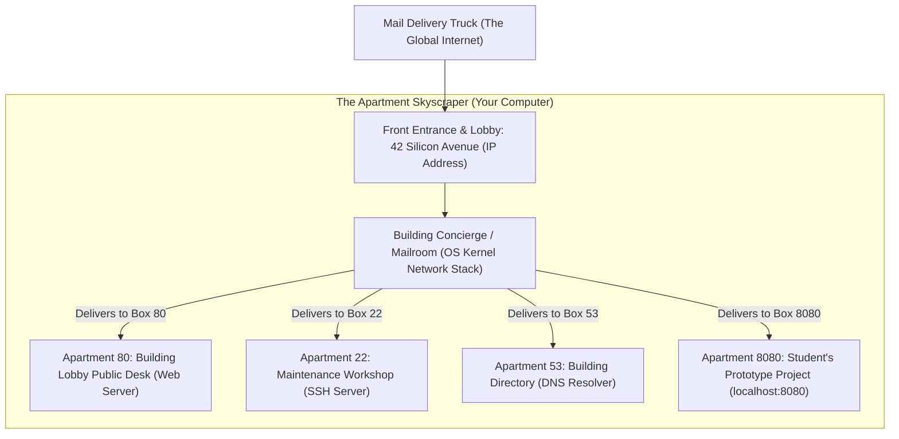
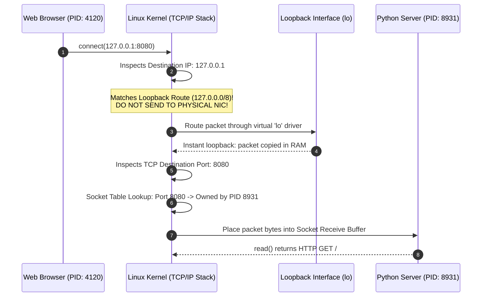
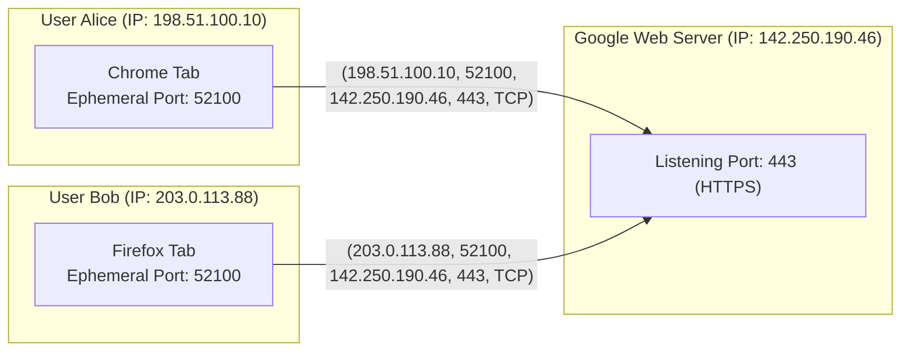
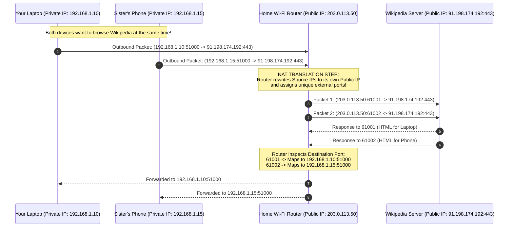

Open your terminal, write five lines of Python or Node.js, and run a local web server:

```python
from http.server import HTTPServer, SimpleHTTPRequestHandler

server = HTTPServer(('localhost', 8080), SimpleHTTPRequestHandler)
print("Serving on http://localhost:8080...")
server.serve_forever()
```

You open your browser, type `http://localhost:8080` into the navigation bar, hit Enter, and your web page appears.

To anyone learning to code, this sequence feels completely ordinary. But if you stop and examine what just happened from the perspective of the machine, a paradox emerges.

Pick up your laptop or inspect the back of your desktop PC. You will see physical ports:
- A couple of oval **USB-C** slots.
- A rectangular **HDMI** slot for your monitor.
- A 3.5mm headphone jack.
- Maybe a square **RJ-45 Ethernet** jack with blinking green and amber LEDs.

Now look closer. Where is port `8080`? 

Where is port `80` that powers Google, or port `443` that encrypts your banking session, or port `22` that lets engineers SSH into remote data center servers? If you took a screwdriver, cracked open your computer's chassis, and examined the motherboard under an electron microscope, you would not find 65,535 microscopic doors waiting to be opened.

A network port has zero physical reality. It is not a plug. It is not a wire. It is not a mechanical switch.

A network port is **pure software**: an abstract, 16-bit unsigned integer embedded inside the binary headers of network packets, maintained as a dynamic lookup table inside your operating system's kernel memory.

Yet, without this simple 16-bit number, the modern internet could not function. Without ports, your computer could only run a single network program at a time. You could not listen to Spotify while browsing a website; you could not download a Steam game while chatting on Discord. 

How does an abstract integer allow millions of packets crossing oceans at the speed of light to land inside the exact right tab of your browser? What does `localhost` actually mean? And how does the operating system kernel translate electrical voltage on a copper pin into an isolated application memory buffer?

Let us take apart the machinery from first principles.

---

## 1. Physical Ports vs. Software Ports: The Vocabulary Trap

The English word **port** originates from the Latin *portus*, meaning a harbor, a haven, or an entryway through a city wall. In maritime trade, a port is a physical location where ships arrive from across the sea, drop anchor at designated piers or docks, and unload physical cargo into specific warehouses.

Computer science borrowed this maritime metaphor twice, creating a permanent linguistic confusion:

```
                                  +--------------------------------------------------+
                                  |                 THE TWO "PORTS"                  |
                                  +--------------------------------------------------+
                                           /                                \
                                          /                                  \
                                         v                                    v
                 +-------------------------------+            +-------------------------------+
                 |         PHYSICAL PORT         |            |         SOFTWARE PORT         |
                 +-------------------------------+            +-------------------------------+
                 | • Material hardware socket    |            | • Abstract 16-bit integer     |
                 | • Copper pins, optical lenses |            | • Lives in TCP/UDP headers    |
                 | • Examples: USB-C, HDMI, RJ45 |            | • Examples: 80, 443, 8080     |
                 | • Visible to your eyes        |            | • Visible only to the OS      |
                 | • Connects wires to chips     |            | • Connects packets to code    |
                 +-------------------------------+            +-------------------------------+
```

When you plug a network cable into your laptop, you are plugging into a **Physical Port** (the 8P8C modular connector of an Ethernet interface). That connector links physical copper wires to your computer's **Network Interface Card (NIC)**. The NIC converts physical electromagnetic fluctuations into digital raw bits (`0`s and `1`s).

Once those bits cross from the hardware wires into the operating system, the physical world ends. From that moment forward, every "port" discussed in computer networking is a **Software Port** a logical addressing construct created by the transport layer protocols of the internet.

---

## 2. The Apartment Building Analogy: How to Explain Ports to a Ten-Year-Old

To build an intuitive mental model, imagine a massive residential skyscraper in New York City located at **42 Silicon Avenue**.

Five hundred different people live in this skyscraper. There is a baker on the 1st floor, a lawyer on the 4th floor, an artist on the 12th floor, and a student building a robotics project in apartment 8080.



Every morning, a mail delivery truck pulls up to the building.

If an envelope arrives stamped simply with:
> *Deliver to: 42 Silicon Avenue*

The mail carrier is completely stuck. Who is this letter for? Should it go to the baker? The lawyer? The student? Without an apartment number, the mail carrier would have to dump the letter in the lobby trash, or knock on five hundred doors asking if someone lost a letter.

To ensure the letter reaches the correct human, the sender must write:
> *Deliver to: 42 Silicon Avenue, **Apartment 8080***

When the letter arrives:
1. **The Street Address (`42 Silicon Avenue`)** routes the letter through the city streets and highways to the correct physical building.
2. **The Concierge in the Lobby** reads the apartment number, walks over to the mailboxes, and drops the envelope into the slot labeled `8080`.
3. **The Resident in Apartment 8080** opens their mailbox and reads the letter.

Now map this directly to your computer:

| Real-World Mail System | Internet Networking Equivalent | What It Does |
| :--- | :--- | :--- |
| **City Highways & Streets** | The Global Internet / Routers | Directs traffic between geographic locations. |
| **The Building's Street Address** | **IP Address** (e.g., `142.250.190.46` or `127.0.0.1`) | Identifies a specific *host machine* on the network. |
| **The Building Front Door** | **Network Interface Card (NIC)** | The physical hardware entry point for signals. |
| **The Building Concierge** | **Operating System Kernel** (TCP/IP Stack) | Reads packet headers and delivers payloads to programs. |
| **The Apartment Number** | **Port Number** (e.g., `80`, `443`, `8080`) | Identifies a specific *software process* on that host. |
| **The Apartment Resident** | **Running Program** (e.g., Node.js, Python, Nginx) | The software executing code that reads the data. |

An IP address gets a packet to the **machine**. A port number gets a packet to the **process running inside that machine**.

---

## 3. Deconstructing `localhost:8080`

When you type `http://localhost:8080` into your web browser, your computer executes a sequence of operations that can be dissected into three distinct tokens:

```
       http   ://   localhost   :   8080
       |---|        |-------|       |--|
     Scheme           Host          Port
   (Protocol)       (Address)     (Process)
```

Let us dissect each element from right to left.

### The Port (`8080`)
The number following the colon is the transport layer port identifier. It tells the operating system: *"Once you establish this connection, do not hand these bytes to my email client, my game launcher, or my system updater. Hand them exclusively to the program that registered ownership of mailbox 8080."*

Why do developers use `8080` instead of `80` or `7421`?
- **Port 80** is the official standard port assigned by the Internet Assigned Numbers Authority (IANA) for unencrypted World Wide Web traffic (HTTP).
- On Unix-like operating systems (Linux, macOS, BSD), all ports below `1024` are designated as **Privileged Ports**. Only the root administrative superuser can open and bind to these ports. This was an early security mechanism designed in the 1970s and 1980s to prevent an ordinary unprivileged university student from launching a rogue mail daemon or spoofing the login service.
- If a junior developer writing a test script tries to bind to port 80, the OS will reject the operation with a fatal error: `PermissionDenied` (`EACCES`).
- To test websites without typing `sudo` or risking security compromises, the developer community adopted **`8080`** (two eighties stacked together) and **`8000`** as informal conventions for alternate, unprivileged development servers.

### The Host (`localhost`)
What is `localhost`? 

`localhost` is not a server in California. It is a human-readable hostname that your computer's local resolver maps to a reserved IP address:

$$\text{IPv4: } 127.0.0.1 \quad \mid \quad \text{IPv6: } ::1$$

In the early IPv4 address space allocation (formalized in RFC 1122), the entire Class A network block `127.0.0.0/8` consisting of over sixteen million IP addresses (`127.0.0.1` through `127.255.255.254`) was set aside permanently for **Loopback**.

When your browser connects to `127.0.0.1`, something remarkable occurs inside the operating system kernel: **the packets never touch a wire.**



Your physical Wi-Fi card does not transmit a single radio wave. Your Ethernet controller does not pulse a single millivolt of electricity. 

The operating system's routing engine detects that the destination IP address falls within the loopback block (`127.0.0.0/8`). Instead of handing the packet down to the hardware device driver, it routes the packet through a virtual network driver called the **Loopback Interface** (`lo`). 

The kernel performs a short-circuit memory transfer: it takes the memory buffer (`sk_buff` in Linux) created by your browser and places it directly into the receive queue of your Python script's socket. It is an internal, inter-process communication pipeline running at the blistering bandwidth of your CPU's L1/L2 cache and system RAM.

---

## 4. Why Exactly 65,535 Ports? The Mathematics of the Wire

Why can a computer not have 1,000,000 ports? Or 100 ports? Why does the number of ports cap out at exactly **65,535**?

The answer is baked directly into the foundational RFC documents written by the architects of the internet in the late 1970s and early 1980s:
- **RFC 793**: *Transmission Control Protocol (TCP)*, authored by Jon Postel in September 1981.
- **RFC 768**: *User Datagram Protocol (UDP)*, authored by Jon Postel in August 1980.

To understand why, we must inspect the physical anatomy of a packet as it travels across the wire:

```
+-----------------------------------------------------------------------------------+
|                           ETHERNET FRAME (Data Link Layer)                        |
|  [Destination MAC: 6 Bytes]  [Source MAC: 6 Bytes]  [EtherType: 0x0800 (IPv4)]    |
+-----------------------------------------------------------------------------------+
       |
       v
+-----------------------------------------------------------------------------------+
|                              IP PACKET (Network Layer)                            |
|  [Version/IHL] [TTL] [Protocol: 6 (TCP)] [Source IP: 4 Bytes] [Dest IP: 4 Bytes]  |
+-----------------------------------------------------------------------------------+
       |
       v
+-----------------------------------------------------------------------------------+
|                             TCP SEGMENT (Transport Layer)                         |
|  +-+-+-+-+-+-+-+-+-+-+-+-+-+-+-+-+-+-+-+-+-+-+-+-+-+-+-+-+-+-+-+-+                |
|  |    SOURCE PORT (16 Bits)      |   DESTINATION PORT (16 Bits)  |  <-- THE PORTS |
|  +-+-+-+-+-+-+-+-+-+-+-+-+-+-+-+-+-+-+-+-+-+-+-+-+-+-+-+-+-+-+-+-+                |
|  |                        Sequence Number (32 Bits)              |                |
|  +-+-+-+-+-+-+-+-+-+-+-+-+-+-+-+-+-+-+-+-+-+-+-+-+-+-+-+-+-+-+-+-+                |
|  |                    Acknowledgment Number (32 Bits)            |                |
|  +-+-+-+-+-+-+-+-+-+-+-+-+-+-+-+-+-+-+-+-+-+-+-+-+-+-+-+-+-+-+-+-+                |
|  | Data Offset | Flags (SYN,ACK) |          Window Size          |                |
|  +-+-+-+-+-+-+-+-+-+-+-+-+-+-+-+-+-+-+-+-+-+-+-+-+-+-+-+-+-+-+-+-+                |
|  |                     APPLICATION PAYLOAD DATA                  |                |
|  |                  (e.g., "GET /index.html HTTP/1.1")           |                |
|  +---------------------------------------------------------------+                |
+-----------------------------------------------------------------------------------+
```

Notice the very first 32 bits of the TCP segment header:
- The first **16 bits** are reserved for the **Source Port**.
- The next **16 bits** are reserved for the **Destination Port**.

A 16-bit binary integer is a sequence of sixteen zeros and ones:

$$0000000000000000_2 \quad \text{to} \quad 1111111111111111_2$$

The total number of unique permutations that can be represented by 16 bits is:

$$2^{16} = 65,536 \text{ distinct numbers}$$

Because computers index starting from zero, the valid range of ports spans from **0 to 65,535**.

That is the entire secret. There are no physical constraints, no metaphysical laws, and no hardware limitations dictating 65,535. Jon Postel and Vint Cerf decided in the 1970s that 16 bits provided more than enough headroom to address every conceivable software service running concurrently on a single machine. Two bytes were allocated in the header specification, and that decision was etched into the global networking architecture forever.

---

## 5. The Three Port Neighborhoods: Who Lives Where?

The Internet Assigned Numbers Authority (IANA) divides the 65,536 available ports into three standardized zones (codified in RFC 6335):

```
0                        1024                                       49152                 65535
+--------------------------+------------------------------------------+---------------------+
|   Well-Known / System    |             Registered Ports             | Dynamic / Ephemeral |
|        (0 - 1023)        |             (1024 - 49151)               |   (49152 - 65535)   |
+--------------------------+------------------------------------------+---------------------+
| • Root/Admin required    | • User applications & databases          | • Assigned randomly |
| • HTTP (80), HTTPS (443) | • Postgres (5432), Redis (6379)          |   by client OS for  |
| • SSH (22), DNS (53)     | • Dev servers (3000, 8080, 8000)         |   outbound requests |
+--------------------------+------------------------------------------+---------------------+
```

### 1. Well-Known Ports (`0 – 1023`)
These are the foundational infrastructure highways of the global internet. Because early internet systems were multi-user mainframes where untrusted users had shell access, operating systems decreed that only the system administrator (`root`) could listen on these ports.

When you type `https://github.com`, your browser does not make you type `https://github.com:443`. The browser assumes port `443` because the worldwide consensus has standardized HTTPS to that well-known port for decades:

- **Port 20 & 21**: FTP (File Transfer Protocol)
- **Port 22**: SSH (Secure Shell for remote terminal access)
- **Port 25**: SMTP (Simple Mail Transfer Protocol for sending email)
- **Port 53**: DNS (Domain Name System translating `google.com` to an IP address)
- **Port 80**: HTTP (Standard unencrypted web traffic)
- **Port 443**: HTTPS (Web traffic encrypted via TLS/SSL)

### 2. Registered Ports (`1024 – 49151`)
These ports can be bound by ordinary, unprivileged user accounts. Companies, open-source projects, and database engineers register these port numbers with IANA to avoid stepping on each other's toes:

- **Port 3306**: MySQL Database
- **Port 5432**: PostgreSQL Database
- **Port 6379**: Redis In-Memory Cache
- **Port 27017**: MongoDB
- **Ports 3000, 5173, 8080**: Common defaults for React, Vite, Node.js, and Java web servers.

### 3. Dynamic / Ephemeral Ports (`49152 – 65535`)
When you visit a website, your computer acts as a **client**, and the remote machine acts as a **server**.

You know the server's port: it is `443` (HTTPS). But what is *your* port?

Your operating system cannot use port 443; that is already reserved. Instead, when your browser opens a connection, your OS kernel quietly reaches into the **Ephemeral Port Pool** (typically ports 49152 through 65535), selects an unused random port (for example, `52419`), and assigns it to that specific browser tab for the duration of the conversation. When you close the tab, the OS releases the port back into the free pool.

---

## 6. The Superpower of Ports: Multiplexing and Demultiplexing

To truly appreciate why ports exist, perform a thought experiment: **What would happen if we removed ports from the internet entirely?**

In a portless internet, an IP packet would contain only:
- Source IP: `192.168.1.5` (Your Laptop)
- Destination IP: `142.250.190.46` (Google's Server)
- Payload: `Hello!`

Imagine you are sitting at your desk. You have four programs open:
1. A Chrome tab watching a 4K YouTube video.
2. A Spotify app streaming a podcast.
3. A Zoom video call with your team.
4. An online video game running in the background.

Suddenly, a packet containing 1,400 bytes of audio data arrives from your Wi-Fi router and hits your computer's network chip.

The operating system looks at the packet:
- It came to IP `192.168.1.5`. That is this laptop.
- But **which application owns this data?**

Does this audio belong to Zoom? Is it a snippet of the Spotify podcast? Is it an explosion sound effect from the video game? Is it the soundtrack of the YouTube video?

The operating system has no idea. Without ports, your computer would have to broadcast the packet to all four programs, causing audio distortion, security breaches, and software crashes. Or, worse, your computer could only run **one single network program at a time**.

```
WITHOUT PORTS (No Multiplexing):
+-------------+
| YouTube App | <---+
+-------------+     |
+-------------+     |--- Single Wi-Fi Wire ---> Incoming Packet: "Which app owns me?!"
| Spotify App | <---+                          (Massive Confusion / Crash)
+-------------+

WITH PORTS (Transport Layer Multiplexing):
+-------------+
| YouTube App | <--- Bound to Socket: Ephemeral Port 51001 <---+
+-------------+                                                 |
+-------------+                                                 |--- Demux by Port!
| Spotify App | <--- Bound to Socket: Ephemeral Port 51002 <---+
+-------------+
```

Ports solve this fundamental challenge through **Multiplexing** and **Demultiplexing** (first formalized in computer networking by Vint Cerf and Robert Kahn in their landmark 1974 IEEE paper, *"A Protocol for Packet Network Intercommunication"*):
- **Multiplexing**: The OS collects outgoing data streams from dozens of running applications, slaps a unique Source Port onto each packet, and merges them onto a single physical Wi-Fi or Ethernet cable.
- **Demultiplexing**: When packets return down that same wire, the OS reads the Destination Port header and sorts each packet into the exact memory buffer of the application waiting for it.

### The 5-Tuple: How One Server Serves Millions of Users Simultaneously

A question that puzzles many software engineers is: **If Google's web server listens on port 443, how can it serve 500,000 users at the exact same millisecond? Why doesn't port 443 get "clogged"?**

The answer lies in the mathematical concept of the **Socket Pair**, or the **5-Tuple**.

In TCP, a connection is never identified by the server's port alone. A connection is uniquely identified across the entire universe by five distinct parameters:

$$\text{Connection Identity} = \Big( \text{Source IP}, \; \text{Source Port}, \; \text{Destination IP}, \; \text{Destination Port}, \; \text{Protocol} \Big)$$



Notice what happened in the diagram above:
- Alice's computer happens to pick ephemeral port `52100`.
- Bob's computer *also* happens to pick ephemeral port `52100`.
- Both are connecting to Google's server on port `443`.

Does Google's server get confused? **Not for a microsecond.**

To Google's operating system kernel, Alice's connection is:
$$\{198.51.100.10, \; 52100, \; 142.250.190.46, \; 443, \; \text{TCP}\}$$

While Bob's connection is:
$$\{203.0.113.88, \; 52100, \; 142.250.190.46, \; 443, \; \text{TCP}\}$$

Because their Source IP addresses are different, the 5-tuple hash values are completely distinct. The server's kernel maps them to two entirely separate socket memory queues. Port 443 is merely the welcoming front door; once the handshake completes, the connection lives as an independent mathematical 5-tuple.

---

## 7. Under the Hood: What Happens in the Linux Kernel During `listen(8080)`?

What actually happens inside your computer's operating system when your code executes:

```python
server.bind(('localhost', 8080))
server.listen()
```

Let us trace the machine-level sequence through the Linux kernel's networking subsystem:

```
[ User Space Application ]
           |
           | sys_socket()
           v
[ Allocate struct socket & struct sock ]
           |
           | sys_bind(addr, port=8080)
           v
[ Check inet_hashinfo: Is port 8080 free? ]
      /                                 \
     v (Occupied)                        v (Free)
Return -EADDRINUSE               Register in listening hash table:
("Address already in use")        listening_hash[hash(8080)] = sock
                                         |
                                         | sys_listen(backlog=128)
                                         v
                                 [ Allocate SYN Queue ]
                                 [ Allocate Accept Queue ]
                                 [ State = TCP_LISTEN ]
```

### 1. `sys_socket()`: Allocating the Socket
The application makes a system call asking the kernel to create a communication endpoint. The kernel allocates two foundational C data structures:
- `struct socket`: The high-level VFS (Virtual File System) representation that gives user space a standard file descriptor (an integer like `fd = 3`).
- `struct sock`: The massive, low-level network protocol state machine containing transmit and receive queues (`sk_receive_queue`, `sk_write_queue`).

### 2. `sys_bind()`: The Hash Table Claim
When your program calls `bind()` on port `8080`, the kernel must verify that no other process has already claimed this port on the same network interface.

The kernel maintains an internal global hash table called **`inet_hashinfo`**. This table contains buckets for:
- Established connections (`ehash`)
- Bound ports (`bhash`)
- Listening sockets (`listening_hash`)

The kernel hashes the requested port number (`8080`) and checks the bucket.
- If another running process (for example, a forgotten Docker container or a zombie Tomcat server) already owns that port on `127.0.0.1`, the kernel immediately rejects the system call and returns the classic error:
  ```
  OSError: [Errno 98] Address already in use
  ```
- If the port is free, the kernel inserts a pointer to your process's `struct sock` into the hash table bucket, locking ownership of that 16-bit integer to your Process ID (PID).

### 3. `sys_listen()`: Initializing the Queues
Calling `listen()` transitions the socket into the `TCP_LISTEN` state. The kernel allocates two internal FIFO queues inside kernel memory:
1. **The SYN Queue (Incomplete Connection Queue)**: Holds connections currently undergoing the TCP Three-Way Handshake (`SYN` received, `SYN-ACK` sent, waiting for final `ACK`).
2. **The Accept Queue (Completed Connection Queue)**: Holds established connections that have finished the handshake and are patiently waiting for your application code to call `accept()`.

### 4. What Happens When a Packet Hits the Wire?
When an incoming electrical signal arrives at your physical network card:
1. **DMA Transfer**: The NIC converts physical voltages into bits and copies the raw Ethernet frame directly into host RAM via Direct Memory Access (DMA).
2. **Hard IRQ & NAPI**: The NIC fires a hardware interrupt to the CPU. The Linux kernel activates its NAPI (New API) polling loop, wrapping the raw bytes into a kernel memory buffer called an **`sk_buff`**.
3. **Layer Peeling**:
   - The kernel's IP layer inspects the IP header: *Is this packet for this host?* Yes (`127.0.0.1` or the local LAN IP). Strip the IP header.
   - The kernel passes the remaining buffer to the TCP layer (`tcp_v4_rcv`).
4. **The Port Lookup**: The kernel reads bytes 2 and 3 of the TCP header: `Destination Port = 8080`.
5. **Hash Lookup**: The kernel executes an $O(1)$ lookup in its `listening_hash` table using the port number. It locates your program's `struct sock`.
6. **Delivery**: The kernel appends the `sk_buff` payload into your socket's receive buffer and wakes up your application thread from its sleeping state.

A port is not a door. **A port is an index key into a kernel hash table of socket queues.**

---

## 8. How Ports Connect Your Living Room to the Global Internet: NAT and PAT

There is one final, magnificent architectural trick that makes the global internet possible, and it relies entirely on ports: **Network Address Translation (NAT)** and **Port Address Translation (PAT)**.

In the late 1980s, computer scientists realized that IPv4's 32-bit address space which caps out at roughly **4.29 billion addresses** was rapidly running out. With billions of laptops, smartphones, tablets, and smart appliances coming online, how could every device have its own public IP address?

The solution was formalized in RFC 1631 and RFC 3022: **Private IP Spaces** and **PAT**.

Inside your home, your Wi-Fi router acts as an international border control agency:



Here is the operational magic:
1. Your laptop has a private IP address: `192.168.1.10`.
2. Your sister's smartphone has another private IP: `192.168.1.15`.
3. Private IP addresses cannot be routed across the public internet. If your router sent a packet stamped with `192.168.1.10` to Wikipedia, Wikipedia would have no way to reply, because millions of homes around the globe use that exact same address!
4. Your ISP assigns your home router **a single public IP address** (e.g., `203.0.113.50`).

How do ten devices in your house share that single public IP address without their traffic tangling?

**Through Port Address Translation (PAT):**
- When your laptop sends a request to Wikipedia, it leaves your laptop from ephemeral port `51000`.
- As the packet passes through your home router, the router intercepts it and **rewrites the packet's headers on the fly**:
  - Replaces Source IP `192.168.1.10` with its own public IP: `203.0.113.50`.
  - Replaces Source Port `51000` with an arbitrary tracked external port: `61001`.
- The router logs this in an internal memory table:
  $$\text{Port } 61001 \longleftrightarrow 192.168.1.10 : 51000$$
- When your sister's phone sends a request at the same time from port `51000`, the router rewrites it to use port `61002`.
- When Wikipedia sends the web pages back, it sends them to `203.0.113.50:61001` and `203.0.113.50:61002`.
- The router inspects the incoming destination port:
  - Port `61001`? That belongs to the laptop! Swap the IP back to `192.168.1.10:51000` and transmit.
  - Port `61002`? That belongs to the phone! Swap the IP back to `192.168.1.15:51000` and transmit.

Without ports, every single smartphone, smart lightbulb, television, and laptop on Earth would require its own unique public IPv4 address, and the internet would have run out of addresses before the year 1998. 

Ports did not just allow multitasking on your PC; they saved the entire internet from running out of room to exist.

---

## The Mental Model to Keep

The next time you spin up a server, write `app.listen(8080)`, and open `localhost:8080` in your browser, step back and appreciate the conceptual clarity of the architecture:

1. **A port has no physical mass.** You cannot touch it. It is a 16-bit integer written into the binary header of a TCP or UDP segment.
2. **There are 65,535 ports** simply because RFC 793 allocated 16 bits of header space ($2^{16}$).
3. **`localhost` is an internal illusion.** It resolves to `127.0.0.1`, which your OS routes through a virtual loopback driver in RAM without touching a network interface wire.
4. **Ports unlock multiplexing.** They transform a dumb copper wire capable of handling only one signal at a time into a multi-lane highway capable of sorting thousands of concurrent application data streams.
5. **A port is a kernel index.** When you bind to a port, you are placing a signpost inside your operating system's internal socket lookup table, telling the kernel concierge: *"Whenever an envelope stamped with this 16-bit number arrives down the wire, wake me up. That letter belongs to me."*

---

### Foundational References & Historic RFCs

1. **Cerf, V., & Kahn, R.** (1974). *"A Protocol for Packet Network Intercommunication"*. *IEEE Transactions on Communications*, COM-22(5), 637–648. [DOI: 10.1109/TCOM.1974.1092259](https://doi.org/10.1109/TCOM.1974.1092259) *(The foundational paper that introduced the TCP architecture, socket addressing, and process-level multiplexing).*
2. **Postel, Jon.** (1981). *"Transmission Control Protocol"*. *IETF RFC 793 / STD 7*. [RFC Editor](https://www.rfc-editor.org/rfc/rfc793.html) *(The formal specification defining the 16-bit Source and Destination Port fields and TCP state transitions).*
3. **Postel, Jon.** (1980). *"User Datagram Protocol"*. *IETF RFC 768 / STD 6*. [RFC Editor](https://www.rfc-editor.org/rfc/rfc768.html) *(The minimal transport protocol formalizing datagram port addressing).*
4. **Saltzer, J. H., Reed, D. P., & Clark, D. D.** (1984). *"End-to-End Arguments in System Design"*. *ACM Transactions on Computer Systems (TOCS)*, 2(4), 277–288. [DOI: 10.1145/357401.357402](https://doi.org/10.1145/357401.357402) *(The seminal systems design paper arguing why connection demultiplexing and integrity must reside in software at end-hosts).*
5. **Cotton, M., Eggert, L., Touch, J., Westerlund, M., & Cheshire, S.** (2011). *"Internet Assigned Numbers Authority (IANA) Procedures for the Management of the Service Name and Transport Protocol Port Number Registry"*. *IETF Best Current Practice RFC 6335*. [RFC Editor](https://www.rfc-editor.org/rfc/rfc6335.html).
6. **Egevang, K., & Francis, P.** (1994). *"The IP Network Address Translator (NAT)"*. *IETF RFC 1631*. [RFC Editor](https://www.rfc-editor.org/rfc/rfc1631.html) *(The historical specification that introduced port-based translation to overcome IPv4 exhaustion).*
7. **Stevens, W. Richard.** (1994). *TCP/IP Illustrated, Volume 1: The Protocols*. Addison-Wesley. *(The definitive textbook on transport layer protocols, packet structure, and socket architecture).*

