Enterprise security has spent the last decade suffering through a massive identity crisis. 

For thirty years, corporate cybersecurity lived and died by the **Castle-and-Moat** perimeter model. You built a tall network wall around your data center with firewalls, provisioned an IPSec or OpenVPN gateway for remote employees, and assumed that anyone possessing an IP address inside the `10.0.0.0/8` subnet was an authenticated, trustworthy actor. 

If you were inside the fortress, you could query the billing database, ping internal dev clusters, or inspect internal telemetry without presenting credentials.

That model died a messy, prolonged death. 

Between mobile workforces, SaaS sprawl, public cloud migrations, and credential phishing, the perimeter stopped existing. A single compromised employee laptop or a vulnerable Jenkins server inside the DMZ gave attackers lateral network traversal across the entire infrastructure. 

In response, Google published their foundational *BeyondCorp* whitepapers, Forrester coined the term **Zero-Trust Architecture (ZTA)**, and the vendor industrial complex smelled blood in the water.

Vendors told CISOs that Zero-Trust was a product they could buy. Just deploy mutual TLS (mTLS) across your Kubernetes service mesh, issue short-lived X.509 certificates with SPIFFE/SPIRE, route traffic through an Identity-Aware Proxy (IAP), and terminate your corporate VPN.

Thousands of engineering organizations spent millions of dollars doing precisely that. 

And yet, modern microservice architectures continue to be breached with alarming regularity. 

Why? Because most infrastructure teams committed a fundamental architectural error: **they confused cryptographic authentication of transport pipelines with fine-grained authorization of application semantics.** 

Stamping an Envoy sidecar on your pod and encrypting byte streams with mTLS does not make your system Zero-Trust. In fact, if done naively, it merely creates a higher-latency, more fragile version of the exact same castle-and-moat security model you were trying to escape.

Here is the unvarnished systems engineering reality of what Zero-Trust actually requires, where the landmines are buried, and how to design systems that survive compromised credentials and lateral movement.

---

## The Illusion of the Encrypted Pipe: Authentication Is Not Authorization

The single most common architectural failure in modern "Zero-Trust" implementations is the conflation of **Identity Verification (Authentication)** with **Capability Delegation (Authorization)**.

```mermaid
graph TB
    subgraph CastleMoat["Legacy Castle-and-Moat (Perimeter Security)"]
        Attacker1["Remote User / Attacker"]
        VPN["Corporate VPN Gateway / DMZ"]
        Subnet["Internal Flat Network (10.0.0.0/8)"]
        ServiceA1["Billing Service"]
        ServiceB1["Postgres Customer DB"]

        Attacker1 -->|Breaches VPN Credential| VPN
        VPN --> Subnet
        Subnet --> ServiceA1
        Subnet --> ServiceB1
        ServiceA1 -->|Implicit Trust / Unrestricted Lateral Access| ServiceB1
    end

    subgraph NaiveZeroTrust["The 'mTLS-Only' Mirage (Service-to-Service Only)"]
        ServiceA2["Service A (Cart Pod)"]
        EnvoyA["Envoy Sidecar (SPIFFE ID: cart.prod)"]
        EnvoyB["Envoy Sidecar (SPIFFE ID: billing.prod)"]
        ServiceB2["Service B (Billing Pod)"]

        ServiceA2 --> EnvoyA
        EnvoyA == "mTLS Tunnel (Mutual Auth Validated)" ==> EnvoyB
        EnvoyB --> ServiceB2
        Note over EnvoyA,EnvoyB: Transport is Encrypted & Authenticated.<br/>BUT: Does Service A have authority to charge User X's card?<br/>Envoy has zero visibility into user context!
    end
```

Consider what happens when you install a service mesh (like Istio or Linkerd) and configure strict mutual TLS with SPIFFE (Secure Production Identity Framework for Everyone):

1. The `order-service` pod is assigned a cryptographic identity via an X.509 SVID:  
   `spiffe://cluster.local/ns/prod/sa/order-service-sa`.
2. When `order-service` calls `payment-service` over gRPC, their respective Envoy sidecar proxies perform a standard TLS handshake.
3. Both sides validate certificates against the internal CA root. The transport pipe is encrypted, and both sides prove their machine identity.

Most teams stop right here. They look at their security audit dashboard, observe that 100% of internal traffic is encrypted with TLS 1.3, and check the box marked "Zero-Trust Architecture."

This is security theater.

What did that mTLS handshake actually prove? It proved that the entity sending bytes over TCP socket `10.244.3.12:443` is indeed running the software image associated with `order-service`. 

It told you **nothing** about:
- Which human end-user initiated the request.
- Whether that human end-user is authenticated, active, and authorized to debit that specific bank account.
- Whether the parameters passed in the HTTP/gRPC payload are malicious, forged, or attempting an IDOR (Insecure Direct Object Reference) attack.
- Whether `order-service` was tricked into making this call via an SSRF (Server-Side Request Forgery) vulnerability.

Transport-level authentication proves the identity of the **messenger**. It does not validate the legitimacy of the **message**.

When an attacker exploits a remote code execution (RCE) bug or an arbitrary file read in `order-service`, the attacker inherits `order-service`'s SPIFFE certificate. 

To the downstream `payment-service` and its Envoy proxy, the attacker’s malicious RPCs look like legitimate, cryptographically authenticated traffic. The mTLS pipe happily ferries the attack straight into the crown jewels at wire speed.

---

## The Ambient Authority Trap and the Confused Deputy

The root cause of this vulnerability is an ancient computer science problem that modern microservice architectures resurrected: **Ambient Authority**.

In our analysis of [the Model Context Protocol and AI agent interfaces](/posts/mcp-the-new-interface-for-everything), we examined how ambient authority creates the Confused Deputy problem. The exact same vulnerability haunts distributed microservices.

An authority is "ambient" if it is implicitly granted to a process merely because of where it sits or what credentials it permanently holds, rather than being explicitly bound to a specific, scoped user intent.

```
[ End-User Alice ]
      |
      | 1. POST /order/checkout (Bearer Token: Alice)
      v
+-----------------------------------------------------------+
| Frontend API Gateway                                      |
+-----------------------------------------------------------+
      |
      | 2. gRPC Internal Call (Strip Alice's Token!)
      |    Authenticated via Service-Level mTLS (SPIFFE)
      v
+-----------------------------------------------------------+
| Order Service                                             |
+-----------------------------------------------------------+
      |
      | 3. POST /accounts/charge
      |    Payload: { "account_id": "BOB_12345", "amount": 1000 }
      |    Identity: spiffe://.../order-service (Service Account)
      v
+-----------------------------------------------------------+
| Payment Service                                           |
| "I trust Order Service, so I will debit Bob's account!"   |
+-----------------------------------------------------------+
```

Look closely at step 2 and step 3:

1. Alice logs in, receives a JWT from the Identity Provider (OIDC), and calls the API Gateway.
2. The Gateway authenticates Alice, terminates her JWT, and translates her request into an internal gRPC call to `order-service`.
3. To communicate downstream, `order-service` uses its own machine credential (its mTLS certificate or a hardcoded service token). Alice's user context is dropped, or relegated to an unverified header like `X-User-Id: alice`.
4. If `order-service` is compromised, an attacker can dispatch calls to `payment-service` directing it to debit Bob's account, wipe Charlie's records, or dump database tables.

The `payment-service` acts as a **Confused Deputy**. It holds broad, ambient authority to execute financial debits because it trusts `order-service`. It cannot verify whether the request originated from an authenticated user who legitimately authorized that specific transfer.

True Zero-Trust mandates that no service possesses broad ambient authority. Every sensitive RPC must carry a cryptographically verifiable **chain of custody** linking the machine identity to the human end-user identity.

---

## The Anatomy of True Zero-Trust Architecture

A resilient Zero-Trust architecture does not rely on a single layer of defense. It operates as an interlocking triad: **Device Attestation**, **Continuous Identity Verification**, and **Fine-Grained Contextual Authorization**.

```mermaid
sequenceDiagram
    autonumber
    participant Client as User Device (TPM Attested)
    participant IAP as Identity-Aware Proxy (Envoy)
    participant IdP as Identity Provider (OIDC/SAML)
    participant OPA as Policy Engine (OPA / Cedar)
    participant ServiceA as Microservice A
    participant ServiceB as Downstream Service B

    Client->>IAP: 1. TLS Handshake + Device TPM Certificate
    IAP->>IdP: 2. Validate User Session & MFA Claims
    Note over IAP: Evaluate Device Posture (OS Version, Disk Encryption)
    
    IAP->>ServiceA: 3. Forward request with User Claims Token (UCT)
    
    ServiceA->>OPA: 4. Evaluate: Can User X perform Action Y on Resource Z?
    OPA-->>ServiceA: 5. Allow (Bounded Context)
    
    rect rgb(30, 40, 60)
        Note over ServiceA,ServiceB: Downstream Delegation Loop
        ServiceA->>ServiceB: 6. Internal gRPC via mTLS (Service SVID) + Minted Token Exchange (RFC 8693)
        ServiceB->>OPA: 7. Validate both Caller Identity AND End-User Delegation Scope
        OPA-->>ServiceB: 8. Authorized
    end

    ServiceB-->>ServiceA: 9. Execution Success
    ServiceA-->>Client: 10. HTTP 200 OK
```



Let's dissect each layer of this architecture:

### 1. Device Posture & Hardware Attestation
Identity is worthless if the machine hosting the identity is compromised. 

If an engineer with valid corporate credentials accesses internal systems from a personal laptop infected with a kernel keylogger or infostealer malware, MFA and mTLS will happily authenticate the malware.

In true Zero-Trust:
- The device itself must possess a hardware-backed cryptographic identity typically an X.509 certificate stored in a **Trusted Platform Module (TPM 2.0)** or Apple Secure Enclave.
- Before access to the network or proxy is granted, the device must submit health telemetry (disk encryption status, active EDR agent, patched OS kernel version). If the device deviates from the compliance baseline, access is revoked instantly, regardless of valid user credentials.

### 2. Token Exchange & Downstream Delegation (RFC 8693)
To eliminate ambient authority between microservices, downstream services must verify both *who called them* and *on whose behalf they are acting*.

This is solved through **OAuth 2.0 Token Exchange (RFC 8693)** or cryptographically signed **User Context Tokens (UCT)**:

```json
{
  "iss": "https://auth.internal.net",
  "sub": "user_alice_9823",
  "aud": "payment-service",
  "act": {
    "sub": "spiffe://prod.cluster/ns/core/sa/order-service"
  },
  "scope": "payments:charge",
  "resource_id": "account_alice_441",
  "max_amount": 150.00,
  "exp": 1721584800
}
```

Notice the `act` (actor) claim:
- `sub` represents the human end-user (`Alice`).
- `act.sub` represents the machine acting as an intermediary (`order-service`).
- `resource_id` and `max_amount` restrict the blast radius.

If `order-service` attempts to use this token to debit `Bob`, or charge \$10,000, `payment-service` rejects the request locally at the policy evaluation layer. Even if an attacker gains arbitrary code execution inside `order-service`, they cannot perform actions beyond the narrow cryptographic scopes delegated by active user transactions.

### 3. Decoupled Fine-Grained Authorization (ReBAC & ABAC)
Hardcoding authorization logic into application code `if user.is_admin()` is where security architectures go to die. Authorization policies must be centralized, declarative, and evaluated locally in microsecond timeframes.

Modern architectures separate authorization into two distinct models:

1. **Attribute-Based Access Control (ABAC)**: Evaluated using policy engines like **Open Policy Agent (OPA)** or AWS Cedar. Policies evaluate contextual environmental attributes: time of day, network subnet, device health score, and risk telemetry.
2. **Relationship-Based Access Control (ReBAC)**: Pioneered by Google's **Zanzibar** paper (implemented in open-source systems like Ory Keto and AuthCEDAR). ReBAC models permissions as directed graph edges between objects, subjects, and relations:
   ```
   document:payroll_q3#viewer@user:alice
   folder:finance#parent@document:payroll_q3
   team:accounting#member@user:bob
   folder:finance#editor@team:accounting
   ```

By running policy decision points (PDP) as local sidecar processes or compiling them into WebAssembly (WASM) filters directly inside the Envoy proxy, authorization decisions execute in less than **200 microseconds** without incurring network round-trips to a central database.

---

## The Performance Reality: The Sidecar Latency Tax

The vendor narrative promises that Zero-Trust is frictionless. 

Systems engineers who actually manage production Kubernetes clusters know that inserting two sidecar proxies, two TLS terminations, cryptographic token validations, and policy evaluations into every network hop carries a brutal tax on CPU and **tail latency (p99)**.

```
Traditional Request:
Client ----------------------> Service B (Kernel TCP Stack)
Latency: ~0.8ms

Service Mesh / Zero-Trust Request:
Client -> [Envoy A] ==(mTLS)==> [Envoy B] -> Service B
           |                     |
           v                     v
      [Local OPA]           [Local OPA]
Latency: ~3.2ms (4x Latency Inflation!)
```

### 1. The Context-Switching Cascade
In a standard Kubernetes service mesh, every inbound and outbound packet is intercepted by `iptables` and redirected through the local loopback interface into the user-space Envoy proxy. 

As we explored in our deep-dive on [Zero-Copy Networking in Linux](/posts/zero-copy) and [asynchronous I/O mechanics](/posts/exploring-io-uring-in-rust), bouncing packets from kernel space to user-space Envoy, back to kernel space, across the virtual ethernet (`veth`) pair, back to the host, into the destination pod's kernel, into destination Envoy user space, and finally into the application container requires multiple context switches and memory copies per network hop.

If a single user request cascades through a microservice dependency graph five levels deep, you are paying that sidecar penalty ten times. A baseline p99 latency of 15 milliseconds can easily inflate to 65 milliseconds purely due to proxy hops.

### 2. TLS Handshake CPU Overhead
While symmetric encryption (AES-GCM or ChaCha20-Poly1305) is hardware-accelerated on modern CPUs (via AES-NI on x86-64 and ARMv8 Cryptography Extensions, as detailed in our [systems guide on x86-64 vs. aarch64](/posts/when-to-choose-x86-64-vs-aarch64)), the asymmetric cryptographic handshakes (ECDSA / Ed25519) required to establish mTLS tunnels consume measurable CPU cycles.

If your services establish short-lived HTTP connections instead of persistent, multiplexed HTTP/2 or gRPC connection pools, your CPUs will spend 30% of their clock cycles running elliptic-curve math instead of serving application logic.

### 3. The Modern Solution: eBPF-Based Kernel Bypassing
The infrastructure world is actively re-architecting the Zero-Trust data plane to eliminate the sidecar proxy entirely.

Using **eBPF (Extended Berkeley Packet Filter)** pioneered by projects like **Cilium** the Linux kernel can inspect sockets and enforce identity-based network policies directly inside kernel space at the socket layer (`sockops`).

```mermaid
graph TB
    subgraph TraditionalMesh["Traditional Sidecar Mesh (Heavy User-Space Bouncing)"]
        App1["App Container"] -->|iptables redirect| Sidecar1["Envoy Proxy (User Space)"]
        Sidecar1 -->|TCP/IP Stack| Net["Host Network Interface"]
        Net -->|TCP/IP Stack| Sidecar2["Envoy Proxy (User Space)"]
        Sidecar2 -->|iptables redirect| App2["App Container"]
    end

    subgraph eBPFMesh["Modern eBPF Kernel Mesh (Zero-Sidecar Socket Redirection)"]
        eApp1["App Container"]
        eApp2["App Container"]
        eBPFProg["eBPF Socket Program (Cilium / Kernel Ring 0)<br/>Validates Identity & Direct Socket-to-Socket Redirection"]

        eApp1 <== Socket Memory Redirection via eBPF ==> eBPFProg
        eBPFProg <== Socket Memory Redirection via eBPF ==> eApp2
    end
```



By attaching eBPF programs directly to the socket layer, packets between pods co-located on the same physical host can be spliced directly across memory buffers without traversing the TCP/IP stack or bouncing into user-space proxy daemons. 

Transport security across hosts is handled transparently via kernel-level WireGuard or IPsec tunnels, dropping latency overhead back down to near-bare-metal speeds.

---

## The Zero-Trust Checklist: Separating Architecture from Hype

If you are designing or auditing a Zero-Trust architecture, ignore vendor feature matrices and evaluate your system against these four architectural realities:

| Security Vector | Fake Zero-Trust (Security Theater) | True Zero-Trust (Systems Architecture) |
| :--- | :--- | :--- |
| **Network Boundary** | "All internal traffic is encrypted with mTLS; our cluster is secure." | "Every network segment is presumed hostile; transport encryption is baseline plumbing, not an authorization mechanism." |
| **Service Identity** | Static API keys, long-lived AWS IAM secrets, or hardcoded passwords in ConfigMaps. | Short-lived, dynamically rotated X.509 SVIDs (SPIFFE/SPIRE) backed by hardware TPM or platform attestation. |
| **User Identity** | API Gateway terminates user token; downstream microservices operate with ambient service authority. | User context tokens (RFC 8693) propagated and validated at every downstream hop; actor delegation explicitly bounded. |
| **Policy Engine** | Hardcoded `if role == 'admin'` logic buried in application source code. | Declarative, decoupled policy engines (OPA, Cedar, Zanzibar) evaluating identity, device posture, and environmental attributes. |
| **Data Plane** | Heavyweight sidecar proxies injected blindly into every pod, inflating p99 latency by 300%. | eBPF-accelerated kernel enforcement, persistent gRPC connection pooling, and WASM-compiled policy decision points. |

---

## Security in the Post-Perimeter Era

Zero-Trust is not a firewall appliance you rack in a datacenter. It is not an agent you push to employee laptops, and it is certainly not a service mesh you install with a single `helm install` command.

Zero-Trust is a fundamental architectural discipline: **the refusal to grant ambient trust to any packet, any socket, any service, or any device based solely on its physical or network location.**

Encrypting your transport layer with mTLS is necessary, but it is merely table stakes. 

Until your architecture systematically eliminates ambient authority, propagates authenticated human delegation scopes down the call graph, validates device hardware posture at runtime, and enforces decoupled contextual policies at the data layer, your fortress has not been modernized. 

You have simply traded an honest, visible wall for an invisible, expensive maze of encrypted pipes. And when the breach occurs, the maze will not save you.

---

### Architectural References & Standards

1. **Ward, R., & Beyer, B.** (2014). *"BeyondCorp: A New Approach to Enterprise Security"*. *IEEE Security & Privacy*, 12(6), 22–31. [Google BeyondCorp Research](https://research.google/pubs/pub43231/)
2. **Rose, S., Borchert, O., Mitchell, S., & Connelly, S.** (2020). *NIST Special Publication 800-207: Zero Trust Architecture*. National Institute of Standards and Technology. [DOI: 10.6028/NIST.SP.800-207](https://doi.org/10.6028/NIST.SP.800-207)
3. **SPIFFE / SPIRE Project Authors.** (2023). *The Secure Production Identity Framework for Everyone (SPIFFE) Specification*. [SPIFFE Standard Specs](https://github.com/spiffe/spiffe)
4. **Hardt, D., Jones, M., & Nadalin, A.** (2020). *OAuth 2.0 Token Exchange (RFC 8693)*. Internet Engineering Task Force (IETF). [RFC 8693](https://www.rfc-editor.org/rfc/rfc8693)
5. **Pang, R., et al.** (2019). *"Zanzibar: Google’s Consistent, Global Authorization System"*. *USENIX Annual Technical Conference (ATC 19)*, 921–935. [USENIX Zanzibar Paper](https://www.usenix.org/conference/atc19/presentation/pang)

